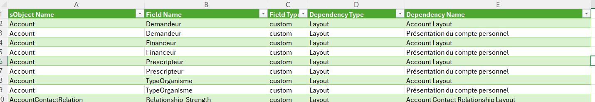
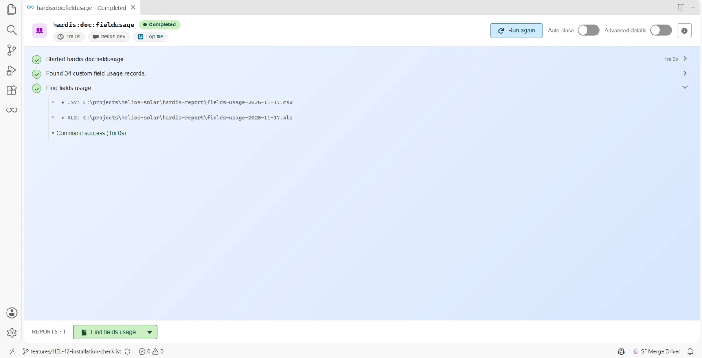
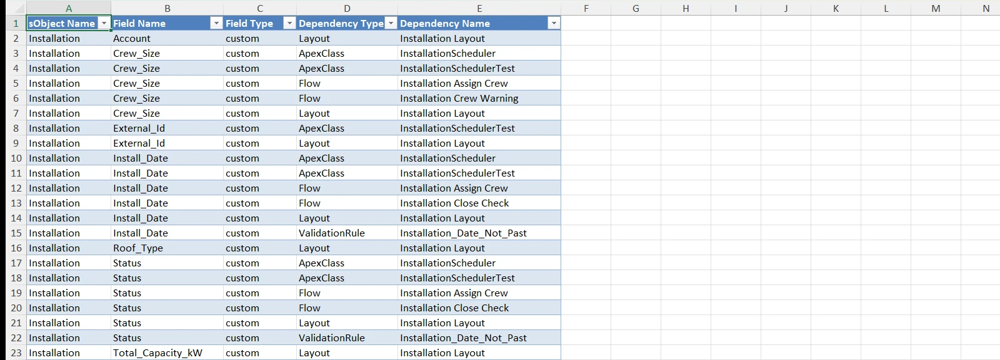

<!-- This file has been generated with command 'sf hardis:doc:plugin:generate'. Please do not update it manually or it may be overwritten -->
# hardis:doc:fieldusage

## Description


## Command Behavior

**Retrieves and displays the usage of custom fields within a Salesforce org, based on metadata dependencies.**

This command helps identify where custom fields are referenced across various metadata components in your Salesforce environment. It's particularly useful for impact analysis before making changes to fields, or for understanding the complexity and interconnectedness of your Salesforce customizations.

- **Targeted sObjects:** You can specify a comma-separated list of sObjects (e.g., `Account,Contact`) to narrow down the analysis to relevant objects. If no sObjects are specified, it will analyze all customizable sObjects.
- **Usage Details:** For each custom field, the command lists the metadata components (e.g., Apex Classes, Visualforce Pages, Flows, Reports) that reference it, along with their types and names.



<details markdown="1">
<summary>Technical explanations</summary>

The command operates by querying Salesforce's Tooling API and Metadata Component Dependency API:

- **sObject Retrieval:** It first queries `EntityDefinition` to get a list of customizable sObjects, optionally filtered by the user's input.
- **Custom Field Identification:** For each identified sObject, it queries `CustomField` to retrieve all custom fields associated with it.
- **Dependency Lookup:** The core of the command involves querying `MetadataComponentDependency` using the IDs of the custom fields. This API provides information about which other metadata components depend on the specified fields.
- **Data Aggregation & Reporting:** The retrieved data is then processed and formatted into a tabular output, showing the sObject name, field name, field type, dependency type, and dependency name. The results are also generated into various report formats (e.g., CSV, JSON) for further analysis.
- **SOQL Queries:** It uses `soqlQuery` and `soqlQueryTooling` utilities to execute SOQL queries against the Salesforce org.
- **Batching:** MetadataComponentDependency queries are processed in batches (default: 20 fields per batch, configurable via `METADATA_COMPONENT_BATCH_SIZE` environment variable) to avoid HTTP 431 errors with large numbers of fields.
</details>

### Agent Mode

Supports non-interactive execution with `--agent`:

```sh
sf hardis:doc:fieldusage --agent
```

In agent mode, all interactive prompts are skipped and default values are used.


## Screenshots



_Where each field of the installations and panel batches is used, in layouts, Apex and Flows_

- **(1)** The report of the run: the button opens it in Excel, the arrow lists its other files

## Reports

The command writes these reports in the `hardis-report` folder of the project: a CSV file, and its Excel copy (XLSX) in the `xls` sub-folder.

### Fields usage

One row per metadata component that uses a custom field, with the object, field name, field type, and the type and name of the dependency, to see where a field is used before changing or deleting it.

Files: `fields-usage-*.csv`, `xls/fields-usage-*.xlsx`



## Parameters

| Name              |  Type   | Description                                                                                                  | Default | Required | Options |
|:------------------|:-------:|:-------------------------------------------------------------------------------------------------------------|:-------:|:--------:|:-------:|
| agent             | boolean | Run in non-interactive mode for agents and automation                                                        |         |          |         |
| flags-dir         | option  | Import flag values from a directory.                                                                         |         |          |         |
| json              | boolean | Format output as json.                                                                                       |         |          |         |
| sObjects<br/>-s   | option  | Comma-separated list of sObjects to filter                                                                   |         |          |         |
| skipauth          | boolean | Skip authentication check when a default username is required                                                |         |          |         |
| target-org<br/>-o | option  | Username or alias of the target org. Not required if the `target-org` configuration variable is already set. |         |   true   |         |
| websocket         | option  | Websocket host:port for VsCode SFDX Hardis UI integration                                                    |         |          |         |

## Examples

```shell
$ sf hardis:doc:fieldusage
```

```shell
$ sf hardis:doc:fieldusage --agent
```

```shell
$ sf hardis:doc:fieldusage --sObjects Account,Contact,Opportunity
```

```shell
$ sf hardis:doc:fieldusage --target-org myOrgAlias --sObjects CustomObject__c
```


