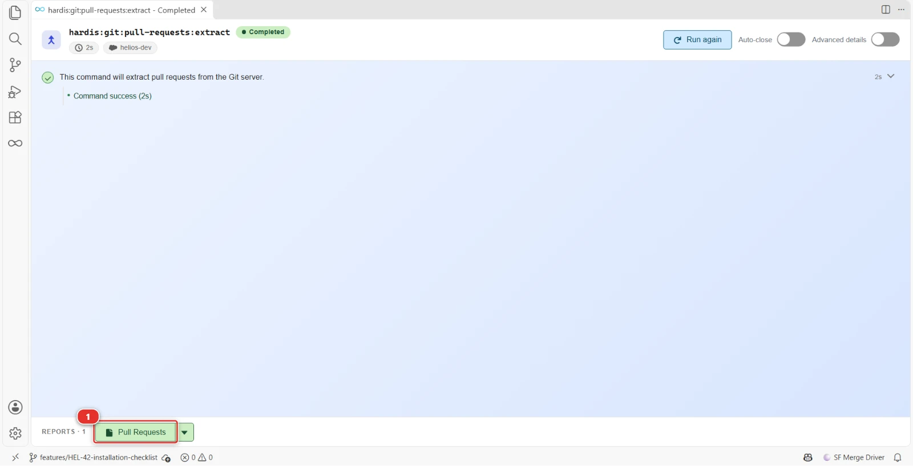
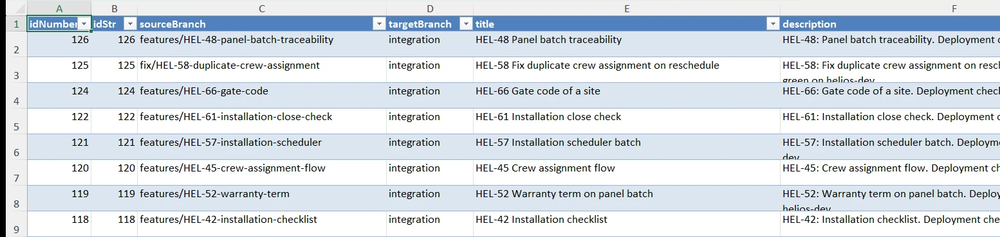

<!-- This file has been generated with command 'sf hardis:doc:plugin:generate'. Please do not update it manually or it may be overwritten -->
# hardis:git:pull-requests:extract

## Description


## Command Behavior

**Extracts pull request information from your Git server based on specified filtering criteria.**

This command provides a powerful way to query and retrieve details about pull requests (or merge requests, depending on your Git provider) in your repository. It's highly useful for reporting, auditing, and analyzing development workflows.

Key functionalities include:

- **Target Branch Filtering:** You can filter pull requests by their target branch using the `--target-branch` flag. If not specified, the command will prompt you to select one.
- **Status Filtering:** Filter pull requests by their status: `open`, `merged`, or `abandoned` using the `--status` flag. An interactive prompt is provided if no status is specified.
- **Minimum Date Filtering:** Use the `--min-date` flag to retrieve pull requests created or updated after a specific date.
- **CSV Output:** The extracted pull request data is generated into a CSV file, which can be used for further analysis in spreadsheet software.

<details markdown="1">
<summary>Technical explanations</summary>

The command's technical implementation involves interacting with a Git provider's API:

- **Git Provider Abstraction:** It uses `GitProvider.getInstance()` to abstract away the specifics of different Git platforms (e.g., GitHub, GitLab, Azure DevOps). This ensures the command can work across various environments. When no provider is found, the user is asked to select one, except in agent mode.
- **API Calls:** The `gitProvider.listPullRequests()` method is called with a `prConstraint` object that encapsulates the filtering criteria (target branch, minimum date, status).
- **Interactive Prompts:** The `prompts` library is used to interactively gather input from the user for the target branch and pull request status if they are not provided as command-line flags.
- **Date Handling:** The `moment` library is used to parse and handle date inputs for the `--min-date` flag.
- **CSV Generation:** The `generateCsvFile` utility is responsible for converting the retrieved pull request data into a CSV format, and `generateReportPath` determines the output file location.
- **Error Handling:** When the git provider cannot be used, the error says why (no token variable, a token refused by the provider...), as `hardis:project:connection:check` does.
</details>

### Agent Mode

Use `--agent` to disable all interactive prompts. In agent mode:

- `--target-branch`: Optional. If omitted, all branches are included.
- `--status`: Optional. If omitted, all statuses are included.
- `--min-date`: Optional date filter.
- All interactive git provider, branch and status selection prompts are skipped.
- When the git provider cannot be used, the command fails with the reason and what to do.


## Screenshots



_The Pull Requests merged into integration, extracted from GitHub to a CSV and an Excel file_

- **(1)** The report of the run: the button opens it in Excel, the arrow lists its other files

## Reports

The command writes these reports in the `hardis-report` folder of the project: a CSV file, and its Excel copy (XLSX) in the `xls` sub-folder.

### Pull requests

One row per pull request or merge request returned by the git provider, with its title, author, branches, status and dates.

Files: `pull-requests-*.csv`, `xls/pull-requests-*.xlsx`



## Parameters

| Name                 |  Type   | Description                                                       | Default | Required |            Options            |
|:---------------------|:-------:|:------------------------------------------------------------------|:-------:|:--------:|:-----------------------------:|
| agent                | boolean | Run in non-interactive mode for agents and automation             |         |          |                               |
| debug<br/>-d         | boolean | Activate debug mode (more logs)                                   |         |          |                               |
| flags-dir            | option  | Import flag values from a directory.                              |         |          |                               |
| json                 | boolean | Format output as json.                                            |         |          |                               |
| min-date<br/>-m      | option  | Minimum date for PR                                               |         |          |                               |
| outputfile<br/>-f    | option  | Force the path and name of output report file. Must end with .csv |         |          |                               |
| skipauth             | boolean | Skip authentication check when a default username is required     |         |          |                               |
| status<br/>-x        | option  | Status of the PR                                                  |         |          | open<br/>merged<br/>abandoned |
| target-branch<br/>-t | option  | Target branch of PRs                                              |         |          |                               |
| websocket            | option  | Websocket host:port for VsCode SFDX Hardis UI integration         |         |          |                               |

## Examples

```shell
$ sf hardis:git:pull-requests:extract
```

```shell
$ sf hardis:git:pull-requests:extract --target-branch main --status merged
```

```shell
$ sf hardis:git:pull-requests:extract --agent
```

```shell
$ sf hardis:git:pull-requests:extract --agent --target-branch main --status merged
```


