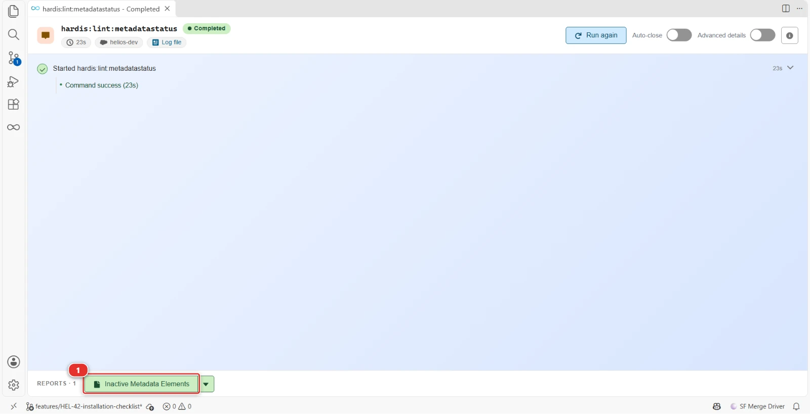
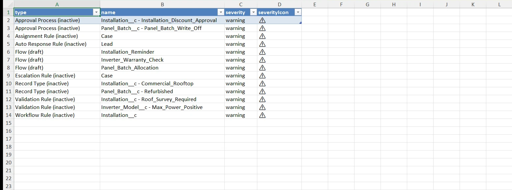

<!-- This file has been generated with command 'sf hardis:doc:plugin:generate'. Please do not update it manually or it may be overwritten -->
# hardis:lint:metadatastatus

## Description


## Command Behavior

**Checks for inactive metadata elements within your Salesforce DX project, helping to maintain a clean and efficient codebase.**

This command identifies various types of metadata components that are marked as inactive in your local project files. Keeping metadata active and relevant is crucial for deployment success, performance, and avoiding confusion. This tool helps you pinpoint and address such inactive elements.

It specifically checks for the inactive status of:

- **Approval Processes**
- **Assignment Rules**
- **Auto Response Rules**
- **Escalation Rules**
- **Flows** (specifically those in 'Draft' status)
- **Forecasting Types**
- **Record Types**
- **Validation Rules**
- **Workflow Rules**


This command is part of [sfdx-hardis Monitoring](https://sfdx-hardis.cloudity.com/salesforce-monitoring-inactive-metadata/) and can output Grafana, Slack and MsTeams Notifications.

<details markdown="1">
<summary>Technical explanations</summary>

The command's technical implementation involves:

- **File Discovery:** It uses `glob` patterns (e.g., `**/flows/**/*.flow-meta.xml`, `**/objects/**/validationRules/*.validationRule-meta.xml`) to locate relevant metadata files within your project.
- **XML Parsing:** For each identified metadata file, it reads the XML content and parses it to extract the `active` or `status` flag (e.g., `<active>false</active>`, `<status>Draft</status>`).
- **Status Verification:** It checks the value of these flags to determine if the metadata component is inactive.
- **Data Aggregation:** All detected inactive items are collected into a list, including their type, name, and a severity level.
- **Report Generation:** It generates a CSV report (`lint-metadatastatus.csv`) containing details of all inactive metadata elements, which can be used for further analysis or record-keeping.
- **Notification Integration:** It integrates with the `NotifProvider` to send notifications (e.g., to Slack, MS Teams, Grafana) about the presence and count of inactive metadata, making it suitable for automated monitoring in CI/CD pipelines.
- **Error Handling:** It includes basic error handling for file operations and ensures that the process continues even if some files cannot be read.
</details>


### Agent Mode

Supports non-interactive execution with `--agent`:

```sh
sf hardis:lint:metadatastatus --agent
```

In agent mode, the command runs fully automatically with no interactive prompts.

## Screenshots



_Draft flows and inactive validation rules searched in the Helios project sources, before they reach production_

- **(1)** The report of the run: the button opens it in Excel, the arrow lists its other files

## Reports

The command writes these reports in the `hardis-report` folder of the project: a CSV file, and its Excel copy (XLSX) in the `xls` sub-folder.

### Inactive metadata

One row per inactive or draft metadata element (flow, validation rule, record type, workflow rule...), to decide whether to activate it or delete it.

Files: `lint-metadatastatus-*.csv`, `xls/lint-metadatastatus-*.xlsx`



## Parameters

| Name              |  Type   | Description                                                                                   | Default | Required | Options |
|:------------------|:-------:|:----------------------------------------------------------------------------------------------|:-------:|:--------:|:-------:|
| agent             | boolean | Run in non-interactive mode for agents and automation. Uses default values and skips prompts. |         |          |         |
| debug<br/>-d      | boolean | Activate debug mode (more logs)                                                               |         |          |         |
| flags-dir         | option  | Import flag values from a directory.                                                          |         |          |         |
| json              | boolean | Format output as json.                                                                        |         |          |         |
| outputfile<br/>-f | option  | Force the path and name of output report file. Must end with .csv                             |         |          |         |
| skipauth          | boolean | Skip authentication check when a default username is required                                 |         |          |         |
| target-org<br/>-o | option  | Username or alias of the target org.                                                          |         |          |         |
| websocket         | option  | Websocket host:port for VsCode SFDX Hardis UI integration                                     |         |          |         |

## Examples

```shell
$ sf hardis:lint:metadatastatus
```

```shell
$ sf hardis:lint:metadatastatus --agent
```


