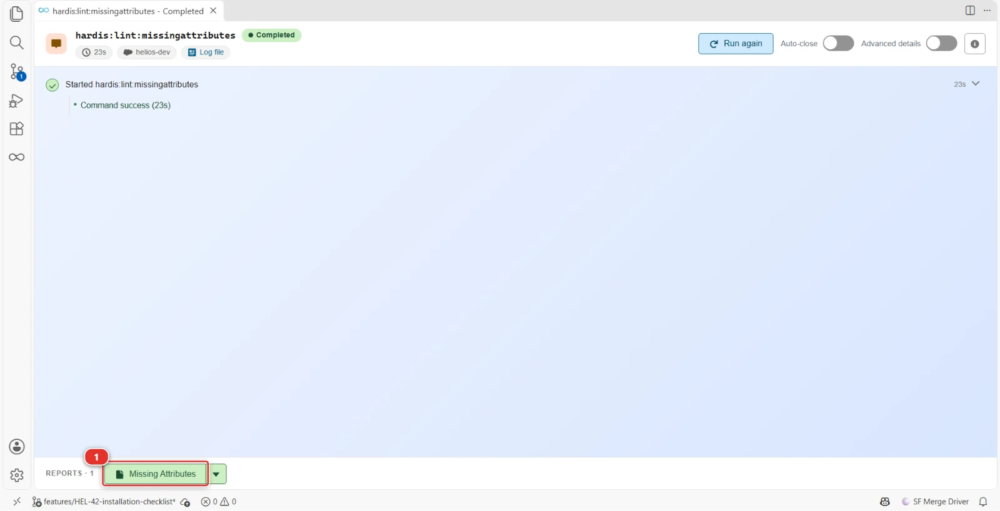
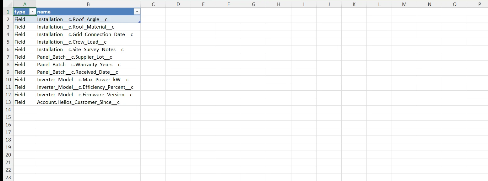

<!-- This file has been generated with command 'sf hardis:doc:plugin:generate'. Please do not update it manually or it may be overwritten -->
# hardis:lint:missingattributes

## Description


## Command Behavior

**Checks for missing descriptions on custom fields within your Salesforce DX project.**

This command helps enforce documentation standards by identifying custom fields that lack a descriptive explanation. Comprehensive field descriptions are crucial for:

- **Maintainability:** Making it easier for developers and administrators to understand the purpose and usage of each field.
- **Data Governance:** Ensuring data quality and consistency.
- **User Adoption:** Providing clear guidance to end-users on how to interact with fields.

It specifically targets custom fields (ending with `__c`) and excludes standard fields, managed package fields, and fields on Custom Settings or Data Cloud objects.

<details markdown="1">
<summary>Technical explanations</summary>

The command's technical implementation involves:

- **File Discovery:** It uses `glob` to find all custom field metadata files (`.field-meta.xml`) within your project.
- **Custom Setting Exclusion:** It first filters out fields belonging to Custom Settings by reading the corresponding object metadata files (`.object-meta.xml`) and checking for the `<customSettingsType>` tag. It also excludes Data Cloud objects (`__dlm`, `__dll`) and managed package fields.
- **XML Parsing:** For each remaining custom field file, it reads the XML content and parses it to extract the `fullName` and `description` attributes.
- **Description Check:** It verifies if the `description` attribute is present and not empty for each custom field.
- **Data Aggregation:** All custom fields found to be missing a description are collected into a list, along with their object and field names.
- **Report Generation:** It generates a CSV report (`lint-missingattributes.csv`) containing details of all fields with missing descriptions.
- **Notification Integration:** It integrates with the `NotifProvider` to send notifications (e.g., to Slack, MS Teams, Grafana) about the presence and count of fields with missing descriptions, making it suitable for automated quality checks in CI/CD pipelines.
</details>


### Agent Mode

Supports non-interactive execution with `--agent`:

```sh
sf hardis:lint:missingattributes --agent
```

In agent mode, the command runs fully automatically with no interactive prompts.

## Screenshots



_Custom fields of the Helios objects checked for a missing description_

- **(1)** The report of the run: the button opens it in Excel, the arrow lists its other files

## Reports

The command writes these reports in the `hardis-report` folder of the project: a CSV file, and its Excel copy (XLSX) in the `xls` sub-folder.

### Missing descriptions

One row per custom field that has no description, to know which fields to document.

Files: `lint-missingattributes-*.csv`, `xls/lint-missingattributes-*.xlsx`



## Parameters

| Name              |  Type   | Description                                                                                   | Default | Required | Options |
|:------------------|:-------:|:----------------------------------------------------------------------------------------------|:-------:|:--------:|:-------:|
| agent             | boolean | Run in non-interactive mode for agents and automation. Uses default values and skips prompts. |         |          |         |
| debug<br/>-d      | boolean | Activate debug mode (more logs)                                                               |         |          |         |
| flags-dir         | option  | Import flag values from a directory.                                                          |         |          |         |
| json              | boolean | Format output as json.                                                                        |         |          |         |
| outputfile<br/>-f | option  | Force the path and name of output report file. Must end with .csv                             |         |          |         |
| skipauth          | boolean | Skip authentication check when a default username is required                                 |         |          |         |
| target-org<br/>-o | option  | Username or alias of the target org.                                                          |         |          |         |
| websocket         | option  | Websocket host:port for VsCode SFDX Hardis UI integration                                     |         |          |         |

## Examples

```shell
$ sf hardis:lint:missingattributes
```

```shell
$ sf hardis:lint:missingattributes --agent
```


