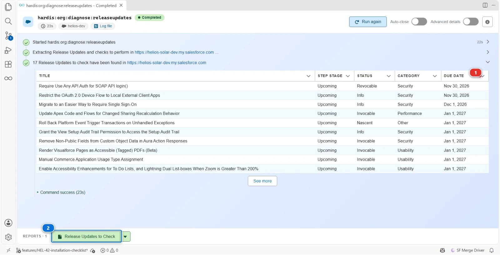
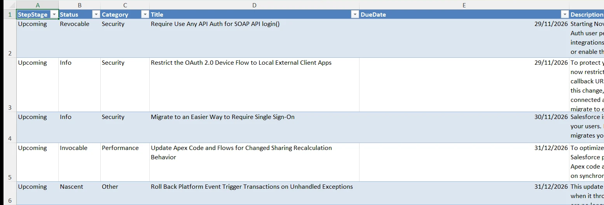

<!-- This file has been generated with command 'sf hardis:doc:plugin:generate'. Please do not update it manually or it may be overwritten -->
# hardis:org:diagnose:releaseupdates

## Description

## DEPRECATED

This command is deprecated: use [hardis:org:diagnose:what-will-break](https://sfdx-hardis.cloudity.com/hardis/org/diagnose/what-will-break/), which checks the release updates due together with everything else that will break after a dated Salesforce change.

Export Release Updates into a CSV file with selected criteria, and highlight Release Updates that should be checked.

Before publishing **Breaking Changes** ❌, Salesforce announce them in the setup menu [**Release Updates**](https://help.salesforce.com/s/articleView?id=sf.release_updates.htm&type=5)

⚠️ Some of them are very important, because if you don't make the related upgrades in time (ex: before Winter 25) , your production org can crash !

This command is part of [sfdx-hardis Monitoring](https://sfdx-hardis.cloudity.com/salesforce-monitoring-release-updates/) and can output Grafana, Slack and MsTeams Notifications.


### Agent Mode

Supports non-interactive execution with `--agent`:

```sh
sf hardis:org:diagnose:releaseupdates --agent --target-org myorg@example.com
```

In agent mode, the command runs fully automatically with no interactive prompts.

## Screenshots



_Release Updates of the Helios org still to check, with their status, category and the date Salesforce enforces them_

- **(1)** Salesforce enforces the update on this date
- **(2)** Every Release Update to check, beyond the first rows shown here

## Reports

The command writes these reports in the `hardis-report` folder of the project: a CSV file, and its Excel copy (XLSX) in the `xls` sub-folder.

### Release updates

One row per upcoming or overdue Release Update of the org, with its title, category, status and due date, so you can plan the ones to activate.

Files: `release-updates-*.csv`, `xls/release-updates-*.xlsx`



## Parameters

| Name              |  Type   | Description                                                                                                  | Default | Required | Options |
|:------------------|:-------:|:-------------------------------------------------------------------------------------------------------------|:-------:|:--------:|:-------:|
| agent             | boolean | Run in non-interactive mode for agents and automation. Uses default values and skips prompts.                |         |          |         |
| debug<br/>-d      | boolean | Activate debug mode (more logs)                                                                              |         |          |         |
| flags-dir         | option  | Import flag values from a directory.                                                                         |         |          |         |
| json              | boolean | Format output as json.                                                                                       |         |          |         |
| outputfile<br/>-f | option  | Force the path and name of output report file. Must end with .csv                                            |         |          |         |
| skipauth          | boolean | Skip authentication check when a default username is required                                                |         |          |         |
| target-org<br/>-o | option  | Username or alias of the target org. Not required if the `target-org` configuration variable is already set. |         |   true   |         |
| websocket         | option  | Websocket host:port for VsCode SFDX Hardis UI integration                                                    |         |          |         |

## Examples

```shell
$ sf hardis:org:diagnose:releaseupdates
```

```shell
$ sf hardis:org:diagnose:releaseupdates --agent
```


