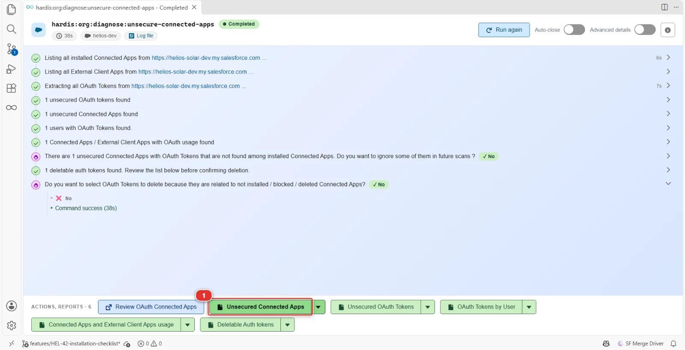
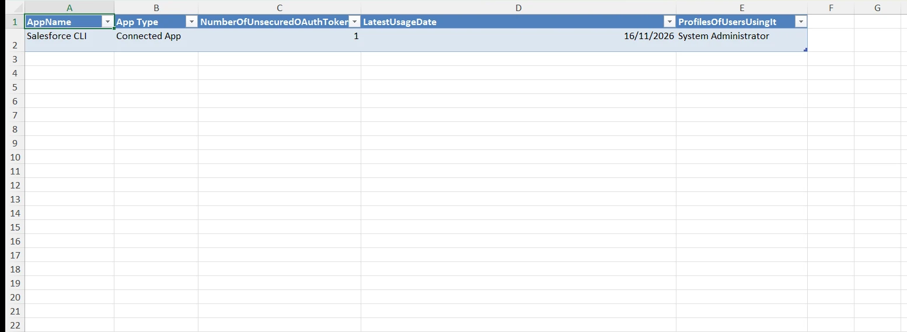
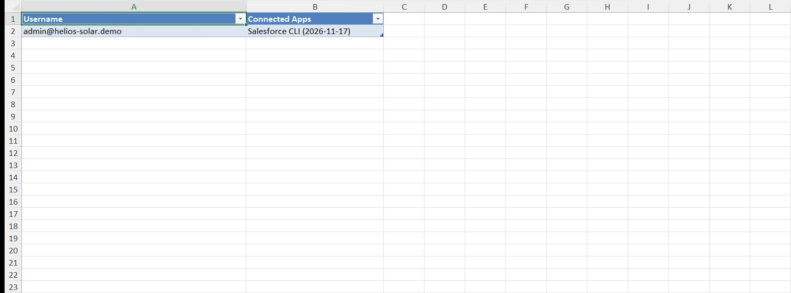
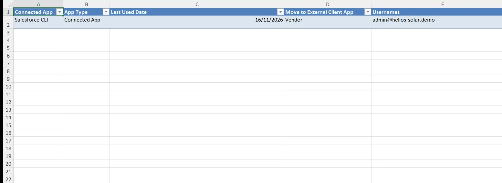
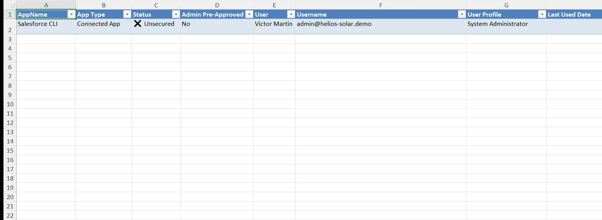
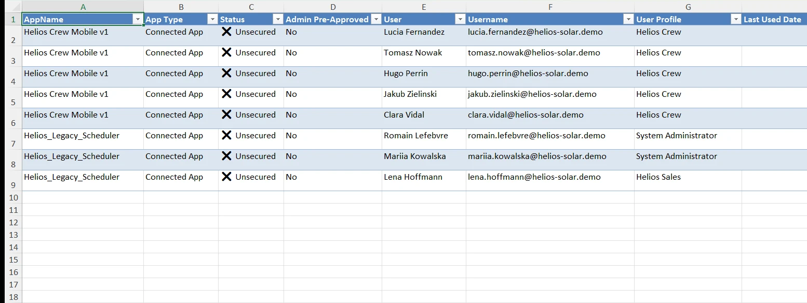
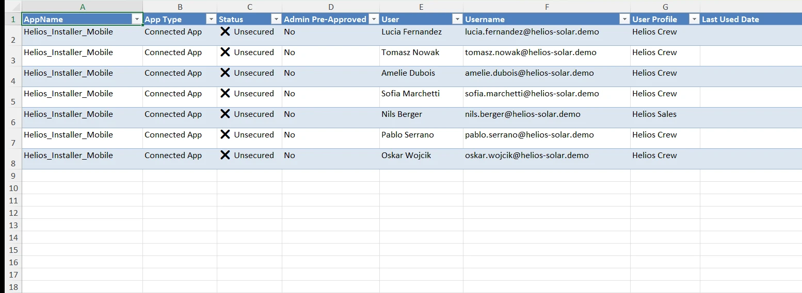

<!-- This file has been generated with command 'sf hardis:doc:plugin:generate'. Please do not update it manually or it may be overwritten -->
# hardis:org:diagnose:unsecure-connected-apps

## Description


## Command Behavior

**Detects unsecured Connected Apps and External Client Apps in a Salesforce org and generates detailed reports for security analysis.**

This command is a critical security diagnostic tool that helps administrators identify Connected Apps and External Client Apps that may pose security risks due to improper OAuth authorization configuration. It provides comprehensive analysis of OAuth tokens and app security settings to ensure proper access control.

Key functionalities:

- **OAuth Token Analysis:** Queries all OAuth tokens in the org using SOQL to retrieve comprehensive token information including app names, users, authorization status, and usage statistics.
- **Connected App and External Client App Coverage:** Checks both Connected Apps (via `AppMenuItem.IsUsingAdminAuthorization`) and External Client Apps (via `ExtlClntAppOauthPlcyCnfg.PermittedUsersPolicyType`) for proper admin pre-approval settings.
- **App Type Column:** Each report row includes an `App Type` column indicating whether the app is a `Connected App`, an `Ext Client App`, or an `Ext Client App (converted)`.
- **Converted Connected Apps:** A Connected App migrated to an External Client App stays in the org as a read-only copy that Salesforce no longer uses for authentication, while its existing OAuth tokens still point to it. When an External Client App with the same name exists, the tokens are evaluated against the External Client App OAuth policy instead of the stale Connected App settings, so a properly secured migration is not reported as unsecured. If that External Client App has no OAuth policy record (or the org does not expose `ExtlClntAppOauthPlcyCnfg`), the Connected App settings are kept and the app is listed in a warning, so a secured Connected App is never reported as unsecured because of a missing policy.
- **AppName-based Fallback Matching:** When an OAuth token has no `AppMenuItem` link (common for External Client App tokens, and for Connected App tokens issued before the app was reinstalled), the command falls back to matching by `AppName` against `ExternalClientApplication.MasterLabel` or `DeveloperName`, then against `ConnectedApplication.Name`. The Connected App setting `OptionsAllowAdminApprovedUsersOnly` ("Admin approved users are pre-authorized") then decides the status.
- **Ignore List Support:** Skips warning/escalation for apps configured in `monitoringUnsecureConnectedAppsIgnore` (project config) or `MONITORING_UNSECURE_CONNECTED_APPS_IGNORE` (environment variable). Matching OAuth tokens are marked as *Ignored*.
- **Unsecured App Detection:** Identifies apps that allow users to authorize themselves without admin approval, which can pose security risks.
- **Phantom App Cleanup (Optional):** Detects unsecured apps not present in the installed Connected Apps or External Client Apps list and offers an interactive option to revoke their OAuth tokens (forces re-authentication if still needed).
- **Stale Token Cleanup (Optional):** Detects secured apps that still have old unsecured OAuth tokens (authorized before proper hardening) and offers an interactive option to delete them.
- **Detailed Reporting:** Generates several CSV reports:
  - **OAuth Tokens Report:** Lists all OAuth tokens with security status, app type, user information, and usage data
  - **Unsecured Connected Apps Summary:** Aggregates unsecured apps with counts of associated OAuth tokens and app type
  - **OAuth Tokens by User:** Lists each user with the apps they hold a token for and the last usage date
  - **Connected Apps Usage:** Lists every Connected App and External Client App that has OAuth tokens (secured or not), with its last usage date, the usernames who use it, and whether it must be moved to an External Client App
- **Move to External Client Apps:** Salesforce ends the support of Connected Apps in Summer '27 (they keep working, without fixes or support). The usage report tells, for each app, whether the move is `Required` (a Connected App of the org used in the last 90 days), done by its `Vendor` (an app of Salesforce or of a package, used in the last 90 days), `Done (converted)`, `Not needed` (already an External Client App) or not worth it (`Not used` for 90 days: delete it instead). The apps to move are also reported by [hardis:org:diagnose:what-will-break](https://sfdx-hardis.cloudity.com/hardis/org/diagnose/what-will-break/), with the date.
- **Visual Indicators:** Uses status icons (❌ for unsecured, ✅ for secured, ⚪ for ignored) to provide immediate visual feedback on security status.
- **Security Recommendations:** Provides actionable guidance on how to secure Connected Apps and External Client Apps through proper configuration.
- **Notifications:** Sends alerts to configured channels (Grafana, Slack, MS Teams) with security findings and attached reports.

This command is part of [sfdx-hardis Monitoring](https://sfdx-hardis.cloudity.com/salesforce-monitoring-org-security/) and can output Grafana, Slack and MsTeams Notifications.

<iframe width="560" height="315" src="https://www.youtube.com/embed/jHv8yrSK8Dg" title="YouTube video player" frameborder="0" allow="accelerometer; autoplay; clipboard-write; encrypted-media; gyroscope; picture-in-picture" allowfullscreen></iframe>

<details markdown="1">
<summary>Technical explanations</summary>

The command's technical implementation involves:

- **SOQL Query Execution:** Executes a comprehensive SOQL query on the `OauthToken` object, joining with `AppMenuItem` and `User` objects to gather complete security context. A Bulk query returns at most 2500 tokens, so the next ones are read page by page on `CreatedDate`.
- **External Client App Migration Logic:** the apps the org owns are its `ConnectedApp` metadata (`listMetadata`), compared with the app label turned into an API name (`ClickDeploy.io` becomes `ClickDeploy_io`). `AppMenuItem.NamespacePrefix` marks packaged apps, and the most recent `LastUsedDate` of the app's tokens tells if it is still used.
- **Connected App Security Logic:** Analyzes the `ConnectedApplication.OptionsAllowAdminApprovedUsersOnly` field (falling back to `AppMenuItem.IsUsingAdminAuthorization`) to determine if a Connected App requires admin pre-approval for user authorization. Booleans returned as strings by the Bulk API are normalized, so a `"false"` value is never read as secured.
- **External Client App Security Logic:** Queries `ExtlClntAppOauthPlcyCnfg` for each External Client App and checks `PermittedUsersPolicyType === 'AdminApprovedPreAuthorized'` to determine if admin pre-approval is required. Falls back to AppName-based matching when `AppMenuItem.ApplicationId` is not populated.
- **Converted Connected App Logic:** When a token points to a Connected App whose name matches an `ExternalClientApplication` `MasterLabel` or `DeveloperName`, the Connected App is considered migrated: the External Client App OAuth policy decides the status and the app type is reported as `Ext Client App (converted)`. The match is made on the name only, so every app whose status comes from an External Client App policy is logged, as well as every name match without an available policy.
- **Ignore Handling:** Normalizes app names and marks matching OAuth tokens as *Ignored* so they do not contribute to unsecured app counts and notifications.
- **Data Transformation:** Processes raw SOQL results to add security status indicators, app type, and reorganizes data for optimal reporting and analysis.
- **Aggregation Processing:** Groups OAuth tokens by app name to provide summary statistics and identify the most problematic applications.
- **Token Revocation:** Optionally calls Salesforce OAuth revoke endpoint using each token's `DeleteToken` value to revoke OAuth tokens for selected phantom apps or stale unsecured tokens on secured apps.
- **Report Generation:** Uses `generateCsvFile` to create structured CSV reports with proper formatting and metadata for easy analysis and sharing.
- **Notification Integration:** Integrates with the `NotifProvider` to send security alerts with detailed metrics, including the number of unsecured apps and associated OAuth tokens.
- **File Management:** Generates multiple output formats (CSV, XLSX) and manages file paths using `generateReportPath` for consistent report organization.
- **Connection Management:** Uses `setConnectionVariables` to ensure proper authentication context for notification providers that require org connection details.
</details>


### Agent Mode

Supports non-interactive execution with `--agent`:

```sh
sf hardis:org:diagnose:unsecure-connected-apps --agent --target-org myorg@example.com
```

In agent mode:

- Phantom app OAuth token revocation prompt is skipped (no tokens are revoked automatically).
- Stale token deletion prompt is skipped (no tokens are deleted automatically).
- All other interactive prompts are skipped.

## Screenshots



_OAuth tokens of Connected Apps that are not locked down, and the apps they belong to_

- **(1)** The report of the run: the button opens it in Excel, the arrow lists its other files

## Reports

The command writes these reports in the `hardis-report` folder of the project: a CSV file, and its Excel copy (XLSX) in the `xls` sub-folder.

### OAuth tokens

One row per OAuth token of the org, with its app, user, last used date and a secured or unsecured status.

Files: `unsecured-oauth-tokens-*.csv`, `xls/unsecured-oauth-tokens-*.xlsx`


### Unsecured apps

One row per app that has unsecured OAuth tokens, with the number of tokens, its latest usage date and the profiles of the users using it, so you can decide which apps to secure.

Files: `unsecured-connected-apps-*.csv`, `xls/unsecured-connected-apps-*.xlsx`



### Tokens by user

One row per user holding OAuth tokens, with the apps they connected and the last usage date of each.

Files: `oauth-tokens-by-user-*.csv`, `xls/oauth-tokens-by-user-*.xlsx`



### Connected apps usage

One row per app that has OAuth tokens, with its last usage date, its users and whether it must move to an External Client App.

Files: `connected-apps-usage-*.csv`, `xls/connected-apps-usage-*.xlsx`



### Deletable tokens

One row per unsecured OAuth token of an app that no longer exists in the org, written in interactive mode before you choose which ones to revoke.

Files: `deletable-auth-tokens-*.csv`, `xls/deletable-auth-tokens-*.xlsx`



### Deleted tokens

One row per OAuth token revoked by the command after your confirmation.

Files: `deleted-auth-tokens-*.csv`, `xls/deleted-auth-tokens-*.xlsx`



### Stale tokens of secured apps

One row per unsecured OAuth token of an app that is otherwise secured, written in interactive mode for each such app (the app name ends the file name).

Files: `unsecured-tokens-secured-app-*.csv`, `xls/unsecured-tokens-secured-app-*.xlsx`



## Parameters

| Name              |  Type   | Description                                                                                                  | Default | Required | Options |
|:------------------|:-------:|:-------------------------------------------------------------------------------------------------------------|:-------:|:--------:|:-------:|
| agent             | boolean | Run in non-interactive mode for agents and automation                                                        |         |          |         |
| debug<br/>-d      | boolean | Activate debug mode (more logs)                                                                              |         |          |         |
| flags-dir         | option  | Import flag values from a directory.                                                                         |         |          |         |
| json              | boolean | Format output as json.                                                                                       |         |          |         |
| outputfile<br/>-f | option  | Force the path and name of output report file. Must end with .csv                                            |         |          |         |
| skipauth          | boolean | Skip authentication check when a default username is required                                                |         |          |         |
| target-org<br/>-o | option  | Username or alias of the target org. Not required if the `target-org` configuration variable is already set. |         |   true   |         |
| websocket         | option  | Websocket host:port for VsCode SFDX Hardis UI integration                                                    |         |          |         |

## Examples

```shell
$ sf hardis:org:diagnose:unsecure-connected-apps
```

```shell
$ sf hardis:org:diagnose:unsecure-connected-apps --agent
```


