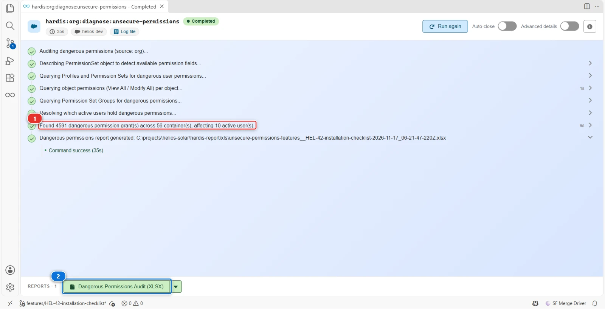
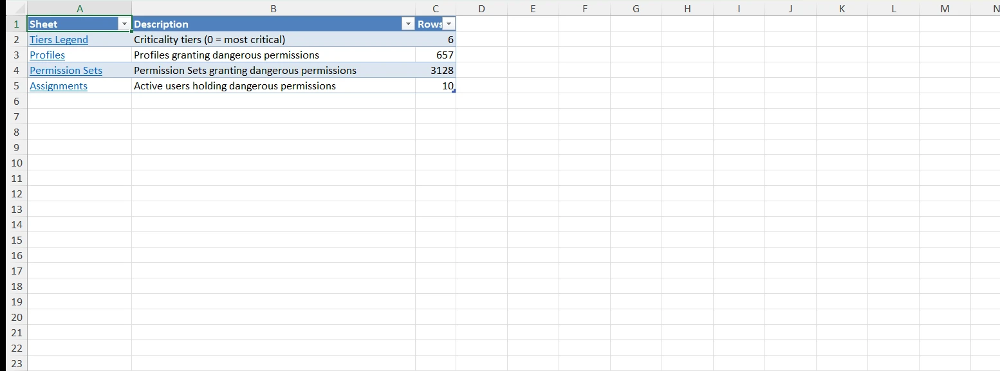

<!-- This file has been generated with command 'sf hardis:doc:plugin:generate'. Please do not update it manually or it may be overwritten -->
# hardis:org:diagnose:unsecure-permissions

## Description


## Command Behavior

**Audits dangerous permissions granted through Profiles, Permission Sets and Permission Set Groups, and resolves which active users hold them.**

Dangerous permissions are broad administrative, identity, sharing-bypass, data-theft or control-weakening rights (for example Modify All Data, Author Apex, Manage Users, View All Data, Weekly Data Export). They are grouped into criticality tiers, from Tier 0 (full org compromise) to Tier 4 (control weakening).

Key functionalities:

- **Two sources:** Analyze a connected org via SOQL (`--source org`, default), local metadata files (`--source local`), or both (`--source both`).
- **User and object permissions:** Detects both user permissions (`Permissions*`) and object permissions (View All / Modify All per object).
- **Assignments:** In org mode, resolves which active users hold each dangerous permission and through which container, with their last login date.
- **Configurable list:** The built-in list is additive: use `dangerousPermissionsExtra` (or `DANGEROUS_PERMISSIONS_EXTRA`) to add permissions and `dangerousPermissionsIgnore` (or `DANGEROUS_PERMISSIONS_IGNORE`) to remove them.
- **Excel report:** Generates a multi-sheet Excel file with an Index sheet linking to a Tiers Legend, Profiles, Permission Sets, Permission Set Groups and Assignments sheets. Columns and rows are auto-sized.

<details markdown="1">
<summary>Technical explanations</summary>

- **Field availability:** Describes the `PermissionSet` object and keeps only the dangerous permission fields that exist in the org, so a missing field never breaks the query.
- **Containers:** Queries `PermissionSet` (profile-owned and standalone) for user permissions and `ObjectPermissions` for View All / Modify All. Permission Set Groups are resolved through `PermissionSetGroupComponent`.
- **Assignments:** Queries `PermissionSetAssignment` for active users, resolving group membership so permissions granted through a Permission Set Group are attributed to their users.
- **Local mode:** Parses `.profile-meta.xml`, `.permissionset-meta.xml` and `.permissionsetgroup-meta.xml` files. Assignments cannot be resolved offline and the Assignments sheet is omitted.
- **Report:** Uses `createXlsxFromCsvFiles` with a post-processing step that turns Index cells into internal hyperlinks and adds a "Back to Index" link on every other sheet.
</details>

### Agent Mode

Supports non-interactive execution with `--agent`:

```sh
sf hardis:org:diagnose:unsecure-permissions --agent --target-org myorg@example.com
```

The command has no interactive prompts, so agent mode behaves like a normal run. Use `--source` to control what is analyzed and `--outputfile` to set the report path.

## Screenshots



_Dangerous permissions such as Modify All Data granted by profiles and permission sets, with the active users holding them_

- **(1)** Grants found and the number of active users they reach
- **(2)** A sheet each for profiles, permission sets, groups and users, with a criticality tier

## Reports

The command writes these reports in the `hardis-report` folder of the project: a CSV file, and its Excel copy (XLSX) in the `xls` sub-folder.

### Dangerous permissions

One workbook with a sheet each for the profiles, permission sets, permission set groups and users that hold dangerous permissions, with a criticality tier per row.

Files: `unsecure-permissions-*.csv`, `xls/unsecure-permissions-*.xlsx`



## Parameters

| Name              |  Type   | Description                                                                           | Default | Required |        Options         |
|:------------------|:-------:|:--------------------------------------------------------------------------------------|:-------:|:--------:|:----------------------:|
| agent             | boolean | Run in non-interactive mode for agents and automation                                 |         |          |                        |
| debug<br/>-d      | boolean | Activate debug mode (more logs)                                                       |         |          |                        |
| flags-dir         | option  | Import flag values from a directory.                                                  |         |          |                        |
| json              | boolean | Format output as json.                                                                |         |          |                        |
| outputfile<br/>-f | option  | Force the path and name of output report file. Must end with .csv                     |         |          |                        |
| skipauth          | boolean | Skip authentication check when a default username is required                         |         |          |                        |
| source<br/>-s     | option  | Where to read permission definitions from: org (SOQL), local (metadata files) or both |   org   |          | org<br/>local<br/>both |
| target-org<br/>-o | option  | Username or alias of the target org.                                                  |         |          |                        |
| websocket         | option  | Websocket host:port for VsCode SFDX Hardis UI integration                             |         |          |                        |

## Examples

```shell
$ sf hardis:org:diagnose:unsecure-permissions
```

```shell
$ sf hardis:org:diagnose:unsecure-permissions --source local
```

```shell
$ sf hardis:org:diagnose:unsecure-permissions --source both
```

```shell
$ sf hardis:org:diagnose:unsecure-permissions --agent --target-org myorg@example.com
```


