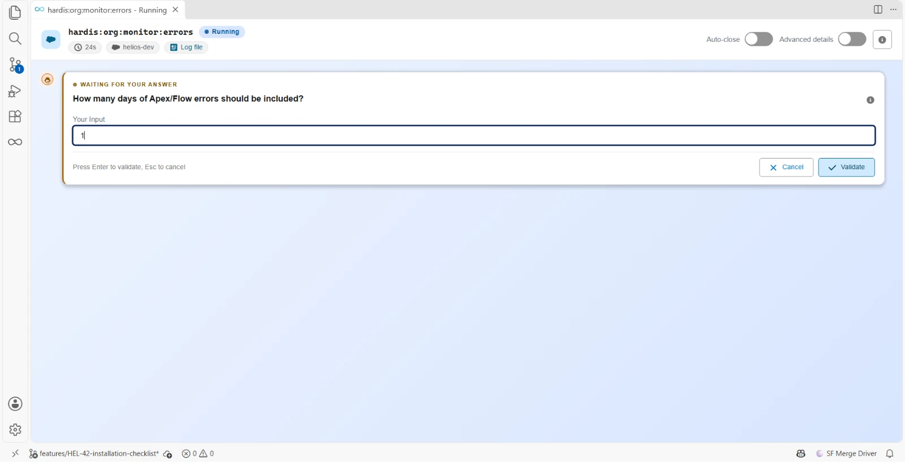
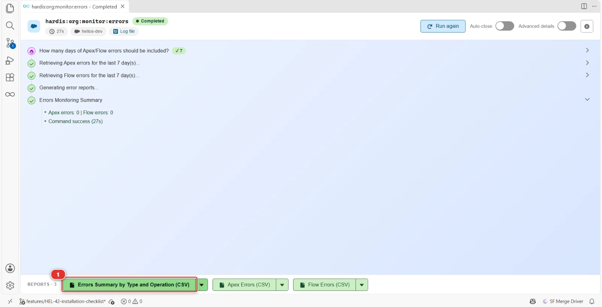
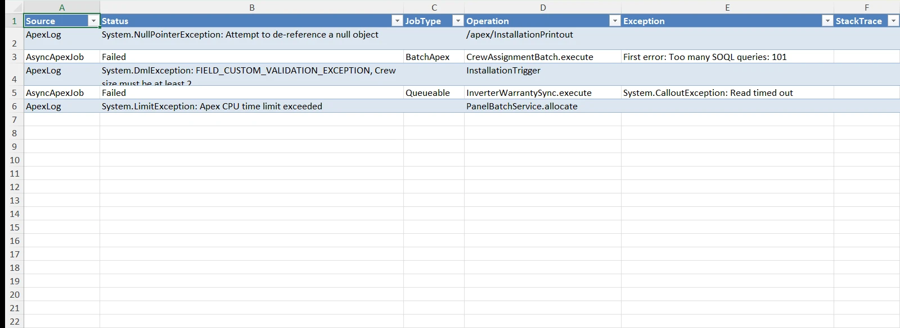
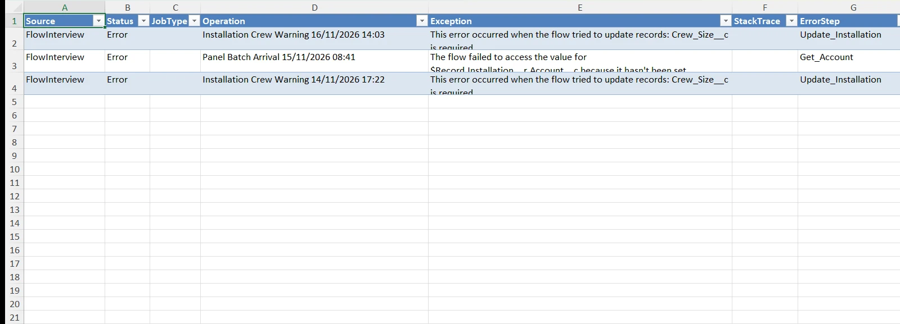
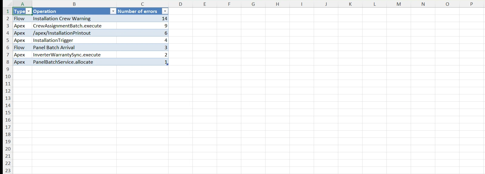

<!-- This file has been generated with command 'sf hardis:doc:plugin:generate'. Please do not update it manually or it may be overwritten -->
# hardis:org:monitor:errors

## Description


## Command Behavior

**Collects Apex and Flow crash logs from the last N days, exports CSV/XLSX reports, and posts notifications.**

Key functionalities:

- **Apex errors:** Queries failed Apex logs from the Tooling API and failed async Apex jobs from the standard API.
- **Flow errors:** Queries failed Flow interviews from the standard REST API.
- **Report generation:** Exports both datasets to CSV/XLSX for monitoring pipelines.
- **Notifications:** Sends notifications with summary metrics and file attachments.

This command is part of [sfdx-hardis Monitoring](https://sfdx-hardis.cloudity.com/salesforce-monitoring-home/) and can output Grafana, Slack and MsTeams Notifications.

### Agent Mode

Supports non-interactive execution with `--agent`:

```sh
sf hardis:org:monitor:errors --agent --target-org myorg@example.com
```

In agent mode:

- The number of days defaults to 1 when `--days` is not provided.
- All interactive prompts are skipped.

## Screenshots



_Pick how many days of errors to collect_



_Apex and Flow errors of the last 7 days in the Helios org, summed up by type and operation_

- **(1)** The report of the run: the button opens it in Excel, the arrow lists its other files

## Reports

The command writes these reports in the `hardis-report` folder of the project: a CSV file, and its Excel copy (XLSX) in the `xls` sub-folder.

### Apex errors

One row per failed Apex job in the period, with its operation, exception, stack trace, start time and user.

Files: `monitor-apex-errors-*.csv`, `xls/monitor-apex-errors-*.xlsx`



### Flow errors

One row per Flow interview error in the period, with the flow operation, error step, exception, record and user.

Files: `monitor-flow-errors-*.csv`, `xls/monitor-flow-errors-*.xlsx`



### Errors summary

One row per Apex class or Flow that raised errors, with its number of errors, so you can see which ones fail the most.

Files: `monitor-errors-summary-*.csv`, `xls/monitor-errors-summary-*.xlsx`



## Parameters

| Name              |  Type   | Description                                                                                                  | Default | Required | Options |
|:------------------|:-------:|:-------------------------------------------------------------------------------------------------------------|:-------:|:--------:|:-------:|
| agent             | boolean | Run in non-interactive mode for agents and automation                                                        |         |          |         |
| days<br/>-n       | option  | Number of days to look back for Apex and Flow errors (default: 1).                                           |         |          |         |
| debug<br/>-d      | boolean | Activate debug mode (more logs)                                                                              |         |          |         |
| flags-dir         | option  | Import flag values from a directory.                                                                         |         |          |         |
| json              | boolean | Format output as json.                                                                                       |         |          |         |
| skipauth          | boolean | Skip authentication check when a default username is required                                                |         |          |         |
| target-org<br/>-o | option  | Username or alias of the target org. Not required if the `target-org` configuration variable is already set. |         |   true   |         |
| websocket         | option  | Websocket host:port for VsCode SFDX Hardis UI integration                                                    |         |          |         |

## Examples

```shell
$ sf hardis:org:monitor:errors
```

```shell
$ sf hardis:org:monitor:errors --agent
```


