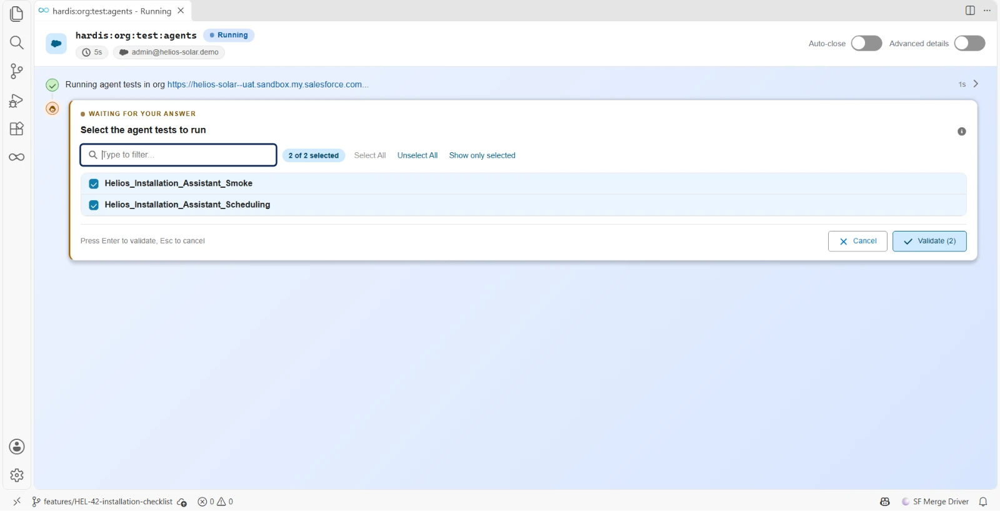
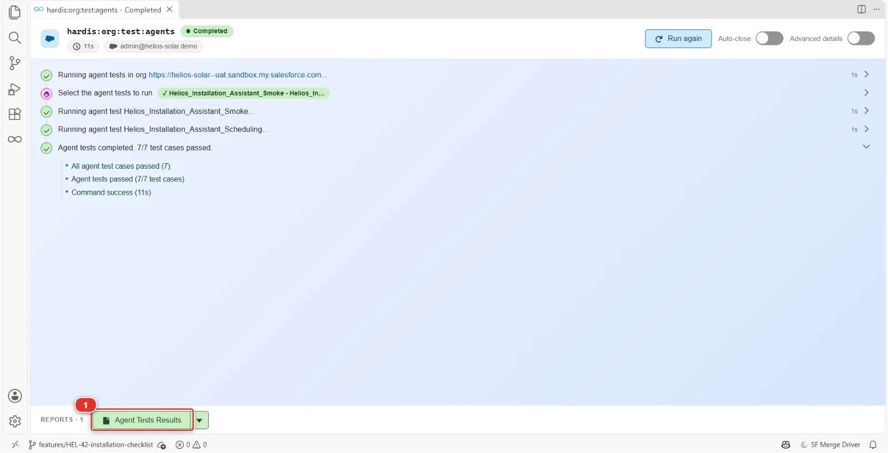
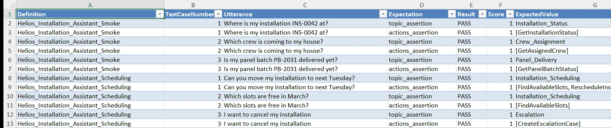

<!-- This file has been generated with command 'sf hardis:doc:plugin:generate'. Please do not update it manually or it may be overwritten -->
# hardis:org:test:agents

## Description

Run Agentforce agent tests (AiEvaluationDefinition metadata) in a Salesforce org.

## Command Behavior

- **Discovers all agent tests:** Lists every AiEvaluationDefinition available in the org using `sf agent test list`.
- **Runs each test:** Executes `sf agent test run` for each definition and waits for completion (override the wait with env var `SFDX_TEST_WAIT_MINUTES`, default 60 minutes).
- **Aggregates results:** Reports pass/fail at the test-case and assertion level. The command fails (exit code 1) if any assertion fails. Measurements such as the output latency, and instruction adherence rated `HIGH` or `UNCERTAIN`, never fail a test case.
- **CSV report:** Generates a report listing every assertion with its verdict, the result returned by Salesforce, its expected and actual values and the explanation of the evaluation.
- **Notifications:** Sends alerts to Grafana, Slack and MS Teams when agent tests fail.

Use `--tests` to run only specific agent tests (comma-separated API names) instead of all of them. In interactive mode (not `--agent`, not in CI), a prompt lets you unselect the agent tests you want to skip, with all of them selected by default.

This command requires the `@salesforce/plugin-agent` Salesforce CLI plugin. Install it with `sf plugins install @salesforce/plugin-agent`.

This command is part of [sfdx-hardis Monitoring](https://sfdx-hardis.cloudity.com/salesforce-monitoring-agent-tests/) and can output Grafana, Slack and MsTeams Notifications.

<details markdown="1">
<summary>Technical explanations</summary>

- Calls `sf agent test list --json` to enumerate AiEvaluationDefinition components, then `sf agent test run --api-name <name> --wait <minutes> --json` for each one (synchronous, no polling).
- Parses the `testCases[].testResults[]` array of each run and gives each assertion a verdict from its `result`:
  - `PASS` or `HIGH` (categorical metrics such as `instruction_adherence`): **PASS**
  - `FAILURE` or `LOW`, or an assertion whose `status` is `ERROR`: **FAILURE**
  - `UNCERTAIN` or an unknown value: **WARNING**
  - No `result` at all, for measurements such as `output_latency_milliseconds`: **INFO**
- A test case fails when one of its assertions is a **FAILURE**, or when it has no assertion. **WARNING** and **INFO** assertions are listed in the report but never fail a test case, like in the `sf agent test run` output.
- A run whose overall status is not `COMPLETED` is treated as an error and flips the notification severity.
</details>

### Agent Mode

Supports non-interactive execution with `--agent`:

```sh
sf hardis:org:test:agents --agent
```

In agent mode the command runs fully automatically. There are no interactive prompts; the wait time defaults to `SFDX_TEST_WAIT_MINUTES` (60 minutes) and all agent tests found in the org are run unless `--tests` is provided.


## Screenshots



_Pick the agent tests to run_



_Seven test cases of the Helios_Installation_Assistant agent pass, with the report buttons_

- **(1)** The report of the run: the button opens it in Excel, the arrow lists its other files

## Reports

The command writes these reports in the `hardis-report` folder of the project: a CSV file, and its Excel copy (XLSX) in the `xls` sub-folder.

### Agent tests results

One row per assertion of the agent tests run, with its result, to find the failing test cases.

Files: `agent-tests-*.csv`, `xls/agent-tests-*.xlsx`



## Parameters

| Name              |  Type   | Description                                                                                                  | Default | Required | Options |
|:------------------|:-------:|:-------------------------------------------------------------------------------------------------------------|:-------:|:--------:|:-------:|
| agent             | boolean | Run in non-interactive mode for agents and automation                                                        |         |          |         |
| debug<br/>-d      | boolean | Activate debug mode (more logs)                                                                              |         |          |         |
| flags-dir         | option  | Import flag values from a directory.                                                                         |         |          |         |
| json              | boolean | Format output as json.                                                                                       |         |          |         |
| outputfile<br/>-f | option  | Force the path and name of output report file. Must end with .csv                                            |         |          |         |
| skipauth          | boolean | Skip authentication check when a default username is required                                                |         |          |         |
| target-org<br/>-o | option  | Username or alias of the target org. Not required if the `target-org` configuration variable is already set. |         |   true   |         |
| tests<br/>-t      | option  | Comma-separated list of agent test API names to run. Runs all tests found in the org when not provided.      |         |          |         |
| websocket         | option  | Websocket host:port for VsCode SFDX Hardis UI integration                                                    |         |          |         |

## Examples

```shell
$ sf hardis:org:test:agents
```

```shell
$ sf hardis:org:test:agents --tests Mercury_Referral_Agent_Eval
```

```shell
$ sf hardis:org:test:agents --outputfile ./reports/agent-tests.csv
```

```shell
$ sf hardis:org:test:agents --agent
```


