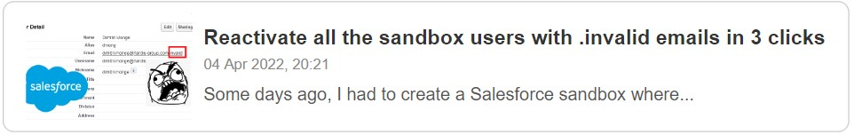
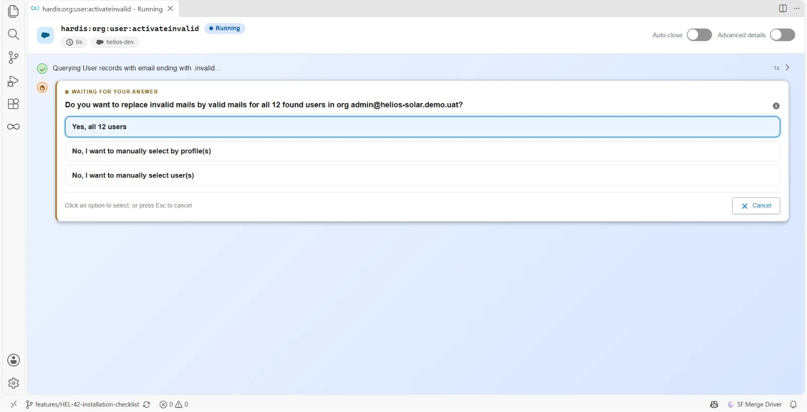
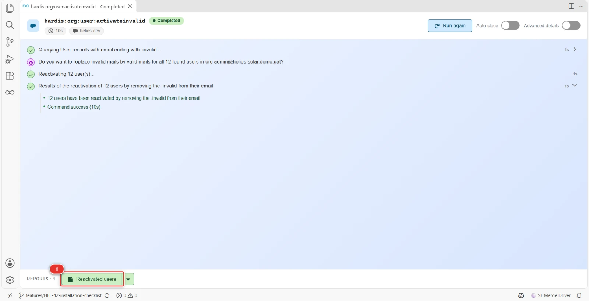
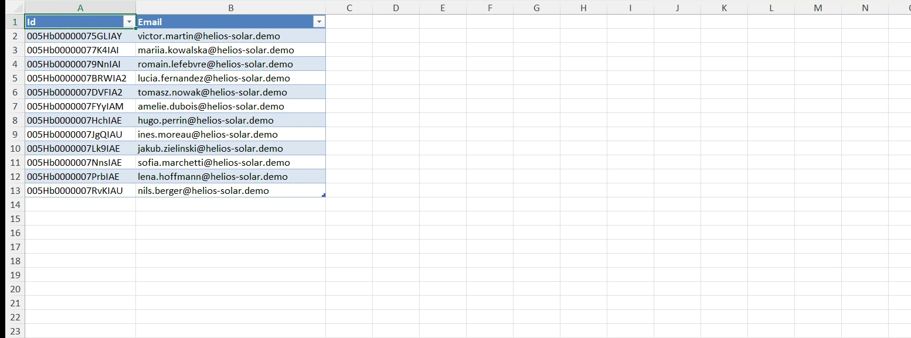

<!-- This file has been generated with command 'sf hardis:doc:plugin:generate'. Please do not update it manually or it may be overwritten -->
# hardis:org:user:activateinvalid

## Description

Update sandbox users so their email is valid

  Example: replaces `toto@company.com.dev.invalid` with `toto@company.com.dev.invalid`

See article below

[](https://nicolas.vuillamy.fr/reactivate-all-the-sandbox-users-with-invalid-emails-in-3-clicks-2265af4e3a3d)

### Agent Mode

Supports non-interactive execution with `--agent`:

```sh
sf hardis:org:user:activateinvalid --agent --target-org my-user@myorg.com
```

In agent mode:

- All interactive prompts and confirmations are skipped.
- All users with `.invalid` emails are activated automatically.
- Use `--profiles` to limit the scope to specific profiles.


## Screenshots



_Restore every email, or pick the users by profile or one by one_



_After a sandbox refresh, the emails ending with .invalid are restored for the users picked_

- **(1)** The report of the run: the button opens it in Excel, the arrow lists its other files

## Reports

The command writes these reports in the `hardis-report` folder of the project: a CSV file, and its Excel copy (XLSX) in the `xls` sub-folder.

### Reactivated users

One row per sandbox user reactivated by the command, with the id and the corrected email.

Files: `reactivated-users-*.csv`, `xls/reactivated-users-*.xlsx`



## Parameters

| Name              |  Type   | Description                                                                                                  | Default | Required | Options |
|:------------------|:-------:|:-------------------------------------------------------------------------------------------------------------|:-------:|:--------:|:-------:|
| agent             | boolean | Run in non-interactive mode for agents and automation                                                        |         |          |         |
| debug<br/>-d      | boolean | Activate debug mode (more logs)                                                                              |         |          |         |
| flags-dir         | option  | Import flag values from a directory.                                                                         |         |          |         |
| json              | boolean | Format output as json.                                                                                       |         |          |         |
| profiles<br/>-p   | option  | Comma-separated list of profiles names that you want to reactive users assigned to and with a .invalid email |         |          |         |
| skipauth          | boolean | Skip authentication check when a default username is required                                                |         |          |         |
| target-org<br/>-o | option  | Username or alias of the target org. Not required if the `target-org` configuration variable is already set. |         |   true   |         |
| websocket         | option  | Websocket host:port for VsCode SFDX Hardis UI integration                                                    |         |          |         |

## Examples

```shell
$ sf hardis:org:user:activateinvalid
```

```shell
$ sf hardis:org:user:activateinvalid --target-org my-user@myorg.com
```

```shell
$ sf hardis:org:user:activateinvalid --profiles 'System Administrator,MyCustomProfile' --target-org my-user@myorg.com
```

```shell
$ sf hardis:org:user:activateinvalid --agent
```


