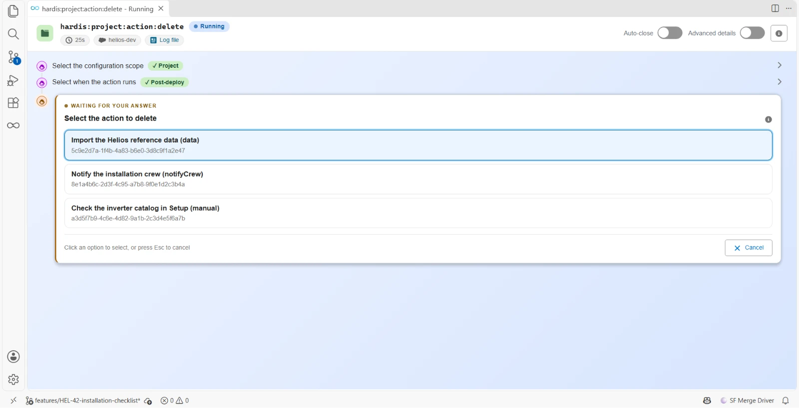
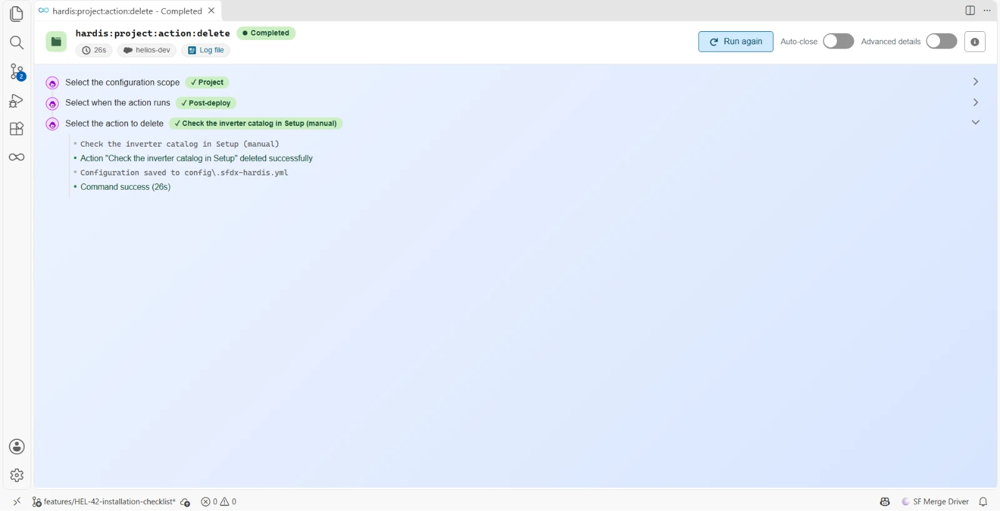

<!-- This file has been generated with command 'sf hardis:doc:plugin:generate'. Please do not update it manually or it may be overwritten -->
# hardis:project:action:delete

## Description


## Command Behavior

**Deletes an existing deployment action from the project configuration.**

Removes a single action identified by its ID from the specified scope and deployment phase.

### Agent Mode

Supports non-interactive execution with `--agent`:

```sh
sf hardis:project:action:delete --agent --scope branch --when pre-deploy --action-id <uuid>
```

Required in agent mode:

- `--scope`, `--when`, `--action-id`

<details markdown="1">
<summary>Technical explanations</summary>

- Reads the action list from the YAML config file, removes the matching action, and writes the file back.
</details>


## Screenshots



_Pick the action to delete_



_The manual action that checks the inverter catalog is removed from the project configuration_

## Parameters

| Name         |  Type   | Description                                                       | Default | Required |          Options           |
|:-------------|:-------:|:------------------------------------------------------------------|:-------:|:--------:|:--------------------------:|
| action-id    | option  | ID of the action to delete                                        |         |          |                            |
| agent        | boolean | Run in non-interactive mode for agents and automation             |         |          |                            |
| branch       | option  | Target branch name (for branch scope, defaults to current branch) |         |          |                            |
| debug<br/>-d | boolean | Activate debug mode (more logs)                                   |         |          |                            |
| flags-dir    | option  | Import flag values from a directory.                              |         |          |                            |
| json         | boolean | Format output as json.                                            |         |          |                            |
| pr-id        | option  | Pull request ID (for pr scope, defaults to draft)                 |         |          |                            |
| scope        | option  | Configuration scope: project, branch, or pr                       |         |          | project<br/>branch<br/>pr  |
| websocket    | option  | Websocket host:port for VsCode SFDX Hardis UI integration         |         |          |                            |
| when         | option  | When to run the action: pre-deploy or post-deploy                 |         |          | pre-deploy<br/>post-deploy |

## Examples

```shell
$ sf hardis:project:action:delete
```

```shell
$ sf hardis:project:action:delete --agent --scope branch --when pre-deploy --action-id abc-123
```


