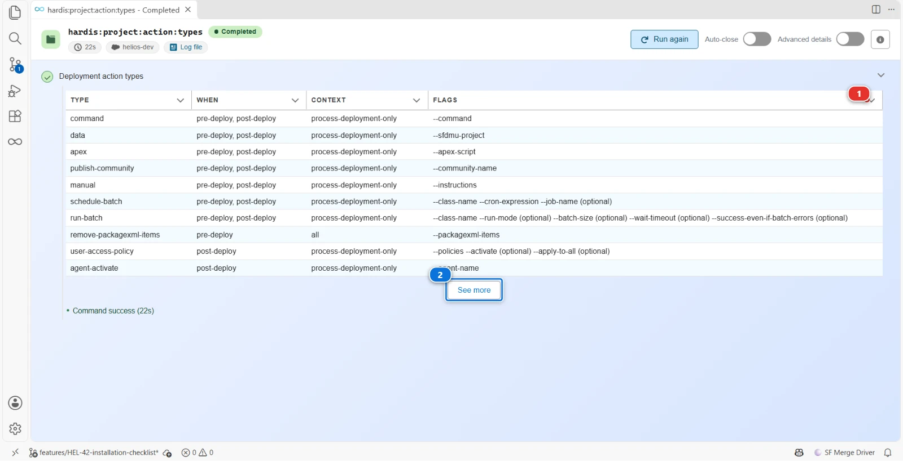
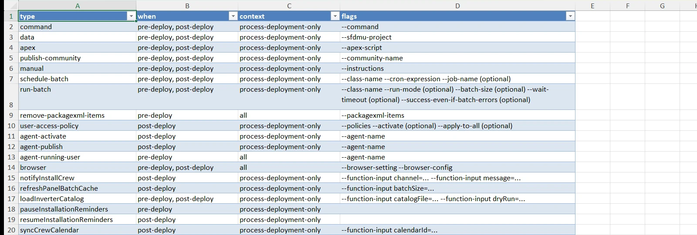

<!-- This file has been generated with command 'sf hardis:doc:plugin:generate'. Please do not update it manually or it may be overwritten -->
# hardis:project:action:types

## Description


## Command Behavior

**Describes the deployment action types: what each one takes, in which phase and context it runs, and its defaults.**

It is meant for AI agents and scripts that create deployment actions with `sf hardis:project:action:create --agent`: they read here which flags and parameters a type expects, instead of guessing them.

For each built-in type:

- `allowedWhen`: the phases it may run in (`pre-deploy`, `post-deploy`)
- `defaultContext`: the context a new action gets, and `deploymentOnly` when it only runs in deployment jobs
- `runOnlyOnceByOrgDefault`: whether it runs once per org by default
- `parameters`: each field of the action, where it is stored, the flag of `action:create` that sets it, its type, whether it is required and its default

The custom functions declared in the project (`customFunctions`) are listed too, with their inputs.

### Browser actions

A `browser` action applies one setting of [Browserforce](https://github.com/amtrack/sfdx-browserforce-plugin) (sfdx-browserforce-plugin), installed when missing. With `--type browser`, the result lists the settings Browserforce can apply, each with its documentation page (`docUrl`, given by Browserforce 7.1.0 and later). With `--type browser --browser-setting <key>`, it describes that setting: its fields, its JSON Schema, examples, warnings and documentation page, which is what `--browser-config` of `action:create` must follow.

Both also describe the names of the CI/CD variables a value can be read from, for each major branch (`secretsLookup`).

### Agent Mode

Supports non-interactive execution with `--agent`. The command never prompts: `--agent` is accepted so agents can pass it to every sfdx-hardis command.

```sh
sf hardis:project:action:types --json
sf hardis:project:action:types --type browser --json
sf hardis:project:action:types --type browser --browser-setting densitySettings --json
```

<details markdown="1">
<summary>Technical explanations</summary>

- Built from the provider class of each action type (`getParameterDescriptions()`, `getAllowedWhen()`, `getDefaultContext()`, `describeTypeDetails()`) and the registries of `actionTypes.ts`.
- The Browserforce catalog comes from `sf browserforce plugins list --json`, cached per Browserforce version in `~/.sfdx/sfdx-hardis-cache/browserforce` (shared with the VS Code extension).
- The variable names come from the secrets provider of the project (`secretsProvider`, CI/CD variables by default).
</details>


## Screenshots



_The deployment action types with their phases, default context and flags, the notifyCrew custom function of Helios included_

- **(1)** The flags of hardis:project:action:create for each type
- **(2)** Shows the other types and the custom functions of the project

## Reports

The command writes these reports in the `hardis-report` folder of the project: a CSV file, and its Excel copy (XLSX) in the `xls` sub-folder.

### Action types

One row per deployment action type or custom function, with when it can run, its default context and its flags.

Files: `deployment-action-types-*.csv`, `xls/deployment-action-types-*.xlsx`



## Parameters

| Name            |  Type   | Description                                                                             | Default | Required |          Options           |
|:----------------|:-------:|:----------------------------------------------------------------------------------------|:-------:|:--------:|:--------------------------:|
| agent           | boolean | Run in non-interactive mode for agents and automation                                   |         |          |                            |
| browser-setting | option  | With --type browser: describe this Browserforce setting (fields, JSON Schema, examples) |         |          |                            |
| debug<br/>-d    | boolean | Activate debug mode (more logs)                                                         |         |          |                            |
| flags-dir       | option  | Import flag values from a directory.                                                    |         |          |                            |
| json            | boolean | Format output as json.                                                                  |         |          |                            |
| type            | option  | Describe only this type: a built-in type or the id of a project custom function         |         |          |                            |
| websocket       | option  | Websocket host:port for VsCode SFDX Hardis UI integration                               |         |          |                            |
| when            | option  | Only the types that can run in this phase                                               |         |          | pre-deploy<br/>post-deploy |

## Examples

```shell
$ sf hardis:project:action:types
```

```shell
$ sf hardis:project:action:types --json
```

```shell
$ sf hardis:project:action:types --when pre-deploy --json
```

```shell
$ sf hardis:project:action:types --type browser --json
```

```shell
$ sf hardis:project:action:types --type browser --browser-setting densitySettings --json
```

```shell
$ sf hardis:project:action:types --agent
```


