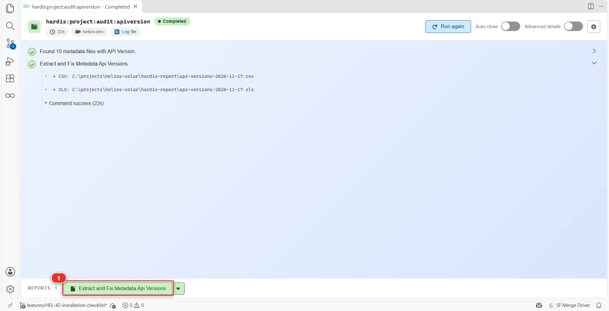
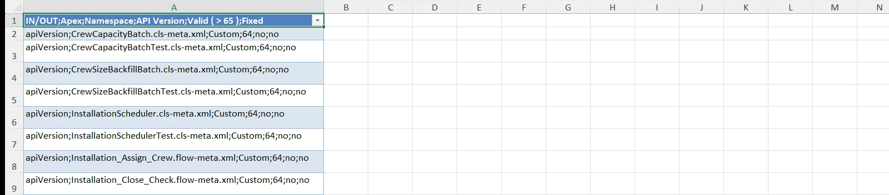

<!-- This file has been generated with command 'sf hardis:doc:plugin:generate'. Please do not update it manually or it may be overwritten -->
# hardis:project:audit:apiversion

## Description

This command identifies metadata with an apiVersion lower than the value specified in the --minimumapiversion parameter.

  It can also update the apiVersion to a specific value:
  - When --fix parameter is provided (updates to minimumapiversion)
  - When --newapiversion is specified (updates to that version)

  Example to handle [ApexClass / Trigger & ApexPage mandatory version upgrade](https://help.salesforce.com/s/articleView?id=sf.admin_locales_update_api.htm&type=5) :
   
   `sf hardis:project:audit:apiversion --metadatatype ApexClass,ApexTrigger,ApexPage --minimumapiversion 45 --newapiversion 50`

### Agent Mode

Supports non-interactive execution with `--agent`:

```sh
sf hardis:project:audit:apiversion --agent
```

In agent mode, all interactive prompts are skipped and default values are used.
  

## Screenshots



_The API version of the Apex and Visualforce files of the Helios project, checked against a minimum of 65, in a CSV report_

- **(1)** The report of the run: the button opens it in Excel, the arrow lists its other files

## Reports

The command writes these reports in the `hardis-report` folder of the project: a CSV file, and its Excel copy (XLSX) in the `xls` sub-folder.

### API versions

One row per metadata file audited, with its API version and whether it is below the minimum version, to find what to upgrade.

Files: `api-versions-*.csv`, `xls/api-versions-*.xlsx`



## Parameters

| Name                     |  Type   | Description                                                                                                          | Default | Required | Options |
|:-------------------------|:-------:|:---------------------------------------------------------------------------------------------------------------------|:-------:|:--------:|:-------:|
| agent                    | boolean | Run in non-interactive mode for agents and automation                                                                |         |          |         |
| debug<br/>-d             | boolean | Activate debug mode (more logs)                                                                                      |         |          |         |
| failiferror<br/>-f       | boolean | Fails (exit code 1) if an error is found                                                                             |         |          |         |
| fix                      | boolean | Automatically update API versions in files that are below the minimum version threshold to match the minimum version |         |          |         |
| flags-dir                | option  | Import flag values from a directory.                                                                                 |         |          |         |
| json                     | boolean | Format output as json.                                                                                               |         |          |         |
| metadatatype             | option  | Metadata Types to fix. Comma separated. Supported Metadata types: ApexClass, ApexTrigger, ApexPage                   |         |          |         |
| minimumapiversion<br/>-m | option  | Minimum allowed API version                                                                                          |   20    |          |         |
| newapiversion<br/>-n     | option  | Define an API version value to apply when updating files                                                             |         |          |         |
| skipauth                 | boolean | Skip authentication check when a default username is required                                                        |         |          |         |
| websocket                | option  | Websocket host:port for VsCode SFDX Hardis UI integration                                                            |         |          |         |

## Examples

```shell
$ sf hardis:project:audit:apiversion
```

```shell
$ sf hardis:project:audit:apiversion --agent
```

```shell
$ sf hardis:project:audit:apiversion --metadatatype ApexClass,ApexTrigger,ApexPage --minimumapiversion 45
```

```shell
$ sf hardis:project:audit:apiversion --metadatatype ApexClass,ApexTrigger,ApexPage --minimumapiversion 45 --fix
```

```shell
$ sf hardis:project:audit:apiversion --metadatatype ApexClass,ApexTrigger,ApexPage --minimumapiversion 45 --newapiversion 50
```


