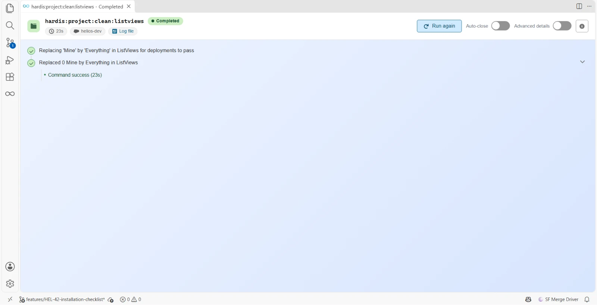

<!-- This file has been generated with command 'sf hardis:doc:plugin:generate'. Please do not update it manually or it may be overwritten -->
# hardis:project:clean:listviews

## Description

Replace Mine by Everything in ListView, and log the replacements in sfdx-hardis.yml

### Agent Mode

Supports non-interactive execution with `--agent`:

```sh
sf hardis:project:clean:listviews --agent
```

In agent mode, all interactive prompts are skipped and default values are used.


## Screenshots



_A list view of the Helios sources switched from scope Mine to Everything, so that its deployment passes_

## Parameters

| Name          |  Type   | Description                                                   |  Default  | Required | Options |
|:--------------|:-------:|:--------------------------------------------------------------|:---------:|:--------:|:-------:|
| agent         | boolean | Run in non-interactive mode for agents and automation         |           |          |         |
| debug<br/>-d  | boolean | Activate debug mode (more logs)                               |           |          |         |
| flags-dir     | option  | Import flag values from a directory.                          |           |          |         |
| folder<br/>-f | option  | Root folder                                                   | force-app |          |         |
| json          | boolean | Format output as json.                                        |           |          |         |
| skipauth      | boolean | Skip authentication check when a default username is required |           |          |         |
| websocket     | option  | Websocket host:port for VsCode SFDX Hardis UI integration     |           |          |         |

## Examples

```shell
$ sf hardis:project:clean:listviews
```

```shell
$ sf hardis:project:clean:listviews --agent
```


