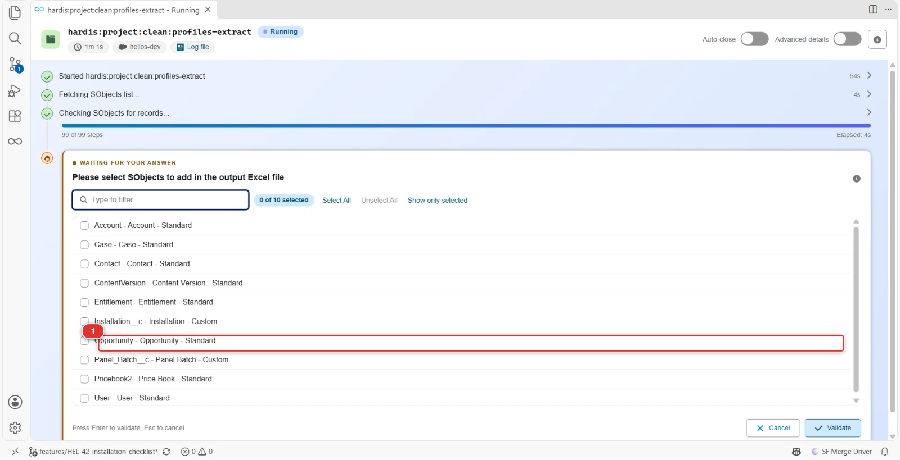
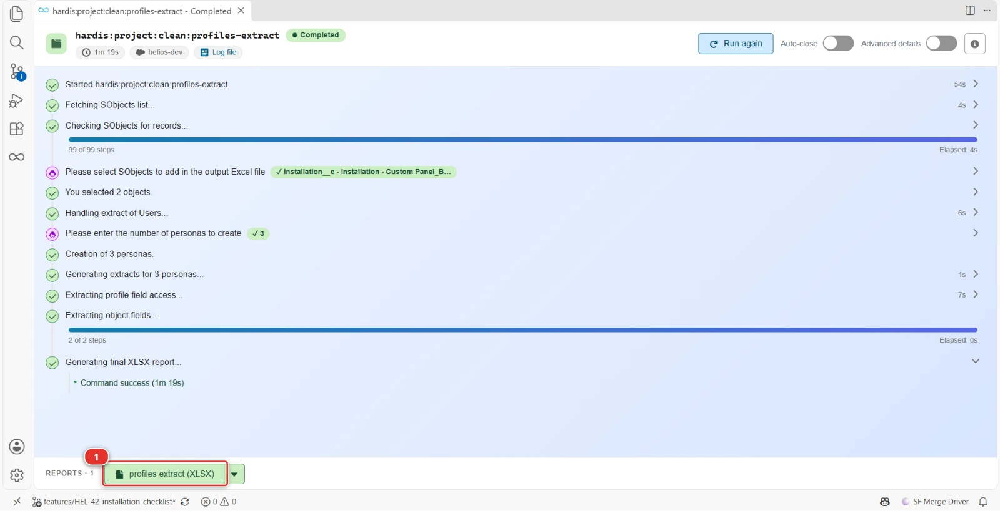
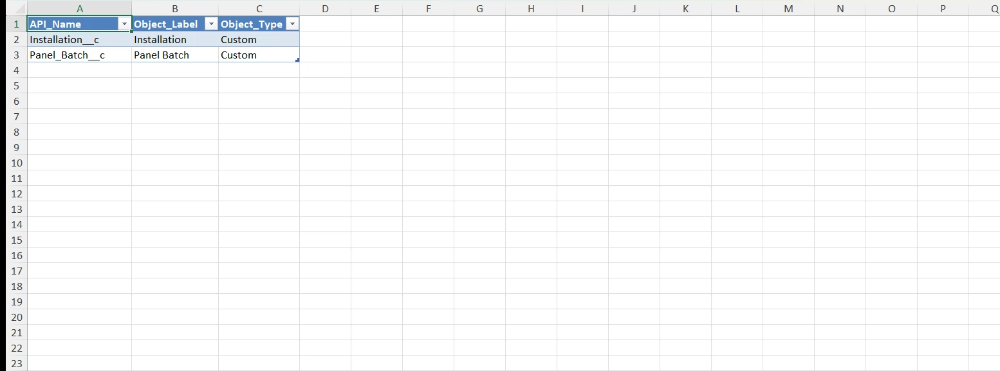

<!-- This file has been generated with command 'sf hardis:doc:plugin:generate'. Please do not update it manually or it may be overwritten -->
# hardis:project:clean:profiles-extract

## Description


## Command Behavior

**Guides administrators through extracting Salesforce profiles, personas, and related metadata into structured CSV/XLSX deliverables.**

The command inventories SObjects that contain data, lets the user pick the ones to document, and then produces persona-centric spreadsheets that cover users, personas, relationships, record types, apps, permissions, tabs, fields, and permission sets. The output consolidates everything into both CSV files and a single Excel workbook, making it easy to audit access models or prepare remediation plans.

Key capabilities:

- **Interactive object discovery:** Lists queryable objects with records and allows multi-selection.
- **Persona modeling:** Lets users define the number of personas and generates cross-object matrices that leverage Excel formulas for faster updates.
- **Comprehensive metadata export:** Captures users, record types, apps, permissions, tabs, fields, and permission sets with persona/profile visibility indicators.
- **Profile field access coverage:** Retrieves FieldPermissions to surface read/edit status per profile and field.
- **Consolidated reporting:** Produces standalone CSVs plus an aggregated XLSX stored in the report directory.

### Agent Mode

Supports non-interactive execution with `--agent`:

```sh
sf hardis:project:clean:profiles-extract --agent --target-org myorg@example.com
```

In agent mode:

- The interactive object selection prompt is skipped; all queryable objects with records are used.
- The persona count prompt is skipped; defaults to 1 persona.

<details markdown="1">
<summary>Technical explanations</summary>

- **Salesforce connectivity:** Uses the requested target org connection from `Flags.requiredOrg` to fetch metadata and records.
- **Bulk/REST queries:** Relies on `bulkQuery` and standard SOQL to evaluate record counts and pull FieldPermissions, Users, RecordTypes, Applications, Tabs, and PermissionSets.
- **Describe calls:** Invokes `describeGlobal` and `describeSObject` to enumerate objects and field-level metadata, including picklists and formulas.
- **Prompt-driven input:** Utilizes the shared `prompts` utility to collect object selections and persona counts, ensuring consistent CLI UX.
- **Reporting pipeline:** Writes intermediate CSV files via `generateCsvFile`, stores them under the report directory from `getReportDirectory`, and finally merges them using `createXlsxFromCsvFiles`.
- **Logging & diagnostics:** Uses `uxLog` with chalk coloring for progress, warnings, and debug output, integrating with the project-wide logging style.

</details>


## Screenshots



_Pick the objects to document_

- **(1)** A custom object of the Helios project



_An Excel workbook to define the access of 3 personas to Installation__c and Panel_Batch__c, built from the org_

- **(1)** The report of the run: the button opens it in Excel, the arrow lists its other files

## Reports

The command writes these reports in the `hardis-report` folder of the project: a CSV file, and its Excel copy (XLSX) in the `xls` sub-folder.

### Profiles extract

One workbook with a sheet per extract (objects, fields, field access, record types, applications, permissions, tabs, permission sets, personas), one row per element, to define the access of each persona.

Files: `profiles-extract-*.csv`, `xls/profiles-extract-*.xlsx`



## Parameters

| Name              |  Type   | Description                                                   | Default | Required | Options |
|:------------------|:-------:|:--------------------------------------------------------------|:-------:|:--------:|:-------:|
| agent             | boolean | Run in non-interactive mode for agents and automation         |         |          |         |
| debug<br/>-d      | boolean | Activate debug mode (more logs)                               |         |          |         |
| flags-dir         | option  | Import flag values from a directory.                          |         |          |         |
| json              | boolean | Format output as json.                                        |         |          |         |
| skipauth          | boolean | Skip authentication check when a default username is required |         |          |         |
| target-org<br/>-o | option  | The target Salesforce org to fetch SObjects from.             |         |   true   |         |
| websocket         | option  | Websocket host:port for VsCode SFDX Hardis UI integration     |         |          |         |

## Examples

```shell
$ sf hardis:project:clean:profiles-extract
```

```shell
$ sf hardis:project:clean:profiles-extract --target-org my-org
```

```shell
$ sf hardis:project:clean:profiles-extract --agent --target-org my-org
```


