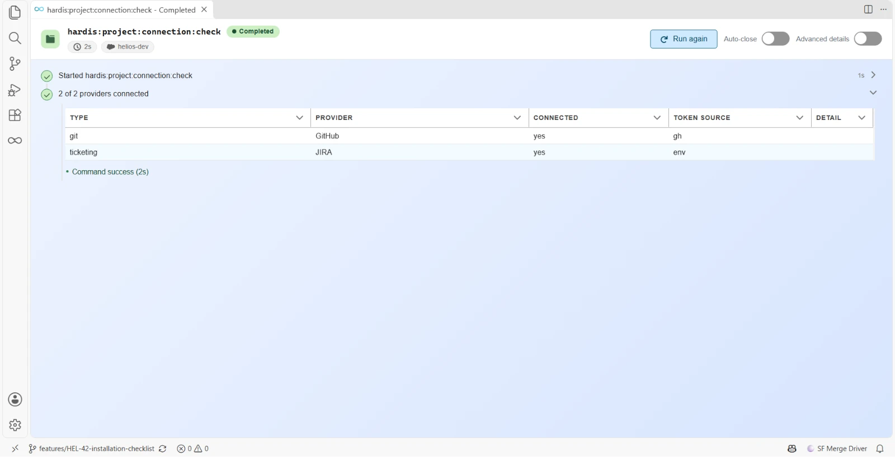

<!-- This file has been generated with command 'sf hardis:doc:plugin:generate'. Please do not update it manually or it may be overwritten -->
# hardis:project:connection:check

## Description


## Command Behavior

**Says whether the git provider of the current repository and the ticketing systems of the project accept the credentials sfdx-hardis has for them, so a coding agent knows before a run whether Pull Requests and tickets will work.**

- Returns `connected: true` or `false` for each provider, and for all of them together.
- When a provider is not connected, `detail` says what to do: the variables to set, the CLI to log in with, or why the provider refused the token.
- The answer comes from the provider itself: the git provider is asked to read the current repository, a ticketing system who the credentials authenticate as. The generic ticketing connector has no API: it is connected as soon as it is configured.
- `tokenSource` says where the token comes from: `env` (a variable of the environment or of the `.env` file), or the CLI it was read from. No token value is ever displayed or returned.
- The command exits with 0 whatever the answer: read `connected` in the JSON output.

### Tokens of the provider CLIs

On a workstation, in agent mode (`--agent`) or with `SFDX_HARDIS_PROVIDER_CLI_AUTH=true`, sfdx-hardis completes the token variables with the CLI of the git provider the developer is already logged in with:

| Provider                      | CLI  | Login command     |
|-------------------------------|------|-------------------|
| GitHub                        | gh   | `gh auth login`   |
| GitLab                        | glab | `glab auth login` |
| Azure DevOps and Azure Boards | az   | `az login`        |

The variables of the environment come first, then the `.env` file, then the CLI: the token of the CLI is used when no variable holds one, or when the provider refuses the one that is set. It is kept for the running process only, never written anywhere. Never in CI. Bitbucket, JIRA, ServiceNow and Aha! have no CLI to read a token from.

| Variable                           | Effect                                                                                                                       |
|------------------------------------|------------------------------------------------------------------------------------------------------------------------------|
| `SFDX_HARDIS_PROVIDER_CLI_AUTH`    | `true`: the CLI tokens are used without `--agent`. `false`: never used, even with `--agent`                                  |
| `SFDX_HARDIS_PROVIDER_TOKEN_CHECK` | `false`: the token of a variable is used without the call that checks it, the CLI is then only asked when no variable is set |

<details markdown="1">
<summary>Technical explanations</summary>

- **GitHub:** `gh auth token --hostname <host>`, the host of the git remote. The check reads `GET /repos/{owner}/{repo}`.
- **GitLab:** `glab auth status --hostname <host> --show-token`: glab has no command that prints the token alone, the `Token found` line is read in memory. The check reads the project.
- **Azure DevOps and Azure Boards:** `az account get-access-token --resource 499b84ac-1321-427f-aa17-267ca6975798`, a Microsoft Entra ID token valid about one hour, sent as a Bearer token. The check reads the repository. When Azure DevOps refuses it, the tenant of the organization is read from the `X-VSS-ResourceTenant` header of an anonymous request: an organization of Microsoft accounts (tenant all zeros) accepts no Microsoft Entra ID token, only a Personal Access Token.
- **Bitbucket:** the check reads the repository.
- **JIRA, Azure Boards, ServiceNow, Aha!:** the same call as [hardis:ticket:whoami](https://sfdx-hardis.cloudity.com/hardis/ticket/whoami/).
- The CLIs run without a shell (except `az.cmd` on Windows, with checked arguments), without prompting, and never from the current folder. The variables a CLI reads its own token from (`GH_TOKEN`, `GITLAB_TOKEN`...) are removed for that call, so it answers with the token it stores and not the refused one.
- A token read from a CLI is registered as a secret before anything can display it: it is replaced with `***` in every log, report and command output.
- A 401, 403 or 404 answer to the check means the token is refused or cannot see the repository: the CLI is then tried. A network error keeps the token.

</details>

### Agent Mode

The command never prompts:

```sh
sf hardis:project:connection:check --agent --json
sf hardis:project:connection:check --type git --agent --json
```


## Screenshots



_The git provider reached with the token of gh, and the Jira account of the project_

## Parameters

| Name         |  Type   | Description                                                   | Default | Required |      Options      |
|:-------------|:-------:|:--------------------------------------------------------------|:-------:|:--------:|:-----------------:|
| agent        | boolean | Run in non-interactive mode for agents and automation         |         |          |                   |
| debug<br/>-d | boolean | Activate debug mode (more logs)                               |         |          |                   |
| flags-dir    | option  | Import flag values from a directory.                          |         |          |                   |
| json         | boolean | Format output as json.                                        |         |          |                   |
| skipauth     | boolean | Skip authentication check when a default username is required |         |          |                   |
| type<br/>-t  | option  | Providers to check: git, ticketing, or both (default)         |         |          | git<br/>ticketing |
| websocket    | option  | Websocket host:port for VsCode SFDX Hardis UI integration     |         |          |                   |

## Examples

```shell
$ sf hardis:project:connection:check
```

```shell
$ sf hardis:project:connection:check --agent
```

```shell
$ sf hardis:project:connection:check --type git --agent --json
```

```shell
$ sf hardis:project:connection:check --type ticketing --agent --json
```


