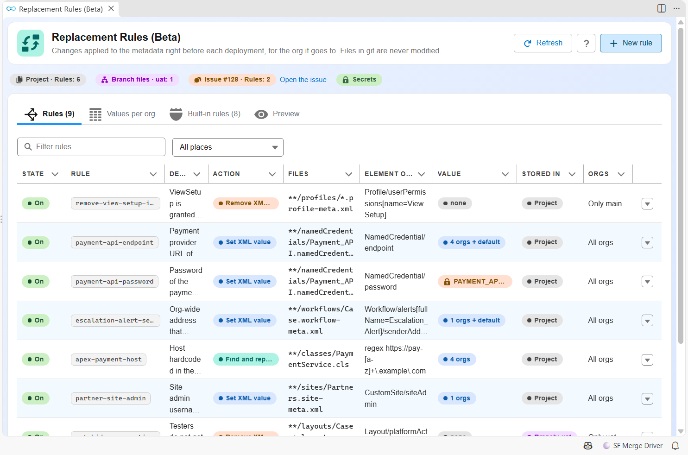
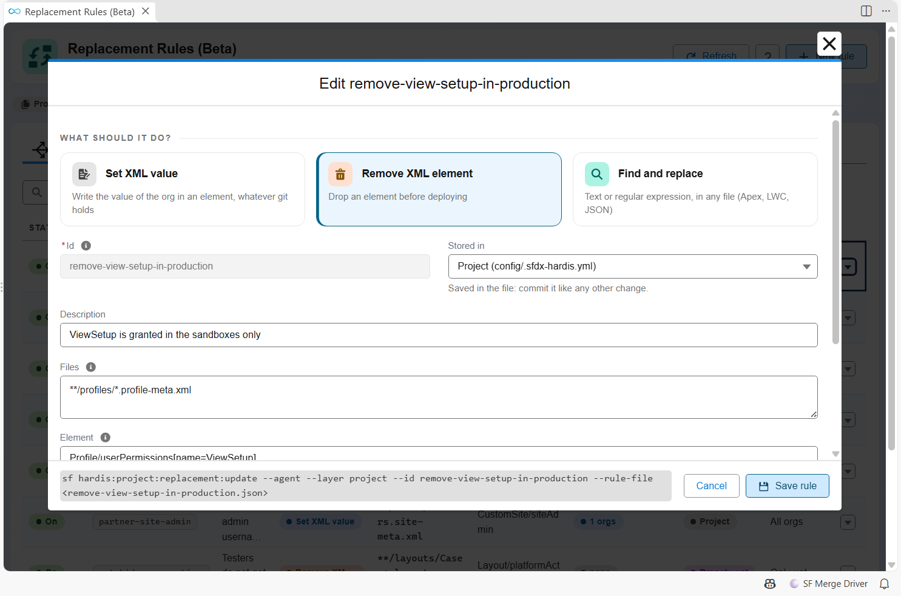
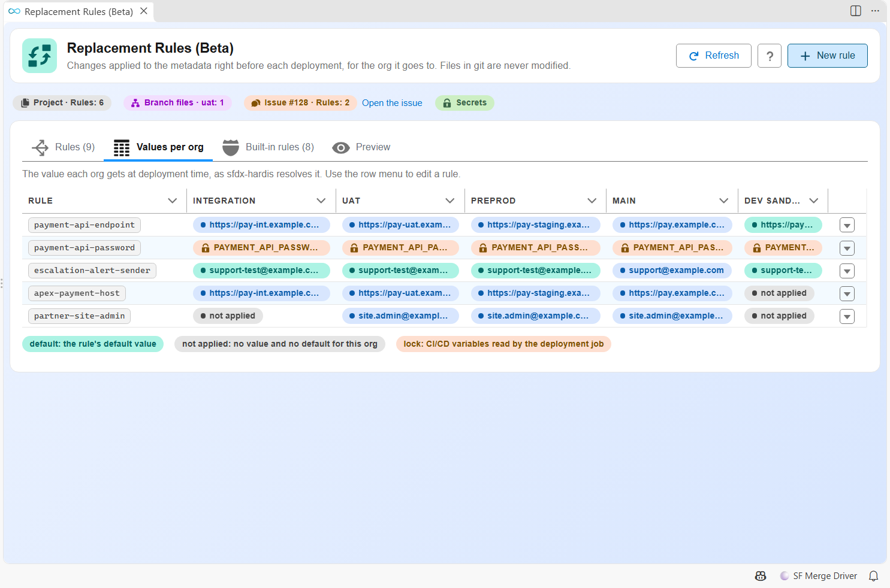
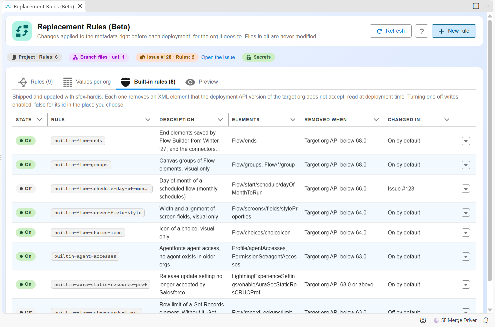
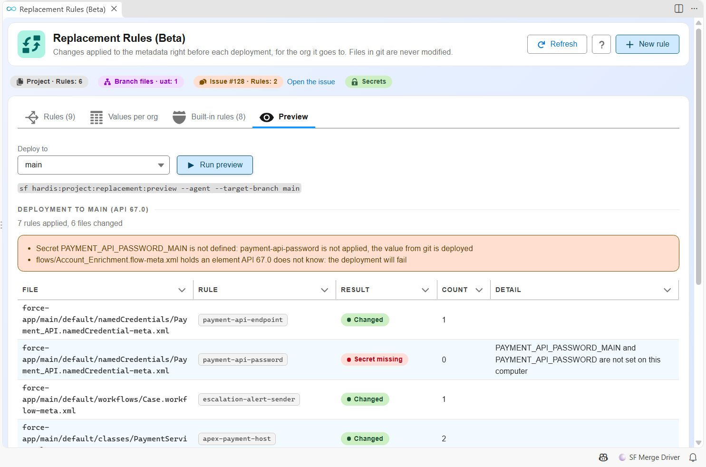

<!-- markdownlint-disable MD013 MD033 -->

## Replacement rules (Beta)

> **This feature is in Beta.** Its behavior may still change from feedback. Please report any issue or feedback on the [sfdx-hardis GitHub repository](https://github.com/hardisgroupcom/sfdx-hardis/issues).

- [What are replacement rules?](#what-are-replacement-rules)
- [Rule types](#rule-types)
- [Values per org](#values-per-org)
- [Secrets](#secrets)
- [Where rules are stored](#where-rules-are-stored)
- [Fix a deployment without a commit: the issue](#fix-a-deployment-without-a-commit-the-issue)
- [Built-in rules](#built-in-rules)
- [Commands and VS Code panel](#commands-and-vs-code-panel)
- [Pull Request comments](#pull-request-comments)
- [Turn every rule off](#turn-every-rule-off)
- [Good to know](#good-to-know)

---

### What are replacement rules?

Some metadata must not be the same in every org: the endpoint of a Named Credential, the sender address of an email alert, the admin of an Experience Cloud site, a password. Other metadata comes from a sandbox already on the next Salesforce release and holds XML elements production does not know yet, so the deployment fails.

Replacement rules change the metadata files **right before each deployment, for the org the deployment goes to**, then put the files back. Git keeps one version of each file.

They apply to:

- [hardis:project:deploy:smart](hardis/project/deploy/smart.md): deployment checks of Pull Requests, deployments to major orgs, quick deploys.
- Scratch org deployments with a manifest (`CI_SCRATCH_MODE=deploy`), and org initialization of pool orgs.
- [Backpromote](salesforce-devops-backpromote.md) deployments to developer sandboxes.

Only the files that are deployed are changed (the components of the package.xml, so a delta deployment stays a delta deployment).

Your own rules only exist once you write them. [Built-in rules](#built-in-rules) are on by default, without any configuration. If they cause trouble, [turn every rule off](#turn-every-rule-off) with one setting.

Rules are configured from the **Replacement Rules** panel of VS Code (settings menu of the DevOps Pipeline), or with [commands](#commands-and-vs-code-panel).



---

### Rule types

| Type         | What it does                                                                     | Example                                                    |
|--------------|----------------------------------------------------------------------------------|------------------------------------------------------------|
| `xml-value`  | Writes the value of the target org in an XML element, whatever git holds         | `NamedCredential/endpoint`                                 |
| `xml-remove` | Removes an XML element before deploying                                          | `Profile/userPermissions[name=ViewSetup]`                  |
| `text`       | Finds and replaces a text or a regular expression, in any file (Apex, LWC, JSON) | `https://pay-[a-z]+\.example\.com` in `PaymentService.cls` |

`xmlPath` is a path of elements from the root, without namespace:

| Path                                                       | Matches                                             |
|------------------------------------------------------------|-----------------------------------------------------|
| `NamedCredential/endpoint`                                 | The `endpoint` element under the root               |
| `Profile/userPermissions[name=ViewSetup]`                  | The whole `userPermissions` block of one permission |
| `Profile/fieldPermissions[field=Account.Secret__c]`        | The access to one field                             |
| `//dayOfMonthToRun`                                        | `dayOfMonthToRun` at any depth                      |
| `Flow/screens//fields/styleProperties`                     | `styleProperties` of screen fields, at any depth    |
| `Workflow/alerts[fullName=Escalation_Alert]/senderAddress` | The sender of one email alert                       |
| `Layout/excludeButtons[.=SmartFillEnrich]`                 | The `excludeButtons` element holding this value     |

For example, to remove one user permission from every Profile deployed to production:

```yaml
replacementRules:
  - id: remove-view-setup-in-production
    description: ViewSetup is granted in the sandboxes only
    type: xml-remove
    files: "**/profiles/*.profile-meta.xml"
    xmlPath: Profile/userPermissions[name=ViewSetup]
    includeTargetBranches: [main]
```

In the VS Code panel, **New rule** opens the editor. The help of the **Element** field lists the common paths.



The same rule works for Permission Sets with `files: "**/permissionsets/*.permissionset-meta.xml"` and `xmlPath: PermissionSet/userPermissions[name=ViewSetup]`.

An `xml-value` rule never creates a missing element: it reports "not found". A `text` rule replaces every occurrence, and its replacement is literal (no `$1`), so a value containing `$` is safe.

---

### Values per org

```yaml
replacementRules:
  - id: payment-api-endpoint
    description: Payment provider URL of each environment
    type: xml-value
    files: "**/namedCredentials/Payment_API.namedCredential-meta.xml"
    xmlPath: NamedCredential/endpoint
    values:
      integration: https://pay-int.example.com
      uat: https://pay-uat.example.com
      preprod: https://pay-staging.example.com
      main: https://pay.example.com
      default: https://pay-sandbox.example.com
    required: true
```

- `value`: the same value for every org.
- `values`: one value per target branch. `default` applies to developer sandboxes, scratch orgs, and the branches without their own value. An org with no value and no default keeps the file of git.
- `includeTargetBranches` / `excludeTargetBranches`: limit the rule to some target branches, like [deployment actions](salesforce-devops-deployment-actions.md) (`dev-sandboxes` means any org that is not a major branch).
- `required: true`: warns in the Pull Request comment when the files of the rule are deployed but nothing matched.

The target branch is the target of the Pull Request in a deployment check, and the branch being deployed in a deployment job.

The **Values per org** tab of the panel shows the value each org gets, and the CI/CD variables a secret is read from:



---

### Secrets

```yaml
  - id: payment-api-password
    type: xml-value
    files: "**/namedCredentials/Payment_API.namedCredential-meta.xml"
    xmlPath: NamedCredential/password
    secret: PAYMENT_API_PASSWORD
```

`secret` is the **name** of a CI/CD variable, never a value. When deploying to `uat`, sfdx-hardis reads `PAYMENT_API_PASSWORD_UAT` first, then `PAYMENT_API_PASSWORD`: the same convention as `SFDX_CLIENT_ID_<BRANCH>`.

Secret values never appear anywhere:

- They are registered with the masking of the CI (`::add-mask::` on GitHub Actions, `task.setsecret` on Azure Pipelines), and replaced by `***` in every log line, command output, Pull Request comment and notification of sfdx-hardis.
- On GitLab, Bitbucket and Jenkins, **declare the variable as masked (or secured)** in the CI settings, so the CI masks it too.
- `preview` and `list --json` only show variable names.

When a secret is missing, the rule is skipped, the file of git is deployed, and the Pull Request comment shows a warning with the variable names that were looked up.

On GitHub Actions, a workflow only sees the secrets it passes to its jobs: add your variables to the `env` of the deployment check and deployment workflows.

```yaml
      env:
        PAYMENT_API_PASSWORD_UAT: ${{ secrets.PAYMENT_API_PASSWORD_UAT }}
        PAYMENT_API_PASSWORD_MAIN: ${{ secrets.PAYMENT_API_PASSWORD_MAIN }}
```

`secretsProvider: ciVariables` (the default) is the only provider today. Vaults (HashiCorp Vault, Azure Key Vault, AWS Secrets Manager) will be other values of this property.

---

### Where rules are stored

Rules merge by `id`, each place changing the ones before it:

1. **Built-in rules** shipped with sfdx-hardis.
2. **Project**: `config/.sfdx-hardis.yml`.
3. **Branch**: `config/branches/.sfdx-hardis.<branch>.yml` of the target branch only.
4. **Issue**: the "sfdx-hardis Replacement Rules" issue of the git provider.

A rule with the same `id` in a later place changes only the fields it sets, and `values` are merged org by org. Setting another value source replaces the previous one: `values` over a single `value` keeps that value as the `default`. For example, this branch file changes the uat value of the project rule:

```yaml
replacementRules:
  - id: payment-api-endpoint
    values:
      uat: https://pay-uat2.example.com
```

and `enabled: false` turns a rule off.

---

### Fix a deployment without a commit: the issue

The issue holds rules in a YAML block of its body. Editing it changes the rules of the whole project at the next deployment job, without any commit or merge: useful to fix a Pull Request between major branches that fails because of a value.

- GitHub and GitLab: an issue. Azure DevOps: a work item. Bitbucket: a dedicated Pull Request that is never merged.
- Edit the YAML block in the web UI, from the VS Code panel, or with `sf hardis:project:replacement:update --layer issue`. On Azure DevOps, prefer the panel or the command: the rich text editor can damage YAML.
- Once the fix is in the repository, delete the rule from the issue.
- A quick deploy reuses the package of the deployment check: after changing the issue, run the check of an open Pull Request again.
- The issue is only read when its author has write access to the repository (GitHub owner, member or collaborator, GitLab Developer or more; Azure DevOps work items and Bitbucket Pull Requests already need it). An issue with this title opened by someone else is ignored, with a warning in the Pull Request comment: close it and create the rules again from VS Code or with the command.
- A rule of the issue cannot use `secret`: secrets only come from the configuration files of the repository, which are reviewed in Pull Requests.
- Anyone who can edit the issue can still change values and removals that reach production. Rules coming from the issue are marked in the job log and the Pull Request comment.

---

### Built-in rules

Some deployments fail on what the target org does not accept, not on your metadata: sources retrieved from a sandbox on the next Salesforce release hold XML elements production does not know yet (`Element {http://soap.sforce.com/2006/04/metadata}dayOfMonthToRun invalid at this location`), and a Profile can grant a user permission the target org does not have (`Unknown user permission`). Built-in rules remove them before deploying:

- **XML elements** the deployment API version of the target org does not know yet, or does not accept anymore, like the Flow `ends` saved from Winter '27 when production is still on Summer '26.
- **User permissions** of Profiles and Permission Sets the target org does not have: sfdx-hardis reads the permissions of the org itself, so a permission of a cloud or a license the org lacks is removed too.
- Elements whose removal would change what a component does (without `limit`, a Get Records element returns every record) are **off by default**: the Pull Request comment warns that the deployment will fail and names the rule to turn on.

The full list, with the API version of each rule and every user permission, is on its own page: [Built-in replacement rules](salesforce-devops-config-replacement-rules-builtin.md).



Turn a built-in rule on or off with `enabled`, in any place:

```yaml
replacementRules:
  - id: builtin-flow-get-records-limit
    enabled: true
  - id: builtin-flow-ends
    enabled: false
```

---

### Commands and VS Code panel

Every action exists as a command, and every command runs without prompt with `--agent`:

| Command                                                                     | Purpose                                                            |
|-----------------------------------------------------------------------------|--------------------------------------------------------------------|
| [hardis:project:replacement:list](hardis/project/replacement/list.md)       | Rules of every place, effective rules of every org, built-in rules |
| [hardis:project:replacement:create](hardis/project/replacement/create.md)   | Add a rule to a place                                              |
| [hardis:project:replacement:update](hardis/project/replacement/update.md)   | Change a rule, or turn a rule on or off                            |
| [hardis:project:replacement:delete](hardis/project/replacement/delete.md)   | Remove a rule from a place                                         |
| [hardis:project:replacement:preview](hardis/project/replacement/preview.md) | What the rules would change for a target org, without writing      |

```sh
sf hardis:project:replacement:preview --target-branch main --api-version 67.0
```

In VS Code, the **Replacement Rules** panel (DevOps Pipeline settings menu) shows the rules, a grid of values per org, the built-in rules and the preview. It runs these commands: the files it writes are the same as the ones written from the terminal.

The **Preview** tab runs `hardis:project:replacement:preview` for the org you pick, and lists what each rule would change in your local files:



---

### Pull Request comments

The deployment check and deployment comments have a **Replacement rules** section: the rules applied, where they come from, the number of files they changed, and the warnings (missing secret, required rule without match, invalid rule, unreadable issue, element that will make the deployment fail). It is open when there are warnings. Values are never shown.

---

### Turn every rule off

To stop all replacement rules at once, built-in ones included, for example while you investigate a deployment that behaves differently than expected:

- In `config/.sfdx-hardis.yml`, for every org of the project:

  ```yaml
  skipReplacementRules: true
  ```

- In the branch config file of one major org (`config/branches/.sfdx-hardis.uat.yml`), for that org only. `skipReplacementRules: false` there runs the rules for that org even when the project file skips them.
- With the CI/CD variable `SFDX_HARDIS_SKIP_REPLACEMENT_RULES=true`, without a commit. It wins over the config files.

The files are then deployed exactly as git holds them, and the Pull Request comments say the rules were skipped. To turn off only one rule, set `enabled: false` on its id instead (see [Built-in rules](#built-in-rules)).

---

### Good to know

- Files are changed in place during the deployment and always put back, also when the deployment fails or the job is interrupted. A run killed before restoring them (power loss) is repaired by the next run in the same folder.
- A plain scratch org push (source tracking, without manifest) does not apply the rules: tracking would record the changed files, and the restored files would then look modified at every push.
- Native `replacements` of `sfdx-project.json` keep working: sf CLI applies them when building the deployment.
