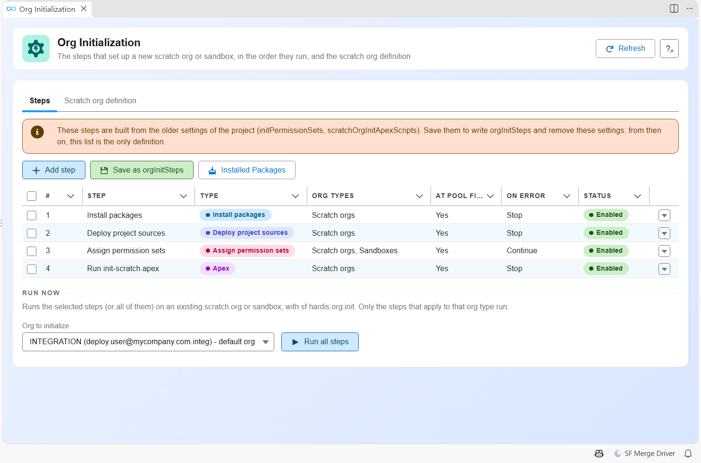

<!-- markdownlint-disable MD013 -->

## Initialize scratch orgs and sandboxes (optional)

A new scratch org or developer sandbox is empty: it needs the project packages, the sources, the permission sets of the team, a few Apex scripts and some test data before anyone can work in it. sfdx-hardis runs these **org initialization steps** for you, in the order your project defines.

This step is optional: without any configuration, a new scratch org still gets the project packages and sources.

- [When the steps run](#when-the-steps-run)
- [Edit the steps from VS Code](#edit-the-steps-from-vs-code)
- [Step types](#step-types)
- [The scratch org definition](#the-scratch-org-definition)
- [Configuration reference](#configuration-reference)
- [Projects configured before orgInitSteps](#projects-configured-before-orginitsteps)

### When the steps run

| Situation                                                                     | Steps that run                                                                                                       |
|-------------------------------------------------------------------------------|----------------------------------------------------------------------------------------------------------------------|
| [hardis:scratch:create](hardis/scratch/create.md) creates a new scratch org   | Every enabled step that applies to scratch orgs                                                                      |
| The [scratch org pool](salesforce-devops-setup-scratch-org-pool.md) is filled | The steps with **Run when filling the pool** (all of them by default), so an org taken from the pool is ready to use |
| A scratch org is taken from the pool (New User Story, CI jobs)                | The steps without **Run when filling the pool**                                                                      |
| [hardis:org:create](hardis/org/create.md) creates a new sandbox               | Every enabled step that applies to sandboxes                                                                         |
| [hardis:org:init](hardis/org/init.md) on an existing org                      | The steps you pick, among the ones that apply to that org                                                            |

New User Story never initializes an existing sandbox. Its metadata comes from a [backpromote](salesforce-devops-backpromote.md), and **Run now** in the Org Initialization panel (or `sf hardis:org:init`) runs the other steps when you need them.

`hardis:org:init` refuses production orgs.

### Edit the steps from VS Code

Open **Org Initialization** from the sfdx-hardis commands of the VS Code extension.



- The **Steps** tab lists the steps in their run order. Move them up and down, switch them on or off, and open one to edit it.
- **Add step** creates a step of any [type](#step-types).
- **Run now** runs the selected steps on the org you pick, with `sf hardis:org:init`.
- The **Scratch org definition** tab edits `config/project-scratch-def.json` and the scratch org duration.

The panel writes `orgInitSteps` in `config/.sfdx-hardis.yml`.

### Step types

| Type                                               | What it does                                                                                                      | Org types        |
|----------------------------------------------------|-------------------------------------------------------------------------------------------------------------------|------------------|
| `install-packages`                                 | Installs the packages of `installedPackages` (on a scratch org, not the ones with `installOnScratchOrgs: false`)  | scratch, sandbox |
| `deploy-sources`                                   | Pushes the project sources (deploys them in CI when `CI_SCRATCH_MODE=deploy`)                                     | scratch only     |
| `assign-permission-sets`                           | Assigns permission sets or permission set groups to the org user                                                  | scratch, sandbox |
| `apex`                                             | Runs an anonymous Apex script                                                                                     | scratch, sandbox |
| `data`                                             | Imports an SFDMU workspace of `scripts/data`                                                                      | scratch, sandbox |
| `command`                                          | Runs a command line. sf commands without `--target-org` target the org being initialized                          | scratch, sandbox |
| `run-batch`, `schedule-batch`, `publish-community` | Same as the [deployment actions](salesforce-devops-work-on-user-story-deployment-actions.md) of the same type     | scratch, sandbox |
| A custom function                                  | A [custom function](salesforce-devops-work-on-user-story-custom-functions.md) declared without a deployment phase | scratch, sandbox |

`install-packages`, `deploy-sources` and `assign-permission-sets` only exist in org initialization steps: deployments already install packages and deploy sources, and a permission set assignment only reaches the user running it.

Each step also has:

- **Enabled**: a switched off step stays in the list and never runs.
- **Org types**: scratch orgs, sandboxes, or both.
- **Continue on error** (`allowFailure`): a failed step is reported as a warning and the next steps run. Without it, a failure stops the initialization.
- **Run when filling the pool** (`runAtPoolFill`, on by default).

While the steps run, `SF_TARGET_ORG`, `SFDX_HARDIS_ORG_USERNAME` and `SFDX_HARDIS_ORG_TYPE` (`scratch` or `sandbox`) point to the org, so your scripts know where they run.

### The scratch org definition

`config/project-scratch-def.json` defines the edition, the features and the settings of the scratch orgs. The panel shows a form for the main fields and a JSON editor for `settings`, and checks the file against the Salesforce CLI schema before saving it.

- **Language, country and release** are picked from lists read from your default Dev Hub (or your default org): its user languages and countries, and its API versions with their release names.
- **Features** are picked from the list Salesforce CLI knows, with a number field for the ones that take one (`MaxApexCodeSize`...). **Import from an org shape** creates an [org shape](https://developer.salesforce.com/docs/atlas.en-us.sfdx_dev.meta/sfdx_dev/sfdx_dev_shape_intro.htm) of an org and adds its features. Org Shape must be enabled in that org and in the Dev Hub.
- **Settings** can be imported from any connected org, production included: pick the settings types, the panel reads them with the Metadata API and merges them into the definition. Check them before saving, some values cannot be set on a scratch org.
- The **Documentation** buttons open the Salesforce pages that list the features and the settings.

The panel reads these values with [hardis:config:org-init](hardis/config/org-init.md) (`--org-values`, `--import-settings`, `--import-features-from-shape`).

[hardis:scratch:create](hardis/scratch/create.md) runs the same check before it asks the Dev Hub for an org, and lists every issue it finds.

### Configuration reference

```yaml
orgInitSteps:
  - id: install-packages
    label: Install packages
    type: install-packages
    orgTypes: [scratch]
  - id: deploy-sources
    label: Deploy project sources
    type: deploy-sources
    orgTypes: [scratch]
  - id: assign-permsets
    label: Assign permission sets
    type: assign-permission-sets
    parameters:
      permissionSets:
        - PS_Admin
        - PS_Sales
  - id: init-custom-settings
    label: Initialize custom settings
    type: apex
    parameters:
      apexScript: scripts/apex/init-custom-settings.apex
    allowFailure: true
  - id: load-accounts
    label: Load test accounts
    type: data
    parameters:
      sfdmuProject: ScratchInit
    runAtPoolFill: false
```

List the steps and their ids with `sf hardis:config:org-init --json`, and run some of them with `sf hardis:org:init --steps assign-permsets,load-accounts`.

### Projects configured before orgInitSteps

When `orgInitSteps` is not defined, sfdx-hardis builds the steps from the older properties, in the order they always ran:

1. `installedPackages` (scratch orgs)
2. The project sources (scratch orgs)
3. `initPermissionSets` (both, a failure does not stop the initialization)
4. `scratchOrgInitApexScripts` (scratch orgs) and `sandboxOrgInitApexScripts` (sandboxes)
5. `scripts/data/ScratchInit` (scratch orgs) and `scripts/data/SandboxInit` (sandboxes), when the folders exist
6. `dataPackages` entries with `importInSandboxOrgs: true` (both)

The Org Initialization panel shows that list. The first save writes `orgInitSteps` and removes `initPermissionSets`, `scratchOrgInitApexScripts` and `sandboxOrgInitApexScripts`. Once `orgInitSteps` exists, the older properties are ignored for org initialization.

All these steps now run when the scratch org pool is filled. Before, the pool only installed the packages and the rest ran when someone took the org.

The pool job pushes the sources from its own runner. When you take a scratch org from the pool, sfdx-hardis resets its source tracking (`sf project reset tracking`), so a pull only lists the changes made after you took it.
