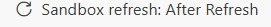

<!-- markdownlint-disable MD013 -->

## Initialize the SFDX project

- Clone locally the [repository that you created in the previous step](salesforce-devops-setup-git.md) (or reuse an existing SFDX project repository)

- Create a new git branch named **cicd** under your lowest major branch (usually **integration**)

- Run the command **Configuration ->**  (`sf hardis:project:create`) and select the options to create a new sfdx-hardis project

> Use the sfdx-hardis command to create the new project, not the default Salesforce one.

- Open the file **manifest/package.xml** and replace its content with the following code

```xml
<?xml version="1.0" encoding="UTF-8" standalone="yes"?>
<Package xmlns="http://soap.sforce.com/2006/04/metadata">
<version>65.0</version> <!-- use the current Salesforce API version -->
</Package>
```

- If you use GitLab CI and sandboxes only (no scratch orgs), open **gitlab-ci-config.yml** at the root of the repository and set the variable **USE_SCRATCH_ORGS** to `"false"`

- Depending on your Git provider, keep the related workflow files and delete the others

  - GitLab
    - `gitlab-ci.yml`
    - `gitlab-ci-config.yml`
  - Azure
    - `azure-pipelines-checks.yml`
    - `azure-pipelines-deployment.yml`
  - GitHub
    - Folder `.github/workflows`
  - Bitbucket
    - `bitbucket-pipelines.yml`

- During the CI/CD setup, find the variable **SFDX_DISABLE_FLOW_DIFF** in the pipeline of your Git provider and set its value to **true**, to avoid generating too many Pull Request comments during the setup. At the end of the setup, set the variable back to false.

> Some workflow files contain additional configuration instructions: read the comments at the beginning of the files.

## Cancelled pipelines

When a new commit is pushed on a Pull Request, the Git provider cancels the previous pipeline. Cancelling it does not stop its deployment simulation in the Salesforce org: Salesforce keeps it running, and the next simulations on the same org wait for it.

The GitLab, GitHub and Azure workflow files call [hardis:project:deploy:cancel](hardis/project/deploy/cancel.md) when a deployment simulation job is cancelled, so the simulation is cancelled in the org too. Only the simulation of the cancelled job is cancelled, never the one of another Pull Request, and never a real deployment.

Real deployments, after a merge, are not cancelled by the next merge: they run one after the other, so the pre-deployment and post-deployment actions of each merged Pull Request are run.

| Git provider | Cancellation hook                                 | Requirement                                        |
|--------------|---------------------------------------------------|----------------------------------------------------|
| GitLab       | `after_script` when `CI_JOB_STATUS` is `canceled` | GitLab 17.0 or later, GitLab Runner 16.11 or later |
| GitHub       | step with `if: cancelled()`                       | -                                                  |
| Azure        | step with `condition: canceled()`                 | -                                                  |

On GitLab, a new commit only cancels the previous pipeline while none of its non-interruptible jobs has started. To cancel its interruptible jobs in any case, uncomment the `workflow: auto_cancel: on_new_commit: interruptible` block at the beginning of `.gitlab-ci.yml` (GitLab 16.10 or later).

If your project was created with an older version of sfdx-hardis, copy these parts from the [latest workflow files](https://github.com/hardisgroupcom/sfdx-hardis/tree/main/defaults/ci) into yours.

You can now go to step [4. Configure CI authentication](salesforce-devops-setup-auth.md).
