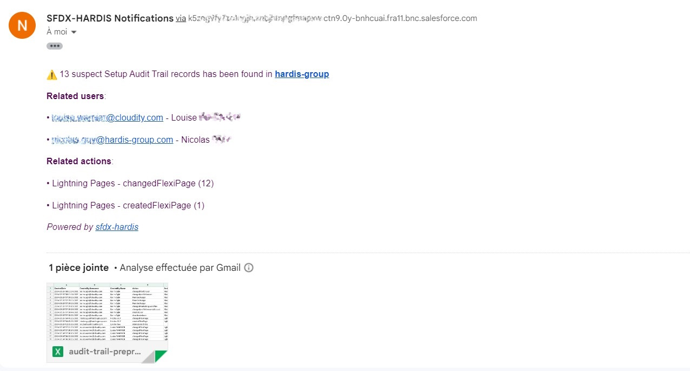
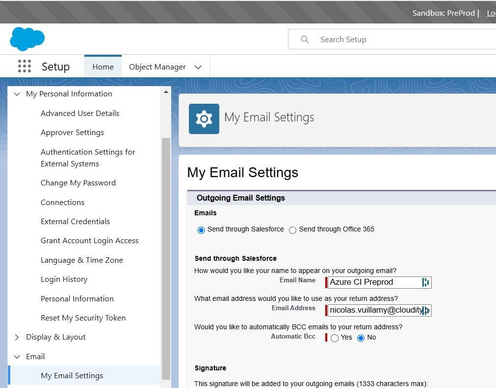

<!-- markdownlint-disable MD013 -->

## Email Integration

You can receive notifications at one or several email addresses when sfdx-hardis events happen:

- Deployment from a major branch to a major Salesforce org (e.g. integration git branch to Integration org)
- Salesforce [Org Monitoring](salesforce-monitoring-home.md)
  - Latest updates
  - Failing Apex tests
  - Monitoring checks notifications

Note: Salesforce email sending capabilities are used, so every email counts against the daily email limit of your org.



## Configuration

Define the CI/CD variable **NOTIF_EMAIL_ADDRESS** with the recipient address(es).

Examples:

- `NOTIF_EMAIL_ADDRESS=admin@cloudity.com`
- `NOTIF_EMAIL_ADDRESS=admin@cloudity.com,another.user@cloudity.com,nico@cloudity.com`

An address is not enough to receive every notification: each notification type is sent by email from a severity of its own, and many monitoring checks are **Disabled** or **Error** by default for the email channel, so an org with nothing wrong sends no email. Change it per check in the **Email** column of the Monitoring Config Workbench of the VS Code extension, or with `notificationConfig` in `.sfdx-hardis.yml` (see [Monitoring configuration](salesforce-monitoring-config-home.md#fine-grained-routing-per-notification-type)). When no email arrives, the job log says why: `Skipped email notification for <TYPE> (severity ..., threshold ...)` or `Sent email to ...`.

You can also target additional recipients per branch (`NOTIF_EMAIL_ADDRESS_<BRANCH>`) or per notification type (`NOTIF_EMAIL_ADDRESS_<TYPE>`), e.g. `NOTIF_EMAIL_ADDRESS_AUDIT_TRAIL=security@cloudity.com`.

## Per notification type recipients (YAML)

In addition to the env-var-based recipients above, you can configure email recipients directly in `.sfdx-hardis.yml` per notification type, with optional severity threshold. This is useful to redirect a specific notification (e.g. `AUDIT_TRAIL`, `UNSECURED_CONNECTED_APPS`) to a dedicated mailing list without polluting the main recipients.

```yaml
monitoringCommands:
  - key: AUDIT_TRAIL
    notifications:
      email:
        threshold: warning           # only warning / error / critical
        recipients:
          - security@company.com
          - audit-team@company.com
        replaceRecipients: true      # ignore env-var recipients for this type
  - key: BACKUP
    notifications:
      email:
        recipients:
          - devops@company.com       # appended to env-var recipients
```

See [Monitoring configuration](salesforce-monitoring-config-home.md#fine-grained-routing-per-notification-type) for the full per-channel routing model.

## Troubleshooting

If the emails are not sent, apply the following configuration in the settings of the Monitoring / Deployment user:

- Send through Salesforce



That's all, you're all set.

<!-- training-links:start -->

## Learn by doing

The free [Salesforce DevOps with sfdx-hardis](https://sfdx-hardis-training.github.io) course does this, click by click, on an org of your own:

- [Lab 3.8 - Monitor your production org](https://sfdx-hardis-training.github.io/en/level-3-release-manager/3-8-monitor-your-production-org/)

<!-- training-links:end -->
