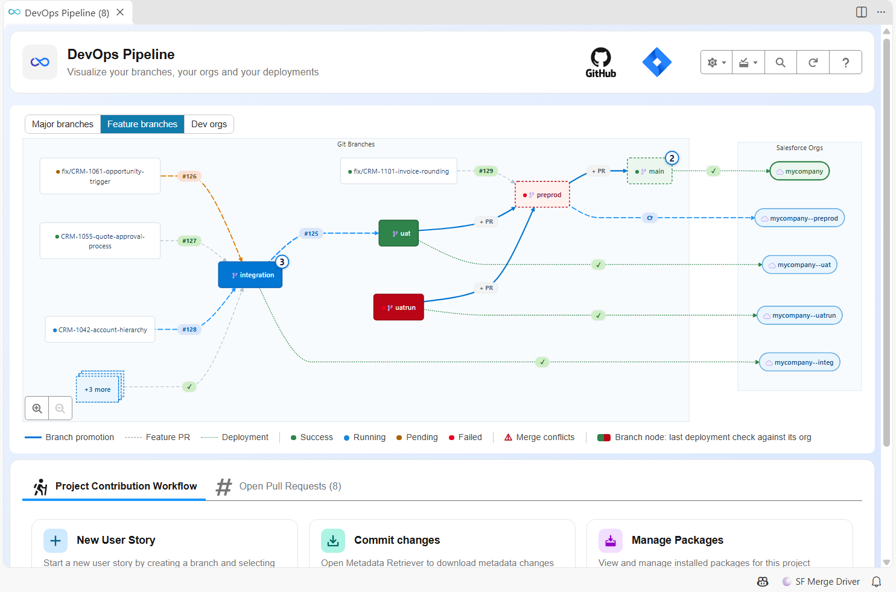
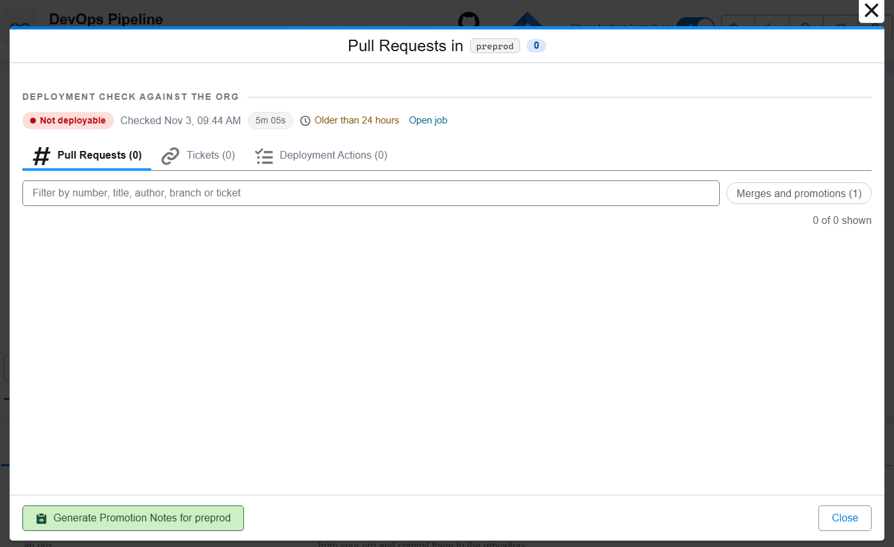
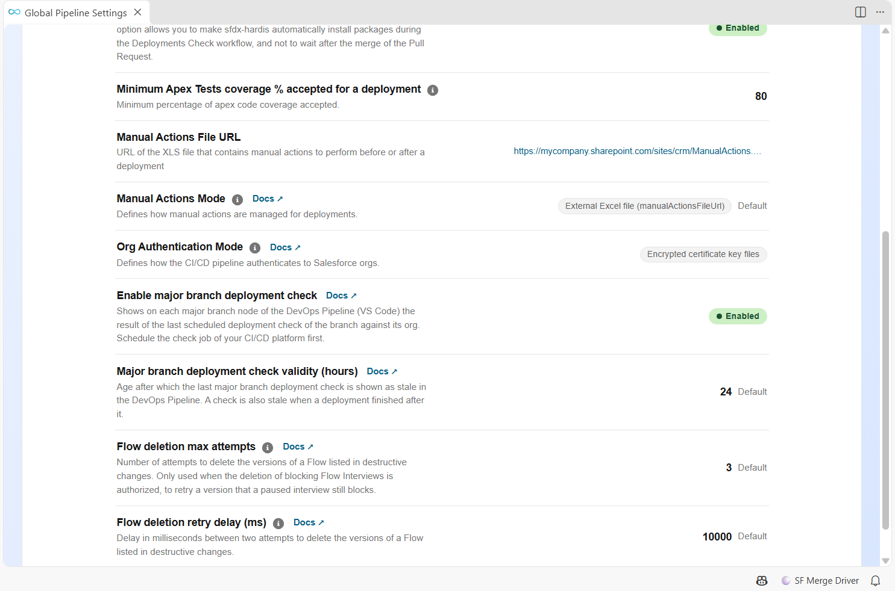

<!-- markdownlint-disable MD013 -->

## Major branch deployment check (optional)

An org drifts from its branch: a change made by hand in the org, a sandbox refresh, a deployment that failed half way. Nobody notices until the next Pull Request into that branch fails its deployment check, for a reason that has nothing to do with it.

The major branch deployment check finds it first. A job scheduled every night simulates the full deployment of each major branch (integration, uat, preprod, main...) to its own org:

- a green job: the org can receive its branch
- a red job: the org has drifted, and the log says which components do not deploy

- [What the job does](#what-the-job-does)
- [Schedule the job](#schedule-the-job)
- [See the result in VS Code](#see-the-result-in-vs-code)
- [Renamed jobs](#renamed-jobs)

### What the job does

The job runs [`sf hardis:project:deploy:smart --check --major-branch-check`](hardis/project/deploy/smart.md) on a major branch:

- Nothing is deployed: it is a deployment simulation, with the Apex tests of the branch config.
- The deployment is always full: no delta, even with `useDeltaDeployment`.
- No Pull Request is read: the Pull Request merged last on the branch gets no comment, and no deployment action is run, since they all ran when the branch was deployed.
- The org is the one of the branch config (`config/branches/.sfdx-hardis.BRANCHNAME.yml`). On a branch without branch config, the job fails at once.

### Schedule the job

The default CI/CD files of sfdx-hardis hold the job. Projects created before it existed can copy it from the [templates](https://github.com/hardisgroupcom/sfdx-hardis/tree/main/defaults/ci).

| CI/CD platform  | Job                                                                                                     | Schedule                                                                                                                                                                                                  |
|-----------------|---------------------------------------------------------------------------------------------------------|-----------------------------------------------------------------------------------------------------------------------------------------------------------------------------------------------------------|
| GitLab          | `check_deploy_to_current_branch_org` in `.gitlab-ci.yml`                                                | **CI/CD > Schedules**: one schedule per major branch (ex: every night at 1am)                                                                                                                             |
| GitHub Actions  | Workflow `.github/workflows/check-major-branch-deploy.yml`                                              | Already scheduled every night. It reads the major branches from `config/branches` of the default branch and checks them all. Add the secrets of every major branch to its job, like in `check-deploy.yml` |
| Azure Pipelines | Pipeline created from `azure-pipelines-major-branch-check.yml`, named **Check Major Branch Deployment** | In the pipeline **Triggers**, add a **Scheduled** trigger that includes all the major branches                                                                                                            |
| Bitbucket       | Custom pipeline `check-major-branch-deployment` in `bitbucket-pipelines.yml`                            | **Pipelines > Schedules**: one schedule per major branch, on the custom pipeline `check-major-branch-deployment`                                                                                          |
| Jenkins         | Stage `Check Major Branch Deployment` of the `Jenkinsfile`                                              | A dedicated Jenkins job on the `Jenkinsfile`, scheduled every night, that sets the environment variable `MAJOR_BRANCH_DEPLOYMENT_CHECK=true`. Name it with "major branch check"                           |

On GitLab, a job started with **Run pipeline** on a major branch also runs `deploy_to_org`: to check a branch by hand without deploying it, play its schedule instead.

### See the result in VS Code

Define in `config/.sfdx-hardis.yml`:

```yaml
enableMajorBranchDeploymentCheck: true
majorBranchDeploymentCheckValidityHours: 24 # optional, 24 by default
```

The [DevOps Pipeline](vscode-extension-devops-pipeline.md) then colors each major branch with its last check:



| Branch node    | Meaning                                                                                                     |
|----------------|-------------------------------------------------------------------------------------------------------------|
| Green          | The last check succeeded: the org can receive its branch                                                    |
| Red            | The last check failed: the org has drifted from its branch                                                  |
| Blinking       | A check is running                                                                                          |
| Dimmed, dashed | The last check is stale: older than `majorBranchDeploymentCheckValidityHours`, or a deployment ran after it |
| Usual color    | No check found for this branch                                                                              |

Click the branch to see the check in its window: status, date, duration, and a link to the job.



The arrow from a branch to its org keeps showing the last deployment, triggered by a merge: a scheduled check, or any pipeline started by a schedule or through the API, does not change it.

Both settings can also be edited in **Pipeline Settings**, in the **Deployment** section.



### Renamed jobs

The DevOps Pipeline finds the check by the name of its job: it must contain "major branch" or "current branch", and "check". `check_deploy_to_current_branch_org`, `Check Major Branch Deployment (uat)` or `check-major-branch-deployment` are found, `nightly_validation` is not.
