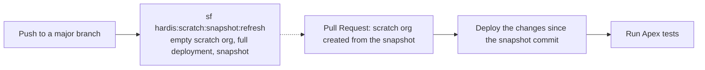
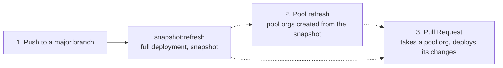
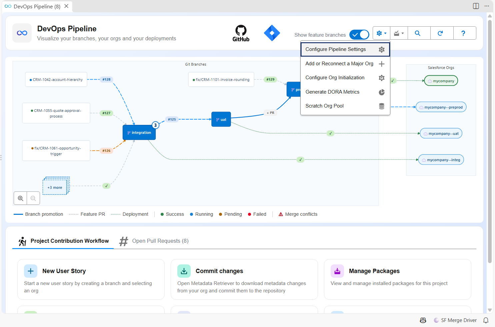
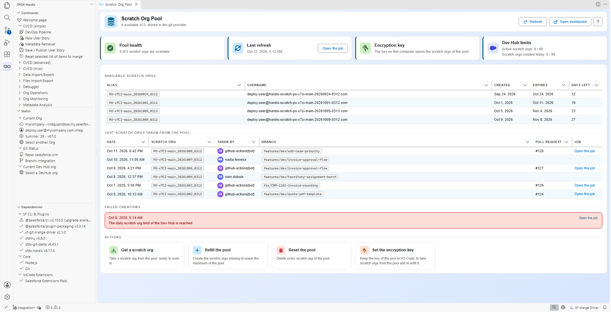
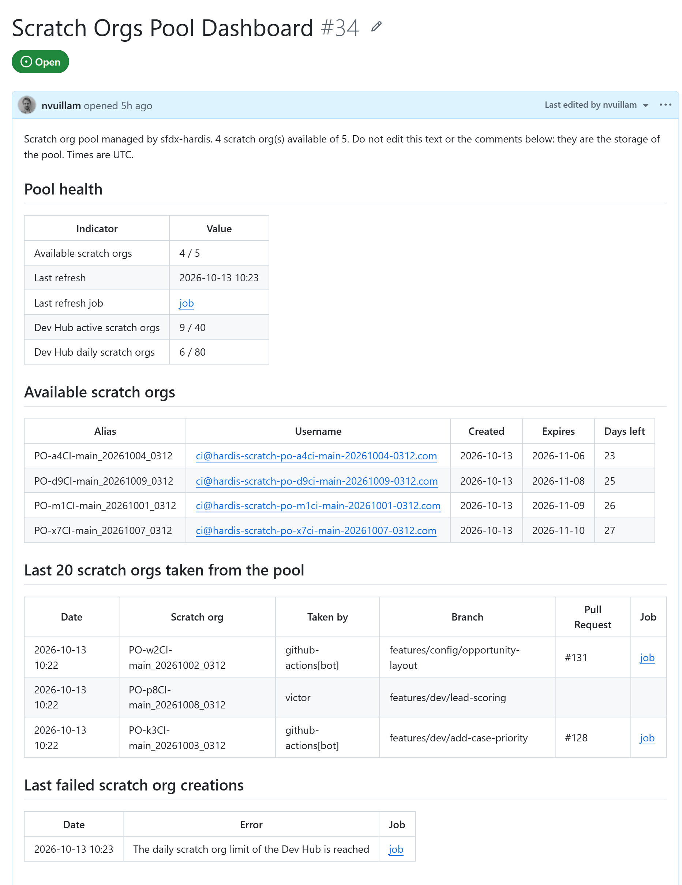

<!-- markdownlint-disable MD013 -->

## Scratch org pool (optional)

This step only concerns projects that work with **scratch orgs**. If you use sandboxes only, skip it and go to [Create the first Pull Request](salesforce-devops-setup-merge-request.md).

Creating a scratch org, installing its packages and pushing the sources takes minutes. A pool keeps scratch orgs ready: a scheduled job creates them during the night, and a Pull Request job or a developer takes one in seconds.

When the pool is filled, each scratch org gets the [org initialization steps](salesforce-devops-org-initialization.md) flagged **Run when filling the pool** (all of them by default), so the org taken from the pool is ready to use.

- [How it works](#how-it-works)
- [Configure the pool](#configure-the-pool)
- [Schedule the pool refresh](#schedule-the-pool-refresh)
- [Run the scratch org jobs on Pull Requests](#run-the-scratch-org-jobs-on-pull-requests)
- [Use scratch org snapshots for Pull Requests](#use-scratch-org-snapshots-for-pull-requests)
- [Use the pool from VS Code](#use-the-pool-from-vs-code)
- [The dashboard on your git provider](#the-dashboard-on-your-git-provider)
- [Rotate the encryption key](#rotate-the-encryption-key)
- [Troubleshooting](#troubleshooting)

### How it works

The pool is stored in your git provider, in a **Scratch Orgs Pool Dashboard**:

| Git provider    | Where the dashboard lives                                           |
|-----------------|---------------------------------------------------------------------|
| GitHub          | An issue of the repository                                          |
| GitLab          | An issue of the project                                             |
| Azure DevOps    | A work item of type Task, named after the repository                |
| Bitbucket Cloud | A Pull Request that is never merged, opened from a technical branch |

Each scratch org of the pool is one comment of the dashboard. Its alias, username and expiration date are readable by anyone who can read the repository. Its credentials are **encrypted** with a key that only your CI/CD variables and your team hold. Every comment is also **signed** with that key: a comment written by someone who does not have it is ignored.

The text of the dashboard is rebuilt from the comments: available scratch orgs, last scratch orgs taken, failed creations, and the scratch org limits of the Dev Hub.

> Do not edit the dashboard or its comments by hand, and on Bitbucket do not merge, decline or delete the dashboard Pull Request and its branch `sfdx-hardis/scratch-orgs-pool`. If the dashboard is lost, the next pool refresh creates a new one and fills it again.

The pool can also be stored in a custom object of the Dev Hub (storage `salesforce`). That storage has no dashboard and no history.

### Configure the pool

Pre-requisites:

- Dev Hub authentication is configured for the CI server: see [Configure CI authentication](salesforce-devops-setup-auth.md).
- You are connected to your git provider in the VS Code SFDX Hardis extension, or its token is in the `.env` file of the project.

Then:

- Run the command [**Configure scratch org pool**](hardis/scratch/pool/create.md) from the VS Code SFDX Hardis extension, or `sf hardis:scratch:pool:create` in a terminal.
- Select the storage **gitProvider** and the maximum number of scratch orgs of the pool.
- The command creates the dashboard and displays the **encryption key once**. Copy it:
  - in a masked CI/CD variable named `SFDX_HARDIS_POOL_ENCRYPTION_KEY`
  - in your password manager, for the developers who will take scratch orgs from their computer
- Commit the file `config/.sfdx-hardis.yml`, that now contains the property `poolConfig`.

```yaml
poolConfig:
  storageService: gitProvider
  maxScratchOrgsNumber: 5
```

The CI account must be allowed to write on the dashboard:

| Git provider    | What to check                                                                                                              |
|-----------------|----------------------------------------------------------------------------------------------------------------------------|
| GitHub          | The workflow templates already give `issues: write` to the scratch org jobs                                                |
| GitLab          | The variable `CI_SFDX_HARDIS_GITLAB_TOKEN` holds a project access token with scope `api`                                   |
| Azure DevOps    | The Build Service user of the project is allowed to edit work items                                                        |
| Bitbucket Cloud | The variable `CI_SFDX_HARDIS_BITBUCKET_TOKEN` holds an access token with scopes `repository:write` and `pullrequest:write` |

### Schedule the pool refresh

The refresh deletes the scratch orgs that are about to expire and creates new ones until the pool is full. Schedule it every night, with the variable `SCRATCH_ORG_POOL` set to `true`.

| CI server           | How to schedule it                                                                                                        |
|---------------------|---------------------------------------------------------------------------------------------------------------------------|
| GitHub Actions      | Workflow `scratch-pool-refresh.yml` runs every night. Create the repository variable `SCRATCH_ORG_POOL` with value `true` |
| GitLab CI           | In **Build -> Pipeline schedules**, create a schedule on your main branch with the variable `SCRATCH_ORG_POOL` = `true`   |
| Azure Pipelines     | Create a pipeline from the file `azure-pipelines-scratch-pool.yml`, with the variable `SCRATCH_ORG_POOL` = `true`         |
| Bitbucket Pipelines | In **Pipelines -> Schedules**, schedule the custom pipeline `scratch-pool-refresh` on your main branch                    |
| Jenkins             | Create a job on the same `Jenkinsfile`, triggered every night, with the environment variable `SCRATCH_ORG_POOL` = `true`  |

On GitHub Actions, Azure Pipelines and Jenkins, the secrets are not sent to the jobs automatically: the templates list the Dev Hub variables and `SFDX_HARDIS_POOL_ENCRYPTION_KEY`, replace `DEVHUB` by the alias of your Dev Hub.

### Run the scratch org jobs on Pull Requests

On each Pull Request, the scratch org jobs take a scratch org from the pool (or create one when the pool is empty), push the sources, run the Apex tests, then delete the scratch org.

- **GitLab CI**: the jobs run unless `USE_SCRATCH_ORGS` is `"false"` in `gitlab-ci-config.yml`.
- **GitHub Actions, Azure Pipelines, Bitbucket Pipelines, Jenkins**: the jobs are off by default. Set the variable `USE_SCRATCH_ORGS` to `true` to run them.

When a job fails, its scratch org is kept until it expires, so you can investigate. To keep it after a successful job too, set `CI_DELETE_SCRATCH_ORG` to `false`, and put it back to `true` afterwards.

### Use scratch org snapshots for Pull Requests

As the project grows, pushing all of it into an empty scratch org on every Pull Request gets slow. With snapshots, a job keeps a [Dev Hub org snapshot](https://developer.salesforce.com/docs/atlas.en-us.sfdx_dev.meta/sfdx_dev/sfdx_dev_snapshots_intro.htm) of each major branch, and the scratch orgs of Pull Requests are created from it: only what changed since the commit of the snapshot is deployed.



The full deployment into an empty scratch org still happens, once per push to the major branch instead of once per Pull Request.

To enable it on a major branch:

1. Enable **Scratch Org Snapshots** in the Setup of your Dev Hub, and set `USE_SCRATCH_ORGS` to `true` (see above).
2. In the branch config of the major branch, set `useScratchOrgSnapshot: true`, for example in `config/branches/.sfdx-hardis.integration.yml`. `scratchOrgSnapshotKeep` (default `2`) is the number of snapshots kept for the branch.
3. Push to the branch: the job **Refresh scratch org snapshot** takes the first snapshot. Until it is Active, Pull Requests use an empty scratch org as before.

The job reads the branch config before it logs in to the Dev Hub: on a branch without `useScratchOrgSnapshot: true`, it ends at once. On GitLab, `gitlab-ci-config.yml` sets `USE_SCRATCH_ORGS: "true"` by default, so the job starts on every push to a major branch and ends there.

On Bitbucket Pipelines, the step **Refresh scratch org snapshot** runs after the deployment step, as the steps of a Bitbucket pipeline run one after the other: a commit that fails to deploy to the org of the branch gets no snapshot. On the other CI servers, the snapshot job runs beside the deployment.

#### Snapshots and the pool

Snapshots and the [pool](#how-it-works) work together: the snapshot feeds the pool, and the pool feeds the Pull Requests.



1. **Push to a major branch**: the snapshot refresh deploys the branch into an empty scratch org, runs the [org initialization steps](salesforce-devops-org-initialization.md) run when filling the pool, and takes the snapshot.
2. **Pool refresh**: each new pool org is created from the newest usable snapshot of the branch the pool refresh runs on. It installs the packages the snapshot lacks, deploys what changed since the snapshot commit and assigns the permission sets. The steps already in the snapshot are not run again. Without a usable snapshot, the pool org is filled as before.
3. **Pull Request**: the job takes a pool org first, which is instant, and deploys what changed since the pool org was filled. When the pool has no org left, the scratch org is created from the snapshot, else empty.

Each part works alone:

| You use         | Jobs    | The Pull Request scratch org                                |
|-----------------|---------|-------------------------------------------------------------|
| The pool only   | 2 and 3 | Taken from the pool, filled with a full deployment as today |
| Snapshots only  | 1 and 3 | Created from the snapshot                                   |
| Both            | 1, 2, 3 | Taken from the pool, filled from the snapshot               |

Schedule the pool refresh after the snapshot refresh, so new pool orgs start from the newest snapshot. On GitHub Actions, `scratch-snapshot-refresh.yml` already runs `scratch-pool-refresh.yml` once a new snapshot of the default branch is Active, and the pool refresh still runs every night. A project or branch that does not use snapshots never starts it. On GitLab CI, Azure Pipelines, Bitbucket Pipelines and Jenkins, schedule the pool refresh at a time when the snapshot refresh is over.

[New User Story](salesforce-devops-create-new-user-story.md) also takes a pool org first. When the pool has no org left, it creates the scratch org from the snapshot of the major branch the User Story starts from.

#### Good to know

- The scratch org of a Pull Request is created from the newest Active snapshot of its target branch whose commit is in the history of the Pull Request. The target branch is the one of the Pull Request the git provider gives; without it, it is read from `FORCE_TARGET_BRANCH`, then from the CI tool's own variable (`GITHUB_BASE_REF`, `CI_MERGE_REQUEST_TARGET_BRANCH_NAME`, `SYSTEM_PULLREQUEST_TARGETBRANCH`, `BITBUCKET_PR_DESTINATION_BRANCH`, `CHANGE_TARGET`). When there is no usable snapshot, the scratch org is created empty and the job log says why.
- Outside CI, the target branch is the major branch the User Story started from, else `developmentBranch`. A CI server that does not set the variable `CI` takes that path too: set `CI=true` in its scratch org jobs (the Jenkins template does).
- When the Pull Request changes `config/project-scratch-def.json` or a file under its `settingsPath`, the scratch org is created empty: a scratch org from a snapshot keeps the features and settings of the snapshot commit.
- When the Pull Request changes an org initialization step run when filling the pool, its Apex script or its data workspace, the scratch org is created empty too, so the change is tested. The next snapshot holds it.
- With `CI_SCRATCH_MODE=deploy`, `useDeltaDeploymentWithDependencies` applies to the delta as it does in deployments: the delta also gets what depends on the changed items, as the record types of a changed field.
- The [org initialization steps](salesforce-devops-org-initialization.md) run as for a scratch org pool: the steps run when filling the pool (`runAtPoolFill`, on by default) run once, in the scratch org of the snapshot, and their result is in every scratch org created from it. A scratch org from a snapshot first installs the packages of `installedPackages` it lacks, as a Pull Request that adds a package can deploy metadata that needs it, then gets the delta, then the steps with `runAtPoolFill: false` and the permission set assignments.
- So `runAtPoolFill` also decides what a snapshot holds. A step with `runAtPoolFill: false` placed before `deploy-sources` runs after the delta. That is fine for most steps, but a step that prepares the deployment must keep `runAtPoolFill` on.
- What a step of yours grants to the admin user of the snapshot scratch org may not reach the admin user of a scratch org created from the snapshot. The permission set assignments run again in each scratch org, so the built-in step is covered.
- A Pull Request proves that its changes deploy on the head of its target branch, not from empty. A change that only fails from empty, as a picklist value removed while a record type still uses it, shows at the next snapshot refresh: that refresh fails, and the previous snapshot stays in use.
- `commandsPreDeploy`, `commandsPostDeploy`, the deferred sharing calculation and the deployment actions run in the snapshot refresh only, not around the delta of a Pull Request.
- A snapshot child takes a few minutes to create, more than an empty scratch org. Snapshots pay off when the full deployment takes longer than that.
- Salesforce writes that snapshots "are intended to include only dependent packages, metadata, and test data".
- Every snapshot counts in the active snapshots allocation of the Dev Hub, and the Dev Hub also limits the snapshots taken per day. When that limit is reached, Pull Requests keep using the previous snapshot.
- The first pull from a scratch org created from a snapshot can list `fragment_space/DefaultWidgetSpace`, a component Salesforce creates in that org, and fail to retrieve it. Add `**/digitalExperiences/fragment_space/**` to `.forceignore`.

### Use the pool from VS Code

Open the **Scratch Org Pool** panel from the settings menu of the DevOps Pipeline. The entry appears when the project has a pool.





The panel shows the available scratch orgs, the last ones taken, the failed creations and the limits of the Dev Hub. From it you can:

- **Get a scratch org**: takes one from the pool, or creates one when the pool is empty.
- **Refill the pool**: runs the refresh from your computer.
- **Reset the pool**: deletes every scratch org of the pool.
- **Set the encryption key**: stores the key in the secrets of VS Code. Without it, the panel still counts the scratch orgs, but none can be taken.

Without the extension, put the key and the token of your git provider in the `.env` file of the project, which must never be committed, then check with `sf hardis:scratch:pool:localauth`.

```sh
SFDX_HARDIS_POOL_ENCRYPTION_KEY=the-key-displayed-at-setup
```

### The dashboard on your git provider

The dashboard is the same pool, read from your git provider. It is the place to look when a Pull Request job did not get a scratch org.



### Rotate the encryption key

- Copy the current value of `SFDX_HARDIS_POOL_ENCRYPTION_KEY` into a masked CI/CD variable named `SFDX_HARDIS_POOL_PREVIOUS_ENCRYPTION_KEY`.
- Replace the value of `SFDX_HARDIS_POOL_ENCRYPTION_KEY` by the new key.
- Run the pool refresh job of your CI server: the scratch orgs encrypted with the previous key are removed from the pool and deleted from the Dev Hub, then new ones are created.
- Delete the variable `SFDX_HARDIS_POOL_PREVIOUS_ENCRYPTION_KEY`, and give the new key to the developers.

Without the previous key, the refresh still removes the old scratch orgs from the pool, but it does not delete them from the Dev Hub: they stay active until they expire. Nothing proves an entry is genuine without the key that signed it, and the refresh never deletes a scratch org on the word of a comment anyone could have written.

A refresh run from a computer never removes the scratch orgs of another key, and refuses to refill a pool it cannot read: a mistyped key cannot empty the pool.

### Troubleshooting

| What you see                                                | What to do                                                                                                         |
|-------------------------------------------------------------|--------------------------------------------------------------------------------------------------------------------|
| The pool is always empty                                    | Check that the refresh job is scheduled and green, and the **failed creations** of the dashboard                   |
| `SFDX_HARDIS_POOL_ENCRYPTION_KEY is not set`                | Define the variable in the CI/CD settings, or in the VS Code panel or the `.env` file on a computer                |
| The key is not the one the scratch orgs were encrypted with | Use the key displayed at setup, or [rotate it](#rotate-the-encryption-key)                                         |
| No git provider token found                                 | Connect to your git provider from the DevOps Pipeline, or define the token variable of your provider               |
| Jobs create scratch orgs although the pool is full          | Look at the job log: it says why no scratch org was taken (missing key, missing token, dashboard not writable)     |
| The Dev Hub limits are reached                              | Lower `maxScratchOrgsNumber`, or delete unused scratch orgs with [hardis:scratch:delete](hardis/scratch/delete.md) |

You can now go to step [7. Create the first Pull Request](salesforce-devops-setup-merge-request.md).

<!-- training-links:start -->

## Learn by doing

The free [Salesforce DevOps with sfdx-hardis](https://sfdx-hardis-training.cloudity.com) course does this, click by click, on an org of your own:

- [Lab 3.1 - Configure the CI/CD pipeline up to production](https://sfdx-hardis-training.cloudity.com/en/level-3-release-manager/3-1-configure-the-pipeline-up-to-production/)

<!-- training-links:end -->
