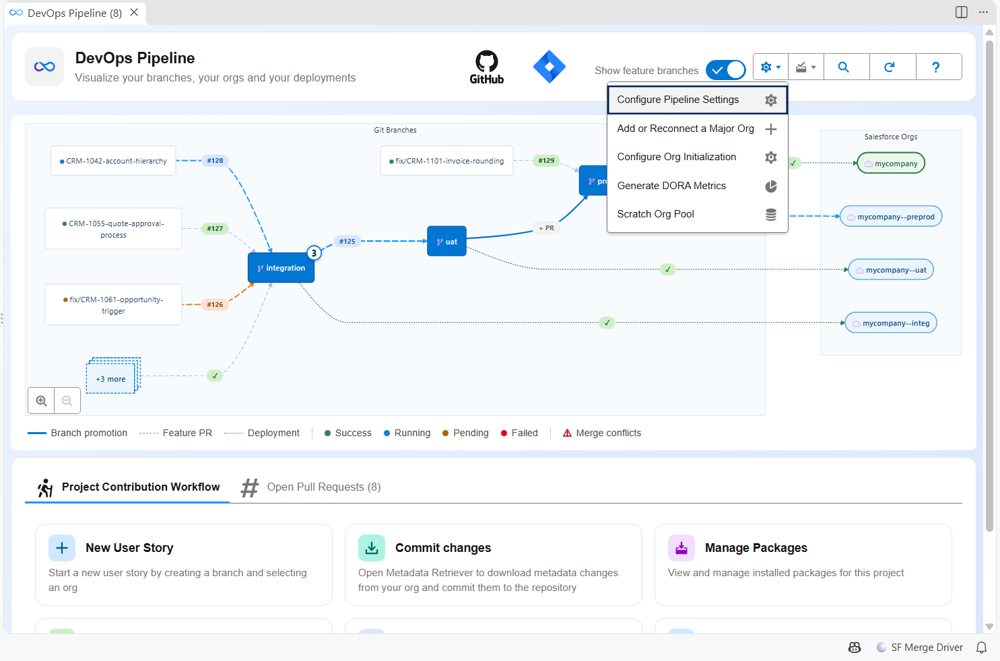
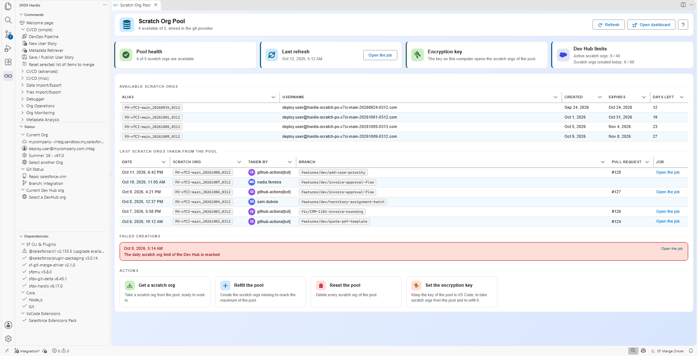
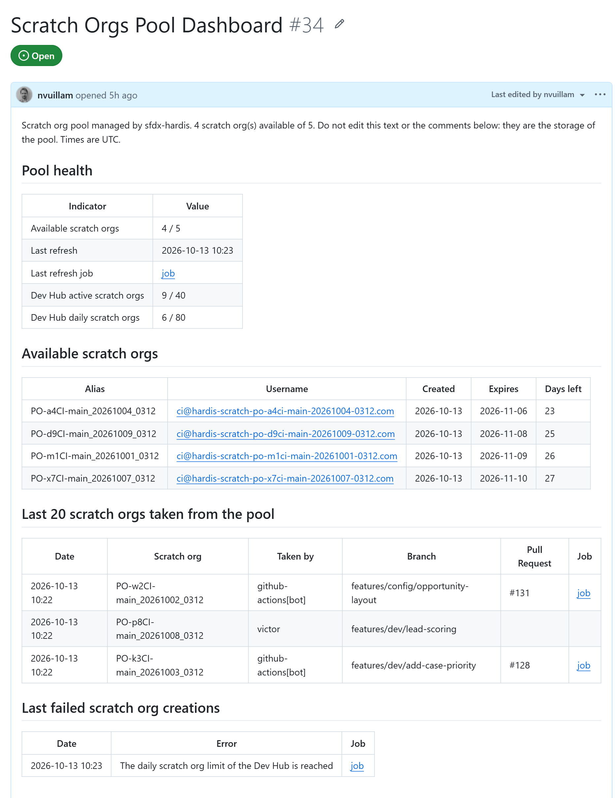

<!-- markdownlint-disable MD013 -->

## Scratch org pool (optional)

This step only concerns projects that work with **scratch orgs**. If you use sandboxes only, skip it and go to [Create the first Pull Request](salesforce-devops-setup-merge-request.md).

Creating a scratch org, installing its packages and pushing the sources takes minutes. A pool keeps scratch orgs ready: a scheduled job creates them during the night, and a Pull Request job or a developer takes one in seconds.

When the pool is filled, each scratch org gets the [org initialization steps](salesforce-devops-org-initialization.md) flagged **Run when filling the pool** (all of them by default), so the org taken from the pool is ready to use.

- [How it works](#how-it-works)
- [Configure the pool](#configure-the-pool)
- [Schedule the pool refresh](#schedule-the-pool-refresh)
- [Run the scratch org jobs on Pull Requests](#run-the-scratch-org-jobs-on-pull-requests)
- [Use the pool from VS Code](#use-the-pool-from-vs-code)
- [The dashboard on your git provider](#the-dashboard-on-your-git-provider)
- [Rotate the encryption key](#rotate-the-encryption-key)
- [Troubleshooting](#troubleshooting)

### How it works

The pool is stored in your git provider, in a **Scratch Orgs Pool Dashboard**:

| Git provider    | Where the dashboard lives                                           |
|-----------------|---------------------------------------------------------------------|
| GitHub          | An issue of the repository                                          |
| GitLab          | An issue of the project                                             |
| Azure DevOps    | A work item of type Task, named after the repository                |
| Bitbucket Cloud | A Pull Request that is never merged, opened from a technical branch |

Each scratch org of the pool is one comment of the dashboard. Its alias, username and expiration date are readable by anyone who can read the repository. Its credentials are **encrypted** with a key that only your CI/CD variables and your team hold. Every comment is also **signed** with that key: a comment written by someone who does not have it is ignored.

The text of the dashboard is rebuilt from the comments: available scratch orgs, last scratch orgs taken, failed creations, and the scratch org limits of the Dev Hub.

> Do not edit the dashboard or its comments by hand, and on Bitbucket do not merge, decline or delete the dashboard Pull Request and its branch `sfdx-hardis/scratch-orgs-pool`. If the dashboard is lost, the next pool refresh creates a new one and fills it again.

The pool can also be stored in a custom object of the Dev Hub (storage `salesforce`). That storage has no dashboard and no history.

### Configure the pool

Pre-requisites:

- Dev Hub authentication is configured for the CI server: see [Configure CI authentication](salesforce-devops-setup-auth.md).
- You are connected to your git provider in the VS Code SFDX Hardis extension, or its token is in the `.env` file of the project.

Then:

- Run the command [**Configure scratch org pool**](hardis/scratch/pool/create.md) from the VS Code SFDX Hardis extension, or `sf hardis:scratch:pool:create` in a terminal.
- Select the storage **gitProvider** and the maximum number of scratch orgs of the pool.
- The command creates the dashboard and displays the **encryption key once**. Copy it:
  - in a masked CI/CD variable named `SFDX_HARDIS_POOL_ENCRYPTION_KEY`
  - in your password manager, for the developers who will take scratch orgs from their computer
- Commit the file `config/.sfdx-hardis.yml`, that now contains the property `poolConfig`.

```yaml
poolConfig:
  storageService: gitProvider
  maxScratchOrgsNumber: 5
```

The CI account must be allowed to write on the dashboard:

| Git provider    | What to check                                                                                                              |
|-----------------|----------------------------------------------------------------------------------------------------------------------------|
| GitHub          | The workflow templates already give `issues: write` to the scratch org jobs                                                |
| GitLab          | The variable `CI_SFDX_HARDIS_GITLAB_TOKEN` holds a project access token with scope `api`                                   |
| Azure DevOps    | The Build Service user of the project is allowed to edit work items                                                        |
| Bitbucket Cloud | The variable `CI_SFDX_HARDIS_BITBUCKET_TOKEN` holds an access token with scopes `repository:write` and `pullrequest:write` |

### Schedule the pool refresh

The refresh deletes the scratch orgs that are about to expire and creates new ones until the pool is full. Schedule it every night, with the variable `SCRATCH_ORG_POOL` set to `true`.

| CI server           | How to schedule it                                                                                                        |
|---------------------|---------------------------------------------------------------------------------------------------------------------------|
| GitHub Actions      | Workflow `scratch-pool-refresh.yml` runs every night. Create the repository variable `SCRATCH_ORG_POOL` with value `true` |
| GitLab CI           | In **Build -> Pipeline schedules**, create a schedule on your main branch with the variable `SCRATCH_ORG_POOL` = `true`   |
| Azure Pipelines     | Create a pipeline from the file `azure-pipelines-scratch-pool.yml`, with the variable `SCRATCH_ORG_POOL` = `true`         |
| Bitbucket Pipelines | In **Pipelines -> Schedules**, schedule the custom pipeline `scratch-pool-refresh` on your main branch                    |
| Jenkins             | Create a job on the same `Jenkinsfile`, triggered every night, with the environment variable `SCRATCH_ORG_POOL` = `true`  |

On GitHub Actions, Azure Pipelines and Jenkins, the secrets are not sent to the jobs automatically: the templates list the Dev Hub variables and `SFDX_HARDIS_POOL_ENCRYPTION_KEY`, replace `DEVHUB` by the alias of your Dev Hub.

### Run the scratch org jobs on Pull Requests

On each Pull Request, the scratch org jobs take a scratch org from the pool (or create one when the pool is empty), push the sources, run the Apex tests, then delete the scratch org.

- **GitLab CI**: the jobs run unless `USE_SCRATCH_ORGS` is `"false"` in `gitlab-ci-config.yml`.
- **GitHub Actions, Azure Pipelines, Bitbucket Pipelines, Jenkins**: the jobs are off by default. Set the variable `USE_SCRATCH_ORGS` to `true` to run them.

When a job fails, its scratch org is kept until it expires, so you can investigate. To keep it after a successful job too, set `CI_DELETE_SCRATCH_ORG` to `false`, and put it back to `true` afterwards.

### Use the pool from VS Code

Open the **Scratch Org Pool** panel from the settings menu of the DevOps Pipeline. The entry appears when the project has a pool.





The panel shows the available scratch orgs, the last ones taken, the failed creations and the limits of the Dev Hub. From it you can:

- **Get a scratch org**: takes one from the pool, or creates one when the pool is empty.
- **Refill the pool**: runs the refresh from your computer.
- **Reset the pool**: deletes every scratch org of the pool.
- **Set the encryption key**: stores the key in the secrets of VS Code. Without it, the panel still counts the scratch orgs, but none can be taken.

Without the extension, put the key and the token of your git provider in the `.env` file of the project, which must never be committed, then check with `sf hardis:scratch:pool:localauth`.

```sh
SFDX_HARDIS_POOL_ENCRYPTION_KEY=the-key-displayed-at-setup
```

### The dashboard on your git provider

The dashboard is the same pool, read from your git provider. It is the place to look when a Pull Request job did not get a scratch org.



### Rotate the encryption key

- Copy the current value of `SFDX_HARDIS_POOL_ENCRYPTION_KEY` into a masked CI/CD variable named `SFDX_HARDIS_POOL_PREVIOUS_ENCRYPTION_KEY`.
- Replace the value of `SFDX_HARDIS_POOL_ENCRYPTION_KEY` by the new key.
- Run the pool refresh job of your CI server: the scratch orgs encrypted with the previous key are removed from the pool and deleted from the Dev Hub, then new ones are created.
- Delete the variable `SFDX_HARDIS_POOL_PREVIOUS_ENCRYPTION_KEY`, and give the new key to the developers.

Without the previous key, the refresh still removes the old scratch orgs from the pool, but it does not delete them from the Dev Hub: they stay active until they expire. Nothing proves an entry is genuine without the key that signed it, and the refresh never deletes a scratch org on the word of a comment anyone could have written.

A refresh run from a computer never removes the scratch orgs of another key, and refuses to refill a pool it cannot read: a mistyped key cannot empty the pool.

### Troubleshooting

| What you see                                                | What to do                                                                                                         |
|-------------------------------------------------------------|--------------------------------------------------------------------------------------------------------------------|
| The pool is always empty                                    | Check that the refresh job is scheduled and green, and the **failed creations** of the dashboard                   |
| `SFDX_HARDIS_POOL_ENCRYPTION_KEY is not set`                | Define the variable in the CI/CD settings, or in the VS Code panel or the `.env` file on a computer                |
| The key is not the one the scratch orgs were encrypted with | Use the key displayed at setup, or [rotate it](#rotate-the-encryption-key)                                         |
| No git provider token found                                 | Connect to your git provider from the DevOps Pipeline, or define the token variable of your provider               |
| Jobs create scratch orgs although the pool is full          | Look at the job log: it says why no scratch org was taken (missing key, missing token, dashboard not writable)     |
| The Dev Hub limits are reached                              | Lower `maxScratchOrgsNumber`, or delete unused scratch orgs with [hardis:scratch:delete](hardis/scratch/delete.md) |

You can now go to step [7. Create the first Pull Request](salesforce-devops-setup-merge-request.md).
