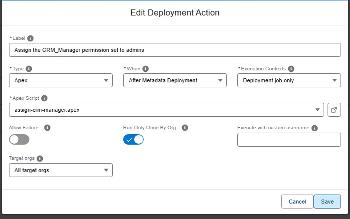

<!-- markdownlint-disable MD013 -->

## Run an Apex script

One of the types of [deployment actions](salesforce-devops-work-on-user-story-deployment-actions.md), YAML `type: apex`. That page explains what all types share: when actions run, how to choose their target orgs, how they are tracked and how to recover a failed one.

Executes one of the `.apex` script files of your project against the target org. Useful for initialization scripts or migrations, like assigning permission sets or recalculating fields.



<details markdown="1"><summary>Technical: apex action (YAML)</summary>

Executes an Apex script file against the target org using `sf apex run --file`.

| Custom parameter        | Description                                                 | Example                  |
|-------------------------|-------------------------------------------------------------|--------------------------|
| `parameters.apexScript` | Relative path to the `.apex` script file in the repository. | `scripts/apex/init.apex` |

```yaml
- id: 00de1479-8639-46a2-96e1-88cfa69be4db
  label: Run initialization apex
  type: apex
  parameters:
    apexScript: scripts/apex/init.apex
  context: process-deployment-only
```

</details>

<!-- training-links:start -->

## Learn by doing

The free [Salesforce DevOps with sfdx-hardis](https://sfdx-hardis-training.cloudity.com) course does this, click by click, on an org of your own:

- [Lab 2.3 - Fix broken records with an Apex deployment action](https://sfdx-hardis-training.cloudity.com/en/level-2-contributor-advanced/2-3-fix-broken-records-with-an-apex-deployment-action/)

<!-- training-links:end -->
