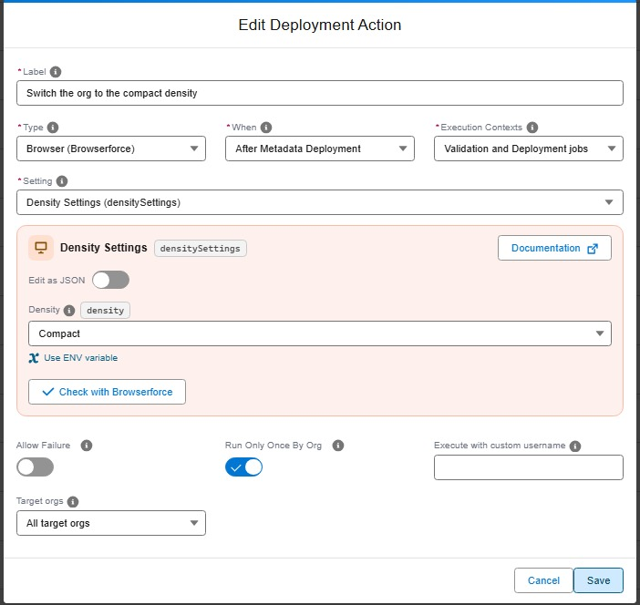
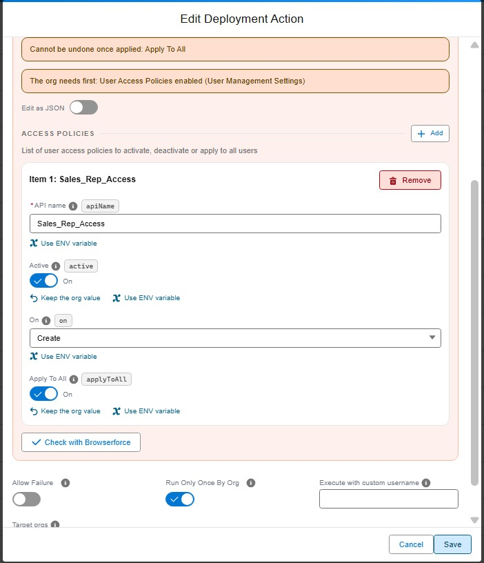
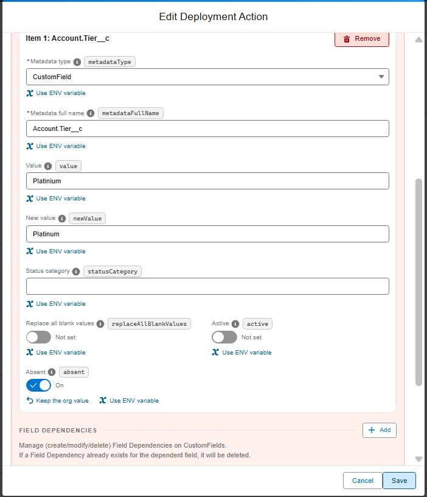

<!-- markdownlint-disable MD013 -->

## Apply a Setup setting in a browser

One of the types of [deployment actions](salesforce-devops-work-on-user-story-deployment-actions.md), YAML `type: browser`. That page explains what all types share: when actions run, how to choose their target orgs, how they are tracked and how to recover a failed one.

Some Setup settings cannot be deployed with the Metadata API: the density of Lightning Experience, the company currency, the secret of an auth provider, the record types of a picklist value, and many more. A browser action applies one of them with [Browserforce](https://github.com/amtrack/sfdx-browserforce-plugin), which clicks through the Setup pages in a headless browser. It only changes what differs from the org, so running it again does nothing.

In VS Code, pick the setting in the list: its fields show as a form, with the example of Browserforce already filled in, and its warnings (a value that cannot be changed back, a feature that only exists in Salesforce Classic, what the org needs first). **Documentation** opens the page of the setting on the [Browserforce documentation site](https://amtrack.github.io/sfdx-browserforce-plugin/settings/), with its screenshots and examples. **Edit as JSON** shows the whole value, and **Check with Browserforce** validates it before saving.



During a deployment check, nothing is changed: Browserforce reads the org and the Pull Request comment shows what the deployment will change.

A browser action can also be an [org initialization step](salesforce-devops-org-initialization.md), to set up each new scratch org or refreshed sandbox the same way.

### Deployment errors a browser action solves

When a deployment fails on an error a browser action can solve (a record type the API cannot delete, a picklist value renamed in the sources, Contacts to Multiple Accounts not enabled, emails blocked by Deliverability, Shared Activities, a standard Lightning theme, history tracking of an object, Call Summaries without Einstein Conversation Insights...), the [deployment assistant](salesforce-deployment-agent-error-list.md) gives, under its tip, the command that creates the action on the Pull Request of the current branch, and the documentation page of the setting:

```shell
sf hardis:project:action:create --agent --scope pr --pr-id current --when pre-deploy --type browser --label "Delete record type Account.Old" --browser-setting recordTypes --browser-config '{"deletions":[{"fullName":"Account.Old"}]}'
```

When the API name of a picklist value was renamed in the sources, the deployment fails on a duplicate label: the target org still has the value under its old API name. The tip reads the new API name from your sources, and the action renames the value in the target org before the deployment, and Salesforce updates the records that hold it. Replace `OLD_API_NAME` with the API name the value has in the target org before you run the command.

Some of these tips also ask to remove an element from your sources: the Metadata API refuses it whatever the org. A deployment check only simulates the action: if the check still fails on the error once the action is created, apply the setting once in the target org with **Run in another org** in the VS Code Deployment Actions tab, or with [hardis:project:action:run](hardis/project/action/run.md) `--select-org`, then run the check again. The deployment of the Pull Request then applies it in each next org of the pipeline. On Windows PowerShell, save the JSON in a file and give its path to `--browser-config`.

### Examples

#### Run a User Access Policy on new users only

The [Activate User Access Policies](salesforce-devops-work-on-user-story-deployment-actions-user-access-policy.md) type activates policies and runs **Apply To All** on them, which covers most needs. The `userAccessPolicies` setting of Browserforce goes further, policy by policy: choose when the policy runs (when a user is created, updated, or both), deactivate it, or run **Apply To All** without changing its status.

Here, the Sales Rep policy only runs when a user is created, and **Apply To All** gives its access to the users that already match it:



```yaml
commandsPostDeploy:
  - id: 6f0b2b1e-1c9a-4e0d-9d2a-128a00000014
    label: Run the Sales Rep access policy on new users only
    type: browser
    context: all
    parameters:
      setting: userAccessPolicies
      config:
        accessPolicies:
          - apiName: Sales_Rep_Access
            active: true
            "on": Create
            applyToAll: true
```

#### Change the API name of a picklist value

With the Metadata API, a new API name is a new picklist value: the records keep the old one. To fix a typo in an API name (`Platinium` instead of `Platinum`), the Pull Request adds the new value to the field, and a browser action with the `picklists` setting of Browserforce does the rest after the deployment: it replaces the old value with the new one in every record that uses it, then deletes the old value (`absent: true`).



```yaml
commandsPostDeploy:
  - id: 6f0b2b1e-1c9a-4e0d-9d2a-128a00000015
    label: Fix the API name of the Platinium account tier
    type: browser
    context: all
    parameters:
      setting: picklists
      config:
        picklistValues:
          - metadataType: CustomField
            metadataFullName: Account.Tier__c
            value: Platinium
            newValue: Platinum
            absent: true
```

Once the action has run in every org, remove the old value from the field in git, so that a later deployment does not create it again. The same setting replaces values of a standard field (`metadataType: StandardValueSet`) or of a global value set (`GlobalValueSet`).

<details markdown="1"><summary>Technical: browser action (YAML)</summary>

| Custom parameter     | Required? | Description                                                                                       | Example                  |
|----------------------|:---------:|---------------------------------------------------------------------------------------------------|--------------------------|
| `parameters.setting` |    Yes    | Key of the Browserforce setting.                                                                  | `densitySettings`        |
| `parameters.config`  |    Yes    | Value of the setting: an object or a list, in the format Browserforce describes for that setting. | `{ density: "Compact" }` |

```yaml
commandsPostDeploy:
  - id: 2f0c4d1e-7a3b-4c5d-9e8f-0a1b2c3d4e5f
    label: Compact density for all users
    type: browser
    context: all
    parameters:
      setting: densitySettings
      config:
        density: Compact
```

List the settings and the format of each one with [hardis:project:action:types](hardis/project/action/types.md):

```sh
sf hardis:project:action:types --type browser
sf hardis:project:action:types --type browser --browser-setting authProviders --json
```

**Secrets and values that differ per org.** Write a value as `"${VARIABLE}"` and declare a CI/CD variable instead of writing the value in git. When deploying to `uat`, sfdx-hardis reads `VARIABLE_UAT` first, then `VARIABLE` (the same rule as `SFDX_CLIENT_ID_<BRANCH>`), and passes the value to Browserforce as an environment variable only. The values are masked in the job logs and in the Pull Request comments. A missing variable fails the action and lists the names that were looked up.

```yaml
    parameters:
      setting: authProviders
      config:
        PaymentProvider:
          consumerSecret: "${PAYMENT_PROVIDER_SECRET}"
```

On GitHub Actions, a workflow only passes to its jobs the secrets it lists: add the variables to the `env` of the deployment check and deployment workflows.

The action runs in both phases. Its default context is `all`: the check job shows the planned changes, the deployment job applies them. It runs once per org by default, like most types: set `runOnlyOnceByOrg: false` to apply the setting at each deployment, for a setting that a deployment can change back.

Browserforce (`sfdx-browserforce-plugin`) is installed when missing or older than 7.2.0. It is in the sfdx-hardis Docker images, which also set its browser. On another machine, Browserforce uses `CHROME_BIN`, or the local Chrome sfdx-hardis finds; otherwise run `sf browserforce playwright -- install chromium`.

</details>
