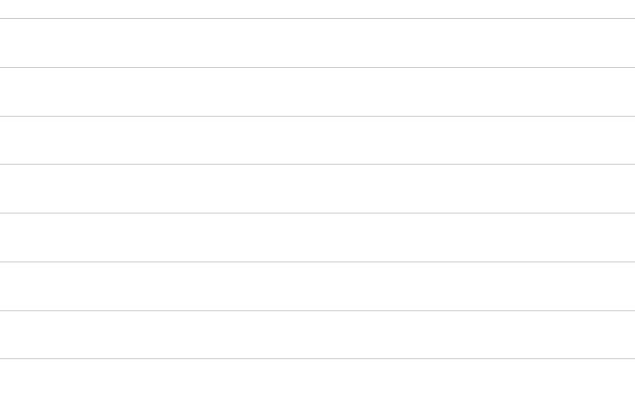

<!-- markdownlint-disable MD013 -->

## Run a command

One of the types of [deployment actions](salesforce-devops-work-on-user-story-deployment-actions.md), YAML `type: command`. That page explains what all types share: when actions run, how to choose their target orgs, how they are tracked and how to recover a failed one.

Runs any command line (a `sf` command, a script, anything your CI runner can execute). Use it for the automations that do not fit any other type.



<details markdown="1"><summary>Technical: command action (YAML)</summary>

In case of multiple commands, use `&&` to separate them.

| Custom parameter | Description                   | Example                    |
|------------------|-------------------------------|----------------------------|
| `command`        | Command line to run (string). | `echo "My custom command"` |

```yaml
- id: 47f666ba-944c-4721-9127-a08f51fb0a6c
  label: Remove KnowledgeUser flag
  type: command
  command: >-
    sf data update record --sobject User --where "UserPermissionsKnowledgeUser='true'" --values "UserPermissionsKnowledgeUser='false'" --json
  context: all
```

</details>
