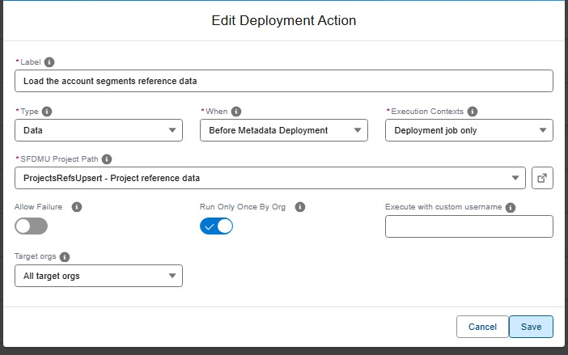

<!-- markdownlint-disable MD013 -->

## Import data (SFDMU)

One of the types of [deployment actions](salesforce-devops-work-on-user-story-deployment-actions.md), YAML `type: data`. That page explains what all types share: when actions run, how to choose their target orgs, how they are tracked and how to recover a failed one.

Loads records into the target org using one of the [SFDMU data workspaces](https://sfdx-hardis.cloudity.com/salesforce-devops-agent-data-workspaces/) of your project: reference data, email templates, demo records...



<details markdown="1"><summary>Technical: data action (YAML)</summary>

Runs a SFDMU import for the specified project name. Typically used post-deploy to load records such as templates or reference data.

| Custom parameter          | Description                       | Example         |
|---------------------------|-----------------------------------|-----------------|
| `parameters.sfdmuProject` | Name of the SFDMU project to run. | `EmailTemplate` |

```yaml
- id: f150d991-ecec-460a-8a0e-5f2db77ded60
  label: Import email templates
  type: data
  parameters:
    sfdmuProject: EmailTemplate
  context: process-deployment-only
```

</details>

<!-- training-links:start -->

## Learn by doing

The free [Salesforce DevOps with sfdx-hardis](https://sfdx-hardis-training.cloudity.com) course does this, click by click, on an org of your own, in these labs:

- [Lab 2.4 - Ship reference data and a batch with deployment actions](https://sfdx-hardis-training.cloudity.com/en/level-2-contributor-advanced/2-4-ship-reference-data-and-a-batch-with-deployment-actions/)
- [Lab 2.9 - Capstone: deliver a User Story that has it all](https://sfdx-hardis-training.cloudity.com/en/level-2-contributor-advanced/2-9-capstone-deliver-a-user-story-that-has-it-all/)

<!-- training-links:end -->
