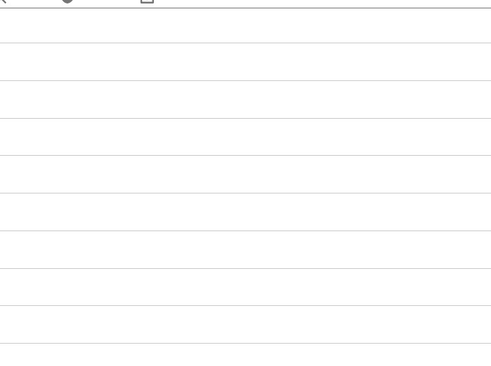

<!-- markdownlint-disable MD013 -->

## Manual step

One of the types of [deployment actions](salesforce-devops-work-on-user-story-deployment-actions.md), YAML `type: manual`. That page explains what all types share: when actions run, how to choose their target orgs, how they are tracked and how to recover a failed one.

Some things cannot be automated: activating a feature that has no API, warning a team, checking an external system. A manual step describes what must be done. sfdx-hardis reminds the right person at the right time, in the Pull Request comments, with a checkbox to tick once it is done.

Before declaring a manual step, check whether it can be scripted: a setting that can be changed with an `sf` command, an Apex anonymous script or a data load belongs in a [command](salesforce-devops-work-on-user-story-deployment-actions-command.md), [Apex](salesforce-devops-work-on-user-story-deployment-actions-apex.md) or [data](salesforce-devops-work-on-user-story-deployment-actions-data.md) action, which runs by itself in every org. Keep `manual` for what really needs a human.



### Write the instructions click by click

A manual step is performed several times: in integration, then uat, then preprod, then production, sometimes months apart, often by a different person each time. When a manual step goes wrong, it is rarely the action itself: it is a one-line description that assumed the reader already knew which setting and which value.

So the rule is: **describe the manual action as if it was for someone who does not know Salesforce at all.** Good instructions say:

- the **exact Setup path**, starting from the Quick Find box,
- the **exact name** of the item to change (field, setting, named credential, user, permission set...),
- the **exact value** to set, per org if it differs,
- **how to check** that it worked,
- **what to do if it is already done** (usually: nothing, tick the box anyway).

No need to say in which orgs the step applies: that is the job of the **Target orgs** field of the action (see [Choose the target orgs](salesforce-devops-work-on-user-story-deployment-actions.md#choose-the-target-orgs)), and the status matrix shows who still has to do it where.

The release manager reads the manual steps when reviewing the Pull Request, and rejects it when a step is not replayable by someone else (see [Validate a Pull Request](salesforce-devops-validate-merge-request.md#deployment-actions)).

<details markdown="1"><summary>Technical: manual action (YAML)</summary>

The Pull Request comments show the instructions (rendered as markdown) and an unchecked box. Once the operator has performed the action, they tick the box: the next job records the action as done for the org branch and skips it from then on (see [Track what has been done](salesforce-devops-work-on-user-story-deployment-actions.md#track-what-has-been-done)).

| Custom parameter          | Description                                                                                                                      | Example |
|---------------------------|----------------------------------------------------------------------------------------------------------------------------------|---------|
| `parameters.instructions` | Human-readable instructions or checklist for the operator/reviewer, in markdown format. Use a YAML block to preserve formatting. |         |

Too short: which named credential? what is the expected value? how do I know it worked?

```yaml
- id: 86cb1653-4072-4f32-b956-093130866cff
  label: Check external callback URL
  type: manual
  parameters:
    instructions: Check that the callback URL is correct in Named Credentials.
  context: process-deployment-only
```

Click by click: anyone can replay it in uat, preprod or production.

```yaml
- id: 86cb1653-4072-4f32-b956-093130866cff
  label: Set the ERP callback URL in Named Credential ERP_Callback
  type: manual
  parameters:
    instructions: |
      1. Open **Setup**, type `Named Credentials` in the Quick Find box, then open **Named Credentials**.
      2. Click **ERP_Callback**, then **Edit**.
      3. Set **URL** to the value of the org you are in (ask the integration team if it is not in the list):
         - uat: `https://erp-uat.example.com/callback`
         - preprod: `https://erp-preprod.example.com/callback`
         - production: `https://erp.example.com/callback`
      4. Click **Save**.
      5. Check: open **ERP_Callback** again, the URL shown is the one of the list above.
         If it was already correct, there is nothing to do: tick the box anyway.
  context: process-deployment-only
```

</details>

<!-- training-links:start -->

## Learn by doing

The free [Salesforce DevOps with sfdx-hardis](https://sfdx-hardis-training.cloudity.com) course does this, click by click, on an org of your own:

- [Lab 2.4 - Ship reference data and a batch with deployment actions](https://sfdx-hardis-training.cloudity.com/en/level-2-contributor-advanced/2-4-ship-reference-data-and-a-batch-with-deployment-actions/)

<!-- training-links:end -->
