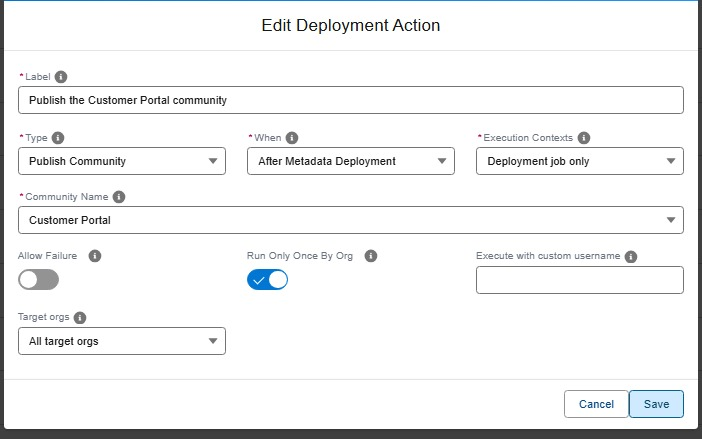

<!-- markdownlint-disable MD013 -->

## Publish an Experience Cloud site

One of the types of [deployment actions](salesforce-devops-work-on-user-story-deployment-actions.md), YAML `type: publish-community`. That page explains what all types share: when actions run, how to choose their target orgs, how they are tracked and how to recover a failed one.

Publishes an Experience Cloud (community) site of the target org after the deployment, so your changes become visible to its users.



<details markdown="1"><summary>Technical: publish-community action (YAML)</summary>

Publishes the specified Experience Cloud (community) site using `sf community publish`.

| Custom parameter           | Description                                       | Example            |
|----------------------------|---------------------------------------------------|--------------------|
| `parameters.communityName` | Name of the community/Experience site to publish. | `MyExperienceSite` |

```yaml
- id: 3d700b21-4916-4344-ac46-67919081a008
  label: Publish Experience site
  type: publish-community
  parameters:
    communityName: "My Experience Site"
  context: process-deployment-only
```

</details>
