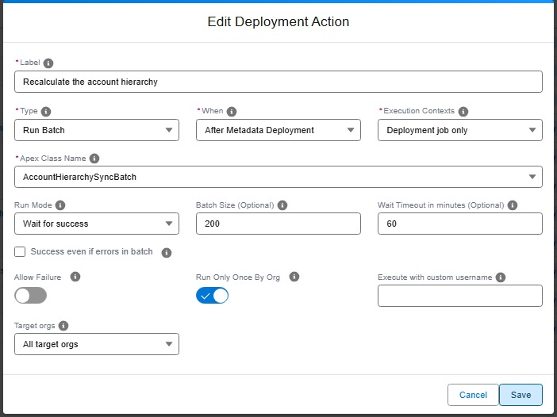

<!-- markdownlint-disable MD013 -->

## Run an Apex batch

One of the types of [deployment actions](salesforce-devops-work-on-user-story-deployment-actions.md), YAML `type: run-batch`. That page explains what all types share: when actions run, how to choose their target orgs, how they are tracked and how to recover a failed one.

Runs an Apex batch once, right during the deployment: recalculate a field on existing records after a new formula ships, or clean data before the metadata arrives. The class picker proposes the batchable classes of the org and of the project, and the global batchable classes of the installed packages.



<details markdown="1"><summary>Technical: run-batch action (YAML)</summary>

Runs an Apex batch class using `Database.executeBatch()`. The action verifies that the specified Apex class exists in the org, implements the `Database.Batchable` interface, and has a public no-arg constructor. If the class does not meet these requirements, the action fails with a recommendation to use an [`apex`](salesforce-devops-work-on-user-story-deployment-actions-apex.md) action instead.

The action can run before or after the metadata deployment. Before the deployment, the class must already be in the target org: a class shipped by the same Pull Request is only there afterwards.

With `runMode: wait`, the deployment job follows the batch until it ends:

| Batch result                        | Action result                                              |
|-------------------------------------|------------------------------------------------------------|
| Completed without error             | Success                                                    |
| Completed with batches in error     | Failed, or success when `successEvenIfBatchErrors` is true |
| Failed or aborted                   | Failed                                                     |
| Not over after `waitTimeoutMinutes` | Failed. The batch keeps running in the org                 |

With `runMode: no-wait`, the batch is launched and the deployment goes on. Before the deployment, that means the batch may still be running while the metadata deploys.

The action never runs the same batch twice at once. When a job of the class is still running in the org, no other one is launched: in wait mode the action follows that job, in no-wait mode it succeeds right away. When a job of the class completed less than 3 hours ago with a result the action accepts, it stands for this run. That covers a deployment retried after a wait timeout.

A long wait holds the CI/CD job: keep `waitTimeoutMinutes` below the timeout of your runner.

Like for `schedule-batch`, a class of a managed package is written with its namespace, `ns.ClassName`, and must be `global`.

| Custom parameter                      | Required? | Description                                                                                   | Example             |
|---------------------------------------|:---------:|-----------------------------------------------------------------------------------------------|---------------------|
| `parameters.className`                |    Yes    | Name of the Apex class that implements `Database.Batchable` with a public no-arg constructor. | `CrewCapacityBatch` |
| `parameters.runMode`                  |    No     | `wait` (default) or `no-wait`.                                                                | `wait`              |
| `parameters.batchSize`                |    No     | Number of records per batch, from 1 to 2000. Defaults to 200.                                 | `50`                |
| `parameters.waitTimeoutMinutes`       |    No     | Wait mode only. Minutes to wait for the batch. Defaults to 60.                                | `30`                |
| `parameters.successEvenIfBatchErrors` |    No     | Wait mode only. Keeps the action successful when the batch completes with batches in error.   | `true`              |

```yaml
- id: 13334707-29d0-44e7-bd88-725e4097d30d
  label: Recalculate crew capacity
  type: run-batch
  parameters:
    className: CrewCapacityBatch
    runMode: wait
    batchSize: 50
    waitTimeoutMinutes: 30
  context: process-deployment-only
```

> **Note:** A run-batch action only runs in the `process-deployment-only` context: a batch changes the data of the org, so it never runs during a deployment check.

</details>
