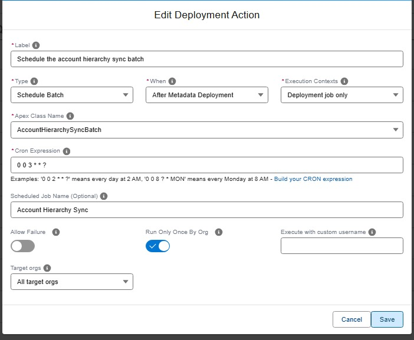

<!-- markdownlint-disable MD013 -->

## Schedule an Apex batch

One of the types of [deployment actions](salesforce-devops-work-on-user-story-deployment-actions.md), YAML `type: schedule-batch`. That page explains what all types share: when actions run, how to choose their target orgs, how they are tracked and how to recover a failed one.

Schedules an Apex batch job in the target org, with a cron expression you can build with a click ("every day at 3 AM"...). The class picker proposes the schedulable classes of the org and of the project, and the global schedulable classes of the installed packages.



<details markdown="1"><summary>Technical: schedule-batch action (YAML)</summary>

Schedules an Apex batch class using `System.schedule()`. The action verifies that the specified Apex class exists in the org, implements the `Schedulable` interface, and has a public no-arg constructor. If the class does not meet these requirements, the action fails with a recommendation to use an [`apex`](salesforce-devops-work-on-user-story-deployment-actions-apex.md) action instead.

The class can come from an installed package. A class of an unlocked package without namespace is named like any other. A class of a managed package is written with its namespace, `ns.ClassName`, and must be `global`: a managed package hides every other class, and nothing outside the package can schedule them.

If a scheduled job with the same name and cron expression already exists, the action is skipped (idempotent). If a job with the same name but a **different** cron expression exists, the action fails so you can resolve the conflict manually.

| Custom parameter            | Required? | Description                                                                            | Example            |
|-----------------------------|:---------:|----------------------------------------------------------------------------------------|--------------------|
| `parameters.className`      |    Yes    | Name of the Apex class that implements `Schedulable` with a public no-arg constructor. | `MyBatchScheduler` |
| `parameters.cronExpression` |    Yes    | Cron expression for the schedule (Salesforce format).                                  | `0 0 0 * * ?`      |
| `parameters.jobName`        |    No     | Name of the scheduled job. Defaults to `<className>_Schedule` if omitted.              | `MyBatch_Nightly`  |

```yaml
- id: 1991c08c-a791-4e54-8adb-307ff23b7564
  label: Schedule nightly batch
  type: schedule-batch
  parameters:
    className: MyBatchScheduler
    cronExpression: "0 0 0 * * ?"
    jobName: MyBatch_Nightly
  context: process-deployment-only
```

> **Note:** If your Schedulable class requires constructor arguments or has a non-public constructor, use an [`apex`](salesforce-devops-work-on-user-story-deployment-actions-apex.md) action with a custom `.apex` script instead.

</details>

<!-- training-links:start -->

## Learn by doing

The free [Salesforce DevOps with sfdx-hardis](https://sfdx-hardis-training.cloudity.com) course does this, click by click, on an org of your own:

- [Lab 2.4 - Ship reference data and a batch with deployment actions](https://sfdx-hardis-training.cloudity.com/en/level-2-contributor-advanced/2-4-ship-reference-data-and-a-batch-with-deployment-actions/)

<!-- training-links:end -->
