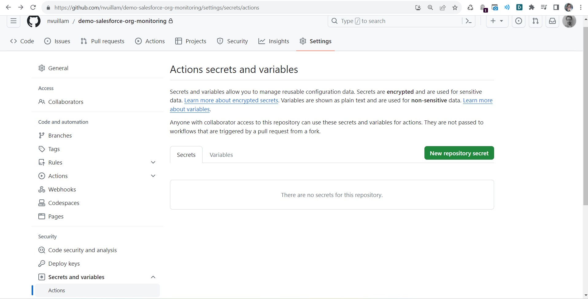
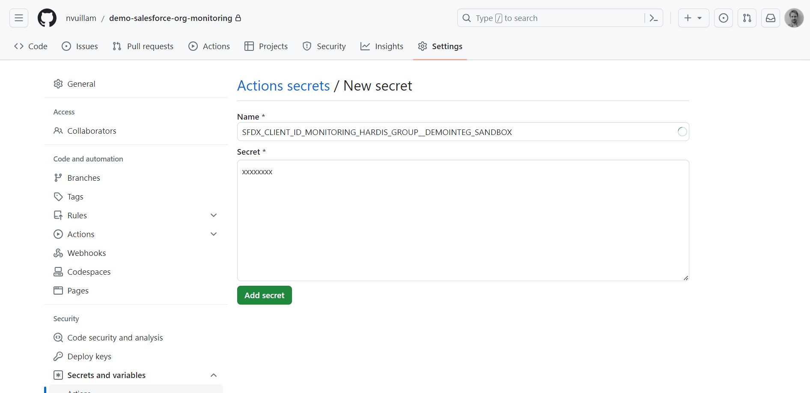

<!-- markdownlint-disable MD013 -->

- [Pre-requisites](#pre-requisites)
- [Run sfdx-hardis configuration command](#run-sfdx-hardis-configuration-command)
- [Define sfdx-hardis environment variables](#define-sfdx-hardis-environment-variables)
- [The workflow on main](#the-workflow-on-main)
- [Schedule the monitoring job](#schedule-the-monitoring-job)

## Pre-requisites

- A repository dedicated to monitoring, with `monitoring` in its name, cloned on your computer
- GitHub credentials allowed to push workflow files (the `workflow` scope): the command pushes `.github/workflows/org-monitoring.yml`, and GitHub refuses that push from credentials without it

## Run sfdx-hardis configuration command

- Run command **Configuration -> Configure Org Monitoring** in the VS Code SFDX Hardis extension, or click **Install Org Monitoring** in the **Org Monitoring Workbench**: both run the same command. Then follow the instructions.
- Run it once per org to monitor: each org gets its own git branch, named `monitoring_` followed by the org domain

## Define sfdx-hardis environment variables

The command stops and asks you to confirm when the variables are set. Define them at that moment, before you answer:

- Go to **Repository -> Settings > Secrets and variables -> Actions** _(you must have GitHub authorizations to access this menu)_
- For each variable the sfdx-hardis command **Configure org monitoring** tells you to define, click **New repository secret** and enter the name and value given in the sfdx-hardis command logs

Each run of the command creates a new certificate: if you run it again for the same org, store the two new values it gives, they replace the previous ones.





## The workflow on main

On GitHub Actions, scheduled workflows only run on the default branch, and **Run workflow** is only offered for the workflows of that branch.

At its end, the command writes `.github/workflows/org-monitoring.yml` on `main` with the monitored branch and its two variables in it, keeping the orgs already listed, then pushes `main`. A single GitHub Actions job (using a matrix) runs the monitoring of all orgs.

- **Never merge a monitoring branch into `main`.** `main` holds the workflow only, each org lives on its own branch. A merge brings the example workflow of the branch to `main`, and its jobs fail on branches called `monitoring_myclient`
- If the push is refused with _refusing to allow an OAuth App to create or update workflow ... without `workflow` scope_, sign in to GitHub again with credentials that have that scope (in VS Code: **Accounts** menu, sign out of GitHub, then sign in again), and run the command again: it pushes what the refused push left on your local `main`
- If the command says it could not write the workflow on `main` for another reason, check out `main`, copy `.github/workflows/org-monitoring.yml` from the monitoring branch (or from [org-monitoring.yml](https://github.com/hardisgroupcom/sfdx-hardis/blob/main/defaults/monitoring/.github/workflows/org-monitoring.yml)), search (Ctrl+F) for **MANUAL**, add your monitored branches and your authentication variable names where indicated, then commit and push

Examples:

```yaml
      env:
        # MANUAL: Update variables below !
        SFDX_CLIENT_ID_MONITORING_MY_CLIENT__INTEG_SANDBOX: ${{ secrets.SFDX_CLIENT_ID_MONITORING_MY_CLIENT__INTEG_SANDBOX}}
        SFDX_CLIENT_KEY_MONITORING_MY_CLIENT__INTEG_SANDBOX: ${{ secrets.SFDX_CLIENT_KEY_MONITORING_MY_CLIENT__INTEG_SANDBOX}}
        SFDX_DEPLOY_WAIT_MINUTES: ${{ vars.SFDX_DEPLOY_WAIT_MINUTES || '120' }}
```

## Schedule the monitoring job

The schedule is already included in **org-monitoring.yml** on the **main** branch.

The default is every day at midnight, but you can update the [CRON expression](https://crontab.cronhub.io/).

```yaml
on:
  push:
  # Automatically run every day at midnight
  schedule:
    - cron: "0 0 * * *" # Cron format -> https://crontab.cronhub.io/
```

<!-- training-links:start -->

## Learn by doing

The free [Salesforce DevOps with sfdx-hardis](https://sfdx-hardis-training.cloudity.com) course does this, click by click, on an org of your own:

- [Lab 3.8 - Monitor your production org](https://sfdx-hardis-training.cloudity.com/en/level-3-release-manager/3-8-monitor-your-production-org/)

<!-- training-links:end -->
