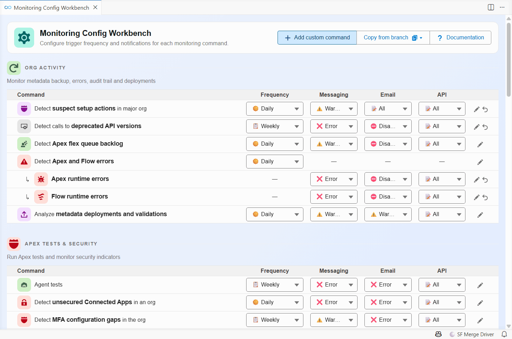

<!-- markdownlint-disable MD013 -->

- [Video tutorial](#video-tutorial)
- [Instructions](#instructions)
  - [Common instructions](#common-instructions)
  - [GitHub](#github)
  - [GitLab](#gitlab)
  - [Azure](#azure)
  - [Bitbucket](#bitbucket)
  - [Jenkins (any Git server)](#jenkins-any-git-server)
- [Notifications](#notifications)
- [Troubleshooting](#troubleshooting)
  - [Too many files to retrieve](#too-many-files-to-retrieve)

## Video tutorial

<div style="text-align:center"><iframe width="560" height="315" src="https://www.youtube.com/embed/bcVdN0XItSc" title="YouTube video player" frameborder="0" allow="accelerometer; autoplay; clipboard-write; encrypted-media; gyroscope; picture-in-picture" allowfullscreen></iframe></div>

## Instructions

### Common instructions

All you need to configure sfdx-hardis Org Monitoring is a **GitHub**, **GitLab**, **Azure**, **Bitbucket** or any Git server accessible from a **Jenkins** instance.

- Create and clone a git repository (initialize it with README)
- Open it with Visual Studio Code, then open the [VS Code SFDX Hardis extension](https://marketplace.visualstudio.com/items?itemName=NicolasVuillamy.vscode-sfdx-hardis) menu.
  - If you need installation instructions, see the [installation documentation page](salesforce-devops-use-install.md)

- Follow the instructions, which can differ depending on your git provider

> Tip: Schedule monitoring jobs at different hours so the notifications are more readable, for example production at 1 AM and preprod at 2 AM

### GitHub

- [GitHub configuration](salesforce-monitoring-config-github.md)
  - [Pre-requisites](salesforce-monitoring-config-github.md#pre-requisites)
  - [Schedule monitoring job](salesforce-monitoring-config-github.md#schedule-the-monitoring-job)

### GitLab

- [GitLab configuration](salesforce-monitoring-config-gitlab.md)
  - [Pre-requisites](salesforce-monitoring-config-gitlab.md#pre-requisites)
  - [Schedule monitoring job](salesforce-monitoring-config-gitlab.md#schedule-the-monitoring-job)

### Azure

- [Azure configuration](salesforce-monitoring-config-azure.md)
  - [Pre-requisites](salesforce-monitoring-config-azure.md#pre-requisites)
  - [Schedule monitoring job](salesforce-monitoring-config-azure.md#schedule-the-monitoring-job)

### Bitbucket

- [Bitbucket configuration](salesforce-monitoring-config-bitbucket.md)
  - [Pre-requisites](salesforce-monitoring-config-bitbucket.md#pre-requisites)
  - [Schedule monitoring job](salesforce-monitoring-config-bitbucket.md#schedule-the-monitoring-job)

### Jenkins (any Git server)

- [Jenkins configuration](salesforce-monitoring-config-jenkins.md)
  - [Pre-requisites](salesforce-monitoring-config-jenkins.md#pre-requisites)
  - [Schedule monitoring job](salesforce-monitoring-config-jenkins.md#schedule-the-monitoring-job)

## Notifications

For a better user experience, we highly recommend configuring notifications.

You can wire any combination of the following targets. They are fully independent and can be enabled in parallel:

- [Slack instructions](salesforce-devops-setup-integration-slack.md) - post to one or several Slack channels (global, branch-scoped, errors-only)
- [Microsoft Teams instructions](salesforce-devops-setup-integration-ms-teams.md) - post to Teams channels via incoming webhooks
- [Email instructions](salesforce-devops-setup-integration-email.md) - send to any recipient list, with per-notification-type overrides
- [API / Grafana instructions](salesforce-devops-setup-integration-api.md) - stream logs and Prometheus metrics to Grafana Loki, Prometheus, or any HTTP endpoint (used to build the [Org Monitoring by sfdx-hardis Grafana dashboards](salesforce-monitoring-grafana-v2.md))

sfdx-hardis groups these targets into three channels, and you can configure each channel independently per notification type:

- **messaging**: Slack and Microsoft Teams
- **email**: email recipients
- **api**: the sfdx-hardis API / metrics provider (e.g. Grafana Loki, Prometheus). The `api` channel is always sent when configured, unless explicitly set to `off`.

The full configuration (frequency, per-channel severity thresholds, custom commands) can be edited from the [VS Code SFDX Hardis extension](https://marketplace.visualstudio.com/items?itemName=NicolasVuillamy.vscode-sfdx-hardis) UI, or directly in `.sfdx-hardis.yml`:



### Fine-grained routing per notification type

You can configure, for each notification type, the minimum severity that must be reached before a channel is notified. This avoids overflowing Slack/Teams with informational notifications while still streaming everything to Grafana.

Severity order (low to high): `log < success < info < warning < error < critical`. Use `off` to disable a channel for a given notification type.

```yaml
monitoringCommands:
  - key: AUDIT_TRAIL
    notifications:
      messaging: warning   # Slack/Teams only on warning, error, critical
      email: error         # email only on error and critical
      api: log             # everything goes to Grafana
  - key: ORG_LIMITS
    notifications:
      messaging: error
      email: critical
  - key: METADATA_STATUS
    notifications:
      messaging: off       # mute Slack/Teams for this notification type
```

### Override email recipients per notification type

For email, you can also override the recipient list per notification type, on top of the env-var-based recipients (`NOTIF_EMAIL_ADDRESS`, `NOTIF_EMAIL_ADDRESS_<BRANCH>`, `NOTIF_EMAIL_ADDRESS_<TYPE>`). Recipients listed in YAML are appended by default; set `replaceRecipients: true` to fully redirect the notification type to a dedicated mailing list.

```yaml
monitoringCommands:
  - key: AUDIT_TRAIL
    notifications:
      email:
        threshold: warning
        recipients:
          - security@company.com
          - audit-team@company.com
        replaceRecipients: true   # ignore env-var recipients for this type
  - key: BACKUP
    notifications:
      email:
        recipients:
          - devops@company.com    # appended to existing env-var recipients
```

You can also decide to skip posting logs or metrics to API for all notification types or specific ones by defining env variables **NOTIF_API_SKIP_LOGS** and **NOTIF_API_SKIP_METRICS**.

Examples:

```sh
# Skip posting logs to API and JSON file for specific notification types
NOTIF_API_SKIP_LOGS=UNUSED_USERS,METADATA_STATUS
```

```sh
# Skip posting logs to API and JSON file for all notification types
NOTIF_API_SKIP_LOGS=all
# Skip posting metrics to API for specific notification types
NOTIF_API_SKIP_METRICS=METADATA_STATUS,UNUSED_METADATAS
```

In **NOTIF_API_SKIP_LOGS**, `UNUSED_USERS` also covers the other checks that send user rows: `UNUSED_USERS_CRM_6_MONTHS`, `UNUSED_USERS_EXPERIENCE_6_MONTHS`, `ACTIVE_USERS`, `ACTIVE_USERS_CRM_WEEKLY` and `ACTIVE_USERS_EXPERIENCE_MONTHLY`. Their metrics are still sent.

## Monitoring commands

You can fine-tune which monitoring commands run, how often, and how their notifications are routed via the **monitoringCommands** property in `.sfdx-hardis.yml`. User entries are **merged by `key`** onto the built-in defaults, so you only need to declare the fields you want to override; new keys are appended as custom commands.

### Frequency

Each entry accepts a `frequency` field with one of:

- `daily`: runs on every run
- `weekly`: runs once per week. The firing day is configurable via `frequencyDay` (`monday`..`sunday`, default `saturday`)
- `biweekly`: runs every other week. Same `frequencyDay` selector. The anchor uses ISO week parity so two `biweekly` entries with the same `frequencyDay` always fire on the same calendar weeks
- `monthly`: runs once per month. The firing day is configurable via `frequencyDayOfMonth` (`1`..`31`, default `1`). Values larger than the current month's last day are clamped to the last day, so `31` reliably means "last day of the month"
- `off`: never runs unless `--force-all` is passed to `hardis:org:monitor:all` (or env var `MONITORING_IGNORE_FREQUENCY=true` is set)

Example overriding cadence + day:

```yaml
monitoringCommands:
  - key: AUDIT_TRAIL
    frequency: weekly
    frequencyDay: monday
  - key: LICENSES
    frequency: monthly
    frequencyDayOfMonth: 1
  - key: ORG_LIMITS
    frequency: off
```

### Custom commands

To add a brand new command, declare a new key with `title` and `command`. Frequency and notifications are optional and behave the same as built-in entries:

```yaml
monitoringCommands:
  - key: MY_CUSTOM_REPORT
    title: My custom command
    command: sf my:custom:command
    frequency: biweekly
    frequencyDay: friday
    notifications:
      messaging: info
      email: warning
```

## Troubleshooting

### Too many files to retrieve

Salesforce refuses to retrieve more than 10000 files at once (`LIMIT_EXCEEDED: Too many files in retrieve call, limit is: 10000`). A file is not a metadata item: an Apex class is 2 files, a Lightning Web Component several, while a field lives inside the file of its object. An org with many reports, email templates or documents reaches the limit first.

When the org refuses the retrieve, the backup does not fail at once:

1. It retrieves again without the types that matter least in a backup: `Report`, `Dashboard`, `Document`, `EmailTemplate` and their folder types (`ReportFolder`, `DashboardFolder`, `DocumentFolder`, `EmailFolder`, `EmailTemplateFolder`), `ContentAsset`, `StaticResource`, the translation types (`Translations`, `CustomObjectTranslation`, `CustomFieldTranslation`, `StandardValueSetTranslation`, `GlobalValueSetTranslation`) and every `Wave*` type. All of them are left out together, even when fewer would have been enough.
2. If the org refuses it again, it also leaves out `ExperienceBundle`.
3. If the org still refuses it, the backup fails with the error.

When a retry works, the backup is committed and the `BACKUP` notification has the **warning** severity, with the types left out and a **How to fix** button that leads to this section. The items left out are listed in `manifest/package-backup-truncated-items.xml`, and their files keep the state of the last backup that retrieved them: their changes are not tracked anymore. Deletions still are: when one of them is deleted in the org, the next backup deletes its files, as for a type you skip (see [Deleted components](salesforce-monitoring-metadata-backup.md#deleted-components)).

This is a workaround, not a normal state: the warning comes back at each backup until you fix the filters. Decide what you do not need to back up, then:

- For one monitored org: add it to `manifest/package-skip-items.xml` in the branch of this org, then commit and push. You can edit this file from the Org Monitoring panel of the [VS Code extension](https://marketplace.visualstudio.com/items?itemName=NicolasVuillamy.vscode-sfdx-hardis). It accepts full types (`<members>*</members>`), named items (`<members>Account.Name</members>`) and partial wildcards (`<members>pi__*</members>`, `<members>*__dlm</members>`, `<members>prefix*suffix</members>`).
- For every monitored org: add the types to the CI/CD variable `MONITORING_BACKUP_SKIP_METADATA_TYPES`, for example `MONITORING_BACKUP_SKIP_METADATA_TYPES=Report,Dashboard,EmailTemplate`.

`manifest/package-backup-truncated-items.xml` is a good starting point: copy into `manifest/package-skip-items.xml` the types or items you can do without. Leaving out a whole type is often enough, for example the reports of an org that has thousands of them. The next backup that fits in one retrieve sends no warning and deletes `manifest/package-backup-truncated-items.xml`.

If you need to back up everything, you can switch to the [full mode](https://sfdx-hardis.cloudity.com/hardis/org/monitor/backup/#full-mode) instead: it splits the retrieve in several calls of at most 3000 items (`--max-by-chunk`), so it never leaves anything out (if a chunk is still refused for too many files, add a smaller `--max-by-chunk`). It is not the recommended way: several retrieves make the backup much slower, and the translations of each call only cover the components of the same call. To use it, update the CI/CD workflow file of the monitoring repository and add the arguments to the backup command:

```sh
sf hardis:org:monitor:backup --full --exclude-namespaces --full-apply-filters
```

- `--exclude-namespaces` and `--full-apply-filters` keep the filters of the default mode (installed packages, `manifest/package-skip-items.xml`, `MONITORING_BACKUP_SKIP_METADATA_TYPES`). Without them, the full mode retrieves everything, managed packages included.
- The line to change is `sf hardis:org:monitor:backup` in `.github/workflows/org-monitoring.yml`, `.gitlab-ci.yml`, `azure-pipelines.yml`, `bitbucket-pipelines.yml` or `Jenkinsfile`.
- On GitHub, the workflow lives on the default branch and runs every monitoring branch: the change applies to all your monitored orgs.
- Instead of `--full`, you can set the variable `MONITORING_BACKUP_MODE_FULL=true`, if your CI/CD platform passes it to the backup job.

When the backup still fails after leaving out `ExperienceBundle`, the remaining types alone are over the limit: skip some of them in the same way. To find which ones are the largest, run `sf hardis:org:monitor:backup --full --exclude-namespaces --full-apply-filters --max-by-chunk 500`, which retrieves in small chunks and lists the content of each one.
