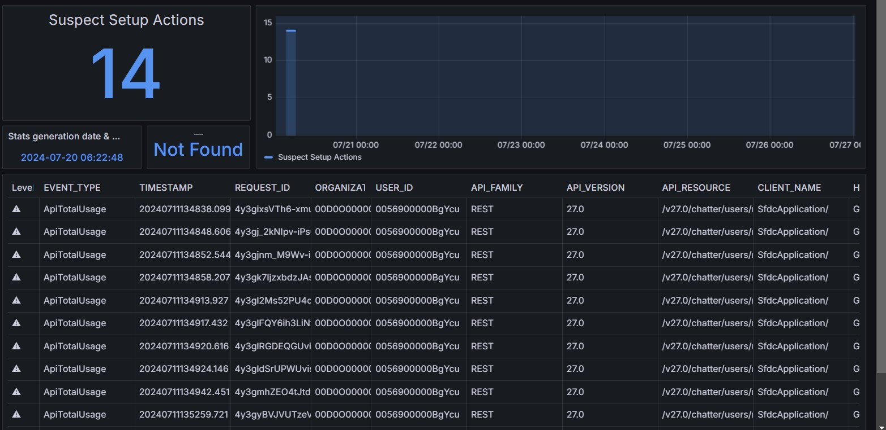
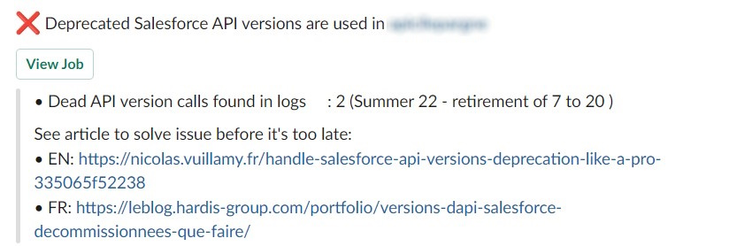

<!-- markdownlint-disable MD013 -->

## Detect calls to deprecated API versions

!!! warning "Deprecated"
    This check is replaced by [What will break](salesforce-monitoring-what-will-break.md), which checks the calls to retired API versions together with everything else that will break after a dated Salesforce change. The daily monitoring now runs it instead.

Checks whether [legacy API versions are called by external tools](https://nicolas.vuillamy.fr/handle-salesforce-api-versions-deprecation-like-a-pro-335065f52238).

Sfdx-hardis command: [sf hardis:org:diagnose:legacyapi](https://sfdx-hardis.cloudity.com/hardis/org/diagnose/legacyapi/)

Key: **LEGACY_API**

### Grafana example

### Slack example

