<!-- markdownlint-disable MD013 MD034 MD052 MD060 -->
<!-- This page is generated by scripts/build-pipeline-settings-doc.mjs: change the script or the JSON schema, not the page -->

# Pipeline Settings

Pipeline Settings is the editor of the sfdx-hardis configuration of a project: where the branches deploy, how deployments run, which tickets are linked, what a contributor is offered. This page lists every setting of the panel, tab by tab, with the key it writes in `.sfdx-hardis.yml`.

## Open it

- In the [DevOps Pipeline](vscode-extension-devops-pipeline.md) panel, open the gear menu and click **Pipeline Settings**.
- The panel opens read-only. Click **Edit**, change what you need, then **Save**.
- A setting left empty reads **Not defined**, or shows its default value followed by **Default**.
- **Docs** next to a setting opens its documentation page.

## Two scopes

The selector at the top right of the panel chooses what you are editing:

| Scope | File written | What it holds |
|-------|--------------|---------------|
| **Global Settings** | `config/.sfdx-hardis.yml` | The settings of the whole project |
| **Branch: integration**, or another major branch | `config/branches/.sfdx-hardis.<name>.yml` | The settings of one major branch and of the org it deploys to |

A setting only exists on the scopes listed for it below. Some are on both: the value of the branch then replaces the one of the project for that branch.

These files are part of the repository: a change is live for the team once it is committed and merged, like any other change.

## Project settings

Scope **Global Settings**. They are written in `config/.sfdx-hardis.yml`.

### Deployment

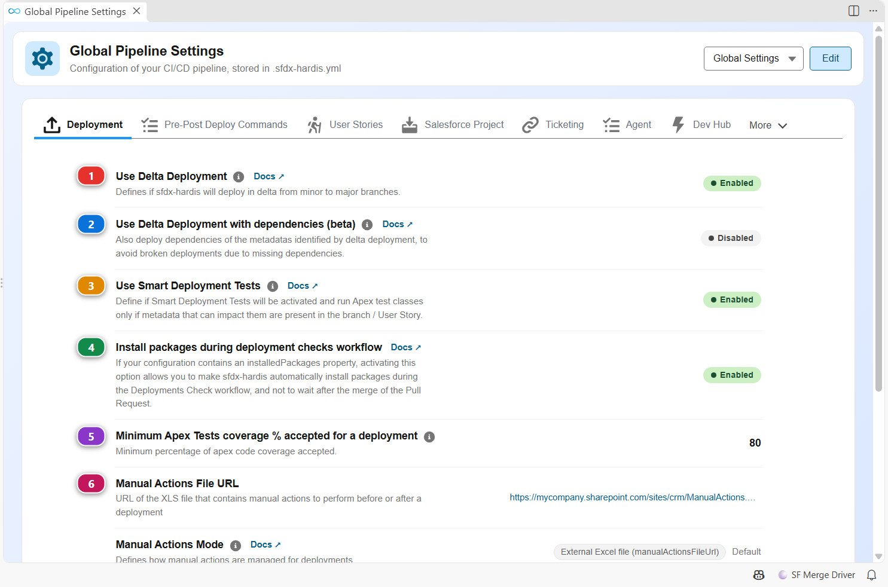

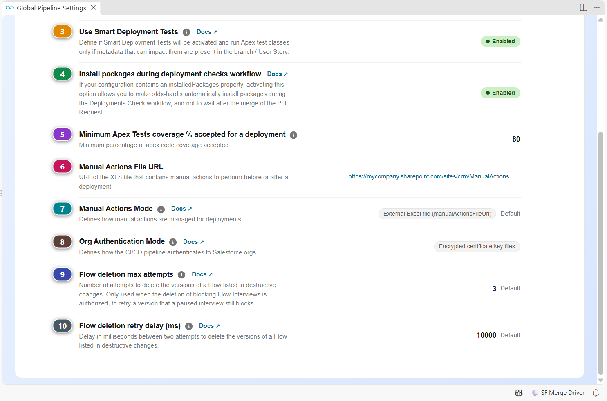

| | Setting | Key | What it does |
|:-:|---------|-----|--------------|
| **(1)** | Use Delta Deployment | `useDeltaDeployment` | Defines if sfdx-hardis will deploy in delta from minor to major branches. When active, Delta Deployments allow to deploy only the metadatas in the branch / User Story, and not the full sources of the SFDX project. Note: Even if activated, Delta Deployments will be applied only for Pull Requests from minor (features,hotfixes) to major branches (integration,preprod). Default: `false`. [Docs](salesforce-devops-config-delta-deployment.md#delta-mode) |
| **(2)** | Use Delta Deployment with dependencies (beta) | `useDeltaDeploymentWithDependencies` | Also deploy dependencies of the metadatas identified by delta deployment, to avoid broken deployments due to missing dependencies. Example: removed picklist value in a field, that is still used in a record type. Default: `false`. [Docs](salesforce-devops-config-delta-deployment.md#delta-with-dependencies-beta) |
| **(3)** | Use Smart Deployment Tests | `useSmartDeploymentTests` | Define if Smart Deployment Tests will be activated and run Apex test classes only if metadata that can impact them are present in the branch / User Story. Note: Smart Deployment Tests will be applied only for Pull Requests from minor (features,hotfixes) to major branches (integration,preprod). Default: `false`. [Docs](hardis/project/deploy/smart.md#smart-deployments-tests) |
| **(4)** | Install packages during deployment checks workflow | `installPackagesDuringCheckDeploy` | If your configuration contains an installedPackages property, activating this option allows you to make sfdx-hardis automatically install packages during the Deployments Check workflow, and not to wait after the merge of the Pull Request. Default: `false`. [Docs](salesforce-devops-work-on-user-story-install-packages.md) |
| **(5)** | Minimum Apex Tests coverage % accepted for a deployment | `apexTestsMinCoverageOrgWide` | Minimum percentage of apex code coverage accepted. 75.0% by default, but if you are on a clean project, it's better to define 80.0, 95.0 or 90.0 😎 Default: `75`. |
| **(6)** | Manual Actions File URL | `manualActionsFileUrl` | URL of the XLS file that contains manual actions to perform before or after a deployment |
| **(7)** | Manual Actions Mode | `manualActionsMode` | Defines how manual actions are managed for deployments. - **externalFile** (default): Manual actions are tracked in an external Excel/XLS file referenced by manualActionsFileUrl, and hardis:work:save reminds you to update it at the end of a run. - **sfdxHardis**: Manual actions are managed directly within sfdx-hardis, as deployment actions of type `manual`. They are listed in the Pull Request comments, where they can be ticked off once performed, and no external file is required. Default: `externalFile`. [Docs](salesforce-devops-work-on-user-story-deployment-actions.md) |
| **(8)** | Org Authentication Mode | `orgAuthenticationMode` | Defines how the CI/CD pipeline authenticates to Salesforce orgs. - **encryptedCert** (default): Authentication uses encrypted certificate key files committed to the repository. The pipeline view will warn if a key file is missing for a branch. - **secretsOnly**: Authentication relies solely on CI/CD secrets variables (e.g. SFDX_HARDIS_CERT_&lt;ORG&gt;). No key file is required, and the pipeline view will not warn about missing certificate files. Default: `encryptedCert`. [Docs](salesforce-devops-setup-auth.md) |
| **(9)** | Flow deletion max attempts | `flowDeleteMaxAttempts` | Number of attempts to delete the versions of a Flow listed in destructive changes. Only used when the deletion of blocking Flow Interviews is authorized, to retry a version that a paused interview still blocks. Can also be set with the FLOW_DELETE_MAX_ATTEMPTS env variable, which takes priority. A value below 1 or not an integer is ignored, with a warning. Default: `3`. [Docs](hardis/project/deploy/smart.md#flow-deletion-in-destructive-changes) |
| **(10)** | Flow deletion retry delay (ms) | `flowDeleteRetryDelayMs` | Delay in milliseconds between two attempts to delete the versions of a Flow listed in destructive changes. Can also be set with the FLOW_DELETE_RETRY_DELAY_MS env variable, which takes priority. A negative value or a value that is not an integer is ignored, with a warning. Default: `10000`. [Docs](hardis/project/deploy/smart.md#flow-deletion-in-destructive-changes) |

### Pre-Post Deploy Commands

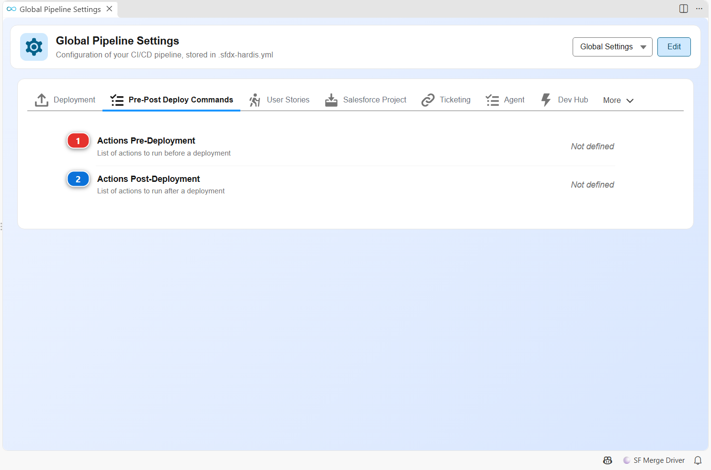

| | Setting | Key | What it does |
|:-:|---------|-----|--------------|
| **(1)** | Actions Pre-Deployment | `commandsPreDeploy` | List of actions to run before a deployment |
| **(2)** | Actions Post-Deployment | `commandsPostDeploy` | List of actions to run after a deployment |

### User Stories

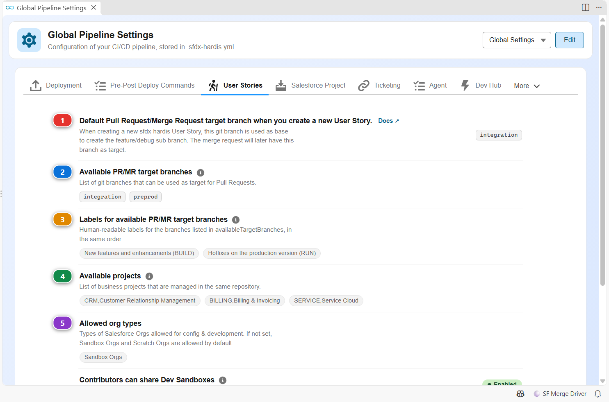

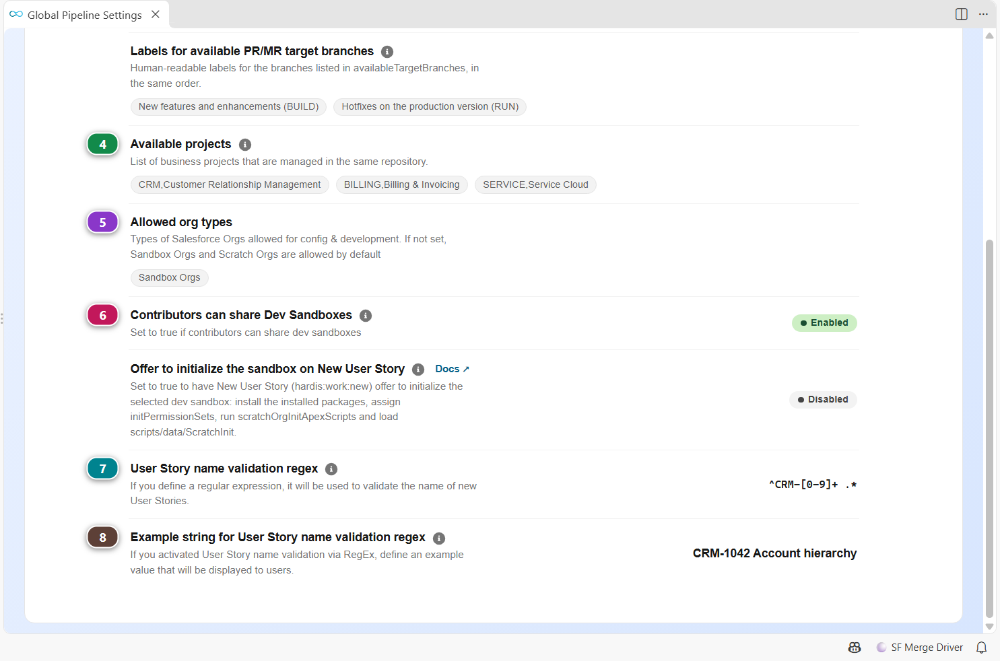

| | Setting | Key | What it does |
|:-:|---------|-----|--------------|
| **(1)** | Default Pull Request/Merge Request target branch when you create a new User Story. | `developmentBranch` | When creating a new sfdx-hardis User Story, this git branch is used as base to create the feature/debug sub branch. The merge request will later have this branch as target. Default: `integration`. [Docs](hardis/work/new.md) |
| **(2)** | Available PR/MR target branches | `availableTargetBranches` | List of git branches that can be used as target for Pull Requests. Contributors will be prompt to select one of these target branch when creating a new User Story A classic example on a project with BUILD & RUN in parallel is to have preprod and integration as available target branches. If defined, makes obsolete the parameter Default Pull Request target branch. |
| **(3)** | Labels for available PR/MR target branches | `availableTargetBranchesLabels` | Human-readable labels for the branches listed in availableTargetBranches, in the same order. When defined, the label at index N is shown instead of the raw branch name when prompting contributors to select a target branch. Example: availableTargetBranches: [preprod, integration] and availableTargetBranchesLabels: [Pre-Production, Integration] |
| **(4)** | Available projects | `availableProjects` | List of business projects that are managed in the same repository. If defined, when creating a new User Story, it will be prompted to the contributor then used to create the git branch name. If a value contains a comma, the left part will be used for key and the right part as label for the users. |
| **(5)** | Allowed org types | `allowedOrgTypes` | Types of Salesforce Orgs allowed for config & development. If not set, Sandbox Orgs and Scratch Orgs are allowed by default |
| **(6)** | Contributors can share Dev Sandboxes | `sharedDevSandboxes` | Set to true if contributors can share dev sandboxes If active, contributors are never offered to initialize their sandbox on New User Story, to avoid overwriting their colleagues work by accident Default: `false`. |
| **(7)** | User Story name validation regex | `newTaskNameRegex` | If you define a regular expression, it will be used to validate the name of new User Stories. For example, you can enforce a Jira number in the name with regex '^MYPROJECT-[0-9]+ .*' The regex is tested against the User Story name as typed by the user, so it can require spaces. Once the name is validated, spaces and special characters are replaced by '-' to build the git branch name. |
| **(8)** | Example string for User Story name validation regex | `newTaskNameRegexExample` | If you activated User Story name validation via RegEx, define an example value that will be displayed to users. Example: 'MYPROJECT-168 Update account status validation rule' |

### Salesforce Project

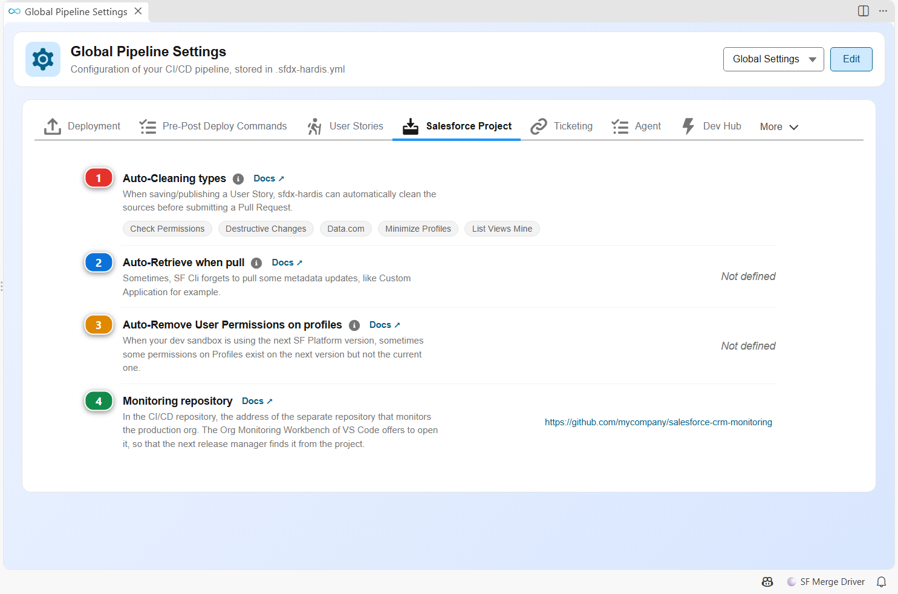

| | Setting | Key | What it does |
|:-:|---------|-----|--------------|
| **(1)** | Auto-Cleaning types | `autoCleanTypes` | When saving/publishing a User Story, sfdx-hardis can automatically clean the sources before submitting a Pull Request. Select the cleanings that will be automatically applied on your project. [Docs](salesforce-devops-config-cleaning.md) |
| **(2)** | Auto-Retrieve when pull | `autoRetrieveWhenPull` | Sometimes, SF Cli forgets to pull some metadata updates, like Custom Application for example. sfdx-hardis can automatically retrieve named metadatas to avoid issues. Example: - CustomApplication:MyApp1 - CustomApplication:MyApp2 Works also with full metadata types (ex: CustomApplication) [Docs](hardis/scratch/pull.md#command-behavior) |
| **(3)** | Auto-Remove User Permissions on profiles | `autoRemoveUserPermissions` | When your dev sandbox is using the next SF Platform version, sometimes some permissions on Profiles exist on the next version but not the current one. To avoid issues, you can force the removal of such permissions when Saving/Publishing a User Story Example: - EnableCommunityAppLauncher - OmnichannelInventorySync [Docs](hardis/work/save.md#command-behavior) |
| **(4)** | Monitoring repository | `monitoringRepository` | In the CI/CD repository, the address of the separate repository that monitors the production org. The Org Monitoring Workbench of VS Code offers to open it, so that the next release manager finds it from the project. Its mirror in the monitoring repository is deploymentRepository. [Docs](salesforce-monitoring-home.md) |

### Ticketing

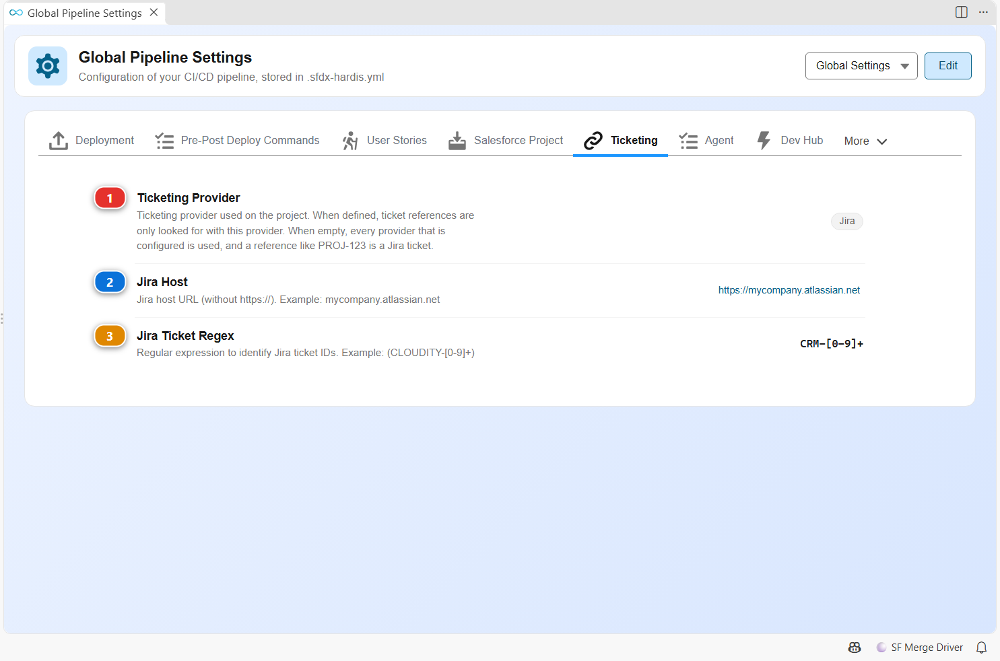

| | Setting | Key | What it does |
|:-:|---------|-----|--------------|
| **(1)** | Ticketing Provider | `ticketingProvider` | Ticketing provider used on the project. When defined, ticket references are only looked for with this provider. When empty, every provider that is configured is used, and a reference like PROJ-123 is a Jira ticket. |
| **(2)** | Jira Host | `jiraHost` | Jira host URL (without https://). Example: mycompany.atlassian.net |
| **(3)** | Jira Ticket Regex | `jiraTicketRegex` | Regular expression to identify Jira ticket IDs. Example: (CLOUDITY-[0-9]+) |

More rows appear depending on the other settings of the tab:

| Setting | Key | What it does |
|---------|-----|--------------|
| Generic Ticketing Provider Regex | `genericTicketingProviderRegex` | Regular expression to identify ticket IDs from your ticketing system. Example: ([R\|I][0-9]+-[0-9]+) for EasyVista. |
| Generic Ticketing Provider URL Builder | `genericTicketingProviderUrlBuilder` | URL pattern to build ticket URLs from ticket IDs. Use {REF} as placeholder for the ticket ID. Example: https://tickets.mycompany.com/ticket/{REF} |
| Generic Ticketing Provider Details URL Builder | `genericTicketingProviderDetailsUrlBuilder` | Optional. URL pattern of a JSON document describing a ticket, with {REF} as placeholder for the ticket ID. The JSON gives the ticket title in subject (or title, or summary) and optionally its status in status. When set, Pull Request comments, release notes and notifications show the title and the status next to each ticket link. Send a token with the GENERIC_TICKETING_PROVIDER_TOKEN variable when the URL requires one. [Docs](salesforce-devops-setup-integration-generic-ticketing.md) |
| ServiceNow Ticket Regex | `serviceNowTicketRegex` | Regular expression to identify ServiceNow record numbers in commits, branch names and Pull Request descriptions. The first capturing group must be the whole record number. Example: (INC[0-9]{7}) [Docs](salesforce-devops-setup-integration-servicenow.md) |
| ServiceNow Table Prefixes | `serviceNowTablePrefixes` | Additional record number prefixes, and the ServiceNow table each one belongs to, as PREFIX:table,PREFIX:table. Use it to reach the tables of a scoped application. [Docs](salesforce-devops-setup-integration-servicenow.md) |
| ServiceNow Comment Field | `serviceNowCommentField` | Journal field the deployment comment is written into. work_notes is the internal journal, comments is read by the person who opened the record. Default: `work_notes`. [Docs](salesforce-devops-setup-integration-servicenow.md) |
| ServiceNow Add Deployment Tag | `serviceNowAddDeploymentTag` | Add a tag on ServiceNow records when they are deployed in a major org. A ServiceNow tag is a record of the global label table, created on first use: keep it disabled unless the CI user is allowed to write there. Default: `false`. [Docs](salesforce-devops-setup-integration-servicenow.md) |
| Aha! Host | `ahaHost` | Host of your Aha! account. Example: mycompany.aha.io [Docs](salesforce-devops-setup-integration-aha.md) |
| Aha! Ticket Regex | `ahaTicketRegex` | Regular expression to identify Aha! feature references in commits, branch names and Pull Request descriptions. The first capturing group must be the whole reference. Example: (PROD-[0-9]+) [Docs](salesforce-devops-setup-integration-aha.md) |

### Agent

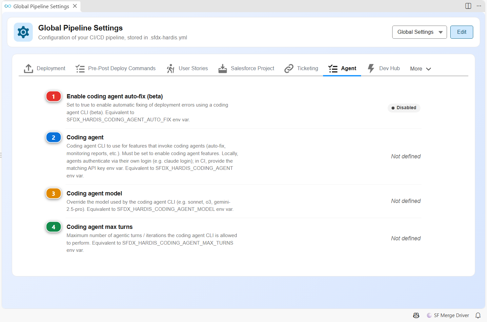

| | Setting | Key | What it does |
|:-:|---------|-----|--------------|
| **(1)** | Enable coding agent auto-fix (beta) | `codingAgentAutoFix` | Set to true to enable automatic fixing of deployment errors using a coding agent CLI (beta). Equivalent to SFDX_HARDIS_CODING_AGENT_AUTO_FIX env var. Default: `false`. |
| **(2)** | Coding agent | `codingAgent` | Coding agent CLI to use for features that invoke coding agents (auto-fix, monitoring reports, etc.). Must be set to enable coding agent features. Locally, agents authenticate via their own login (e.g. claude login); in CI, provide the matching API key env var. Equivalent to SFDX_HARDIS_CODING_AGENT env var. |
| **(3)** | Coding agent model | `codingAgentModel` | Override the model used by the coding agent CLI (e.g. sonnet, o3, gemini-2.5-pro). Equivalent to SFDX_HARDIS_CODING_AGENT_MODEL env var. |
| **(4)** | Coding agent max turns | `codingAgentMaxTurns` | Maximum number of agentic turns / iterations the coding agent CLI is allowed to perform. Equivalent to SFDX_HARDIS_CODING_AGENT_MAX_TURNS env var. |

### Dev Hub

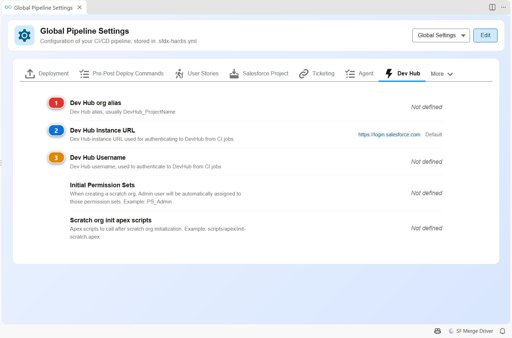

| | Setting | Key | What it does |
|:-:|---------|-----|--------------|
| **(1)** | Dev Hub org alias | `devHubAlias` | Dev Hub alias, usually DevHub_ProjectName |
| **(2)** | Dev Hub Instance URL | `devHubInstanceUrl` | Dev Hub instance URL used for authenticating to DevHub from CI jobs Default: `https://login.salesforce.com`. |
| **(3)** | Dev Hub Username | `devHubUsername` | Dev Hub username, used to authenticate to DevHub from CI jobs |

### Security & Privacy

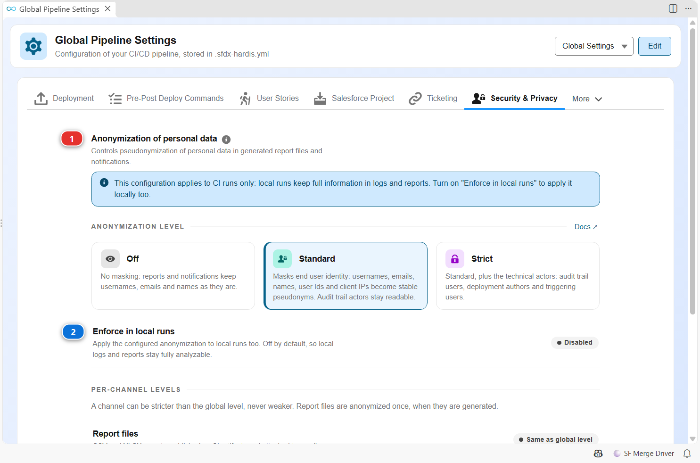

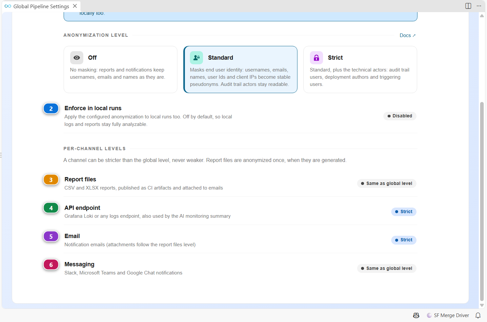

| | Setting | Key | What it does |
|:-:|---------|-----|--------------|
| **(1)** | Anonymization of personal data | `anonymization` | Controls pseudonymization of personal data in generated report files and notifications. Level 'standard' masks end-user identity (usernames, emails, names, user Ids, client IPs); 'strict' also masks technical actors (audit trail users, DeployedBy, TriggeredBy); 'off' disables it. Default: standard when running in CI, off in local runs. Overridable with the SFDX_HARDIS_ANONYMIZE env var. [Docs](salesforce-security-privacy.md#data-anonymization) |
| **(2)** | Enforce in local runs | `anonymization.enforceLocally` | By default this configuration only applies to CI runs: local runs keep full information in logs and reports. Set to true to enforce the configured anonymization in local runs too. Default: `false`. |
| **(3)** | Report files | `anonymization.channels.files` | Per-channel level raises: a channel can be stricter than the global level, never weaker (report files are anonymized at the source) |
| **(4)** | API endpoint | `anonymization.channels.api` | Per-channel level raises: a channel can be stricter than the global level, never weaker (report files are anonymized at the source) |
| **(5)** | Email | `anonymization.channels.email` | Per-channel level raises: a channel can be stricter than the global level, never weaker (report files are anonymized at the source) |
| **(6)** | Messaging | `anonymization.channels.messaging` | Per-channel level raises: a channel can be stricter than the global level, never weaker (report files are anonymized at the source) |

### Danger Zone

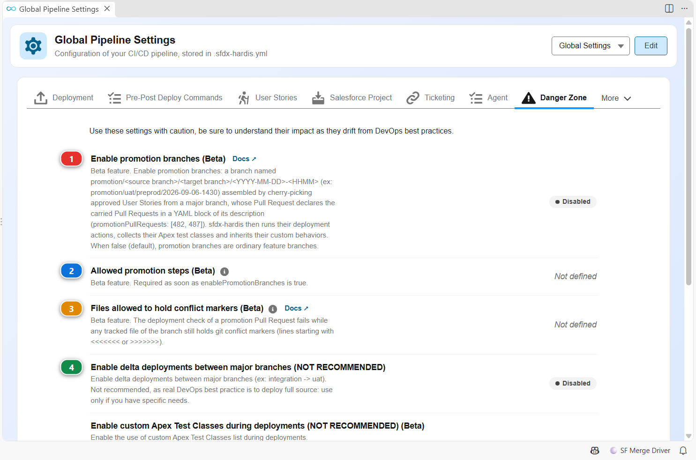

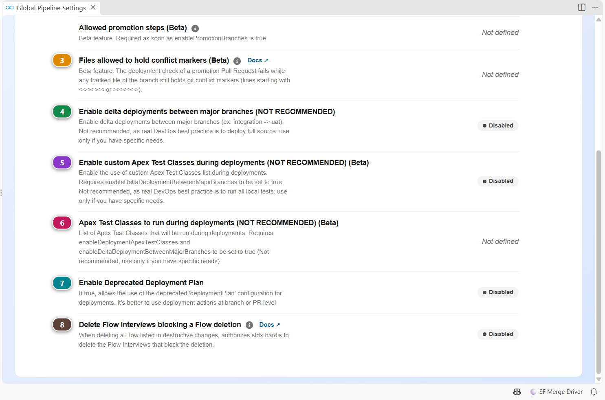

| | Setting | Key | What it does |
|:-:|---------|-----|--------------|
| **(1)** | Enable promotion branches (Beta) | `enablePromotionBranches` | Beta feature. Enable promotion branches: a branch named promotion/&lt;source branch&gt;/&lt;target branch&gt;/&lt;YYYY-MM-DD&gt;-&lt;HHMM&gt; (ex: promotion/uat/preprod/2026-09-06-1430) assembled by cherry-picking approved User Stories from a major branch, whose Pull Request declares the carried Pull Requests in a YAML block of its description (promotionPullRequests: [482, 487]). sfdx-hardis then runs their deployment actions, collects their Apex test classes and inherits their custom behaviors. When false (default), promotion branches are ordinary feature branches. Default: `false`. [Docs](salesforce-devops-promotion-branches.md) |
| **(2)** | Allowed promotion steps (Beta) | `allowedPromotionSteps` | Beta feature. Required as soon as enablePromotionBranches is true. Source and target branches a release manager is allowed to assemble a promotion between (ex: only from uat to preprod). Every other step is left out of the prompts of sf hardis:project:promotion:create and of the DevOps Pipeline, and naming one anyway fails the command. Leave an entry without a target to allow every merge target of that source branch. While the list is missing, sf hardis:project:promotion:create stops and asks for it: no promotion can be assembled before the project says between which branches. [Docs](salesforce-devops-promotion-branches.md) |
| **(3)** | Files allowed to hold conflict markers (Beta) | `promotionConflictMarkersIgnoredFiles` | Beta feature. The deployment check of a promotion Pull Request fails while any tracked file of the branch still holds git conflict markers (lines starting with &lt;&lt;&lt;&lt;&lt;&lt;&lt; or &gt;&gt;&gt;&gt;&gt;&gt;&gt;). List here, as git glob patterns relative to the repository root, the files that hold such lines on purpose (ex: documentation about merge conflicts, merge driver fixtures), so they do not block every promotion. '*' does not cross a '/', use '**' for any depth. [Docs](salesforce-devops-promotion-branches.md) |
| **(4)** | Enable delta deployments between major branches (NOT RECOMMENDED) | `enableDeltaDeploymentBetweenMajorBranches` | Enable delta deployments between major branches (ex: integration -&gt; uat). Not recommended, as real DevOps best practice is to deploy full source: use only if you have specific needs. Default: `false`. |
| **(5)** | Enable custom Apex Test Classes during deployments (NOT RECOMMENDED) (Beta) | `enableDeploymentApexTestClasses` | Enable the use of custom Apex Test Classes list during deployments. Requires enableDeltaDeploymentBetweenMajorBranches to be set to true. Not recommended, as real DevOps best practice is to run all local tests: use only if you have specific needs. Default: `false`. |
| **(6)** | Apex Test Classes to run during deployments (NOT RECOMMENDED) (Beta) | `deploymentApexTestClasses` | List of Apex Test Classes that will be run during deployments. Requires enableDeploymentApexTestClasses and enableDeltaDeploymentBetweenMajorBranches to be set to true (Not recommended, use only if you have specific needs) |
| **(7)** | Enable Deprecated Deployment Plan | `enableDeprecatedDeploymentPlan` | If true, allows the use of the deprecated 'deploymentPlan' configuration for deployments. It's better to use deployment actions at branch or PR level Default: `false`. |
| **(8)** | Delete Flow Interviews blocking a Flow deletion | `flowDeleteInterviews` | When deleting a Flow listed in destructive changes, authorizes sfdx-hardis to delete the Flow Interviews that block the deletion. Caution: deleting Flow Interviews is irreversible and destroys in-flight process state. Can also be set with the FLOW_DELETE_INTERVIEWS env variable or an affirmative, standalone FLOW_DELETE_INTERVIEWS directive in the Pull Request description. Default: `false`. [Docs](hardis/project/deploy/smart.md#flow-deletion-in-destructive-changes) |

### Other

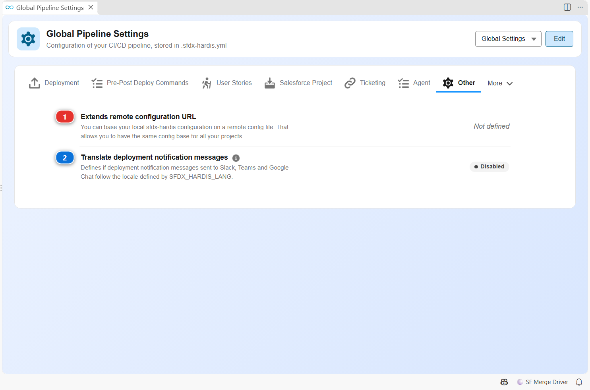

| | Setting | Key | What it does |
|:-:|---------|-----|--------------|
| **(1)** | Extends remote configuration URL | `extends` | You can base your local sfdx-hardis configuration on a remote config file. That allows you to have the same config base for all your projects |
| **(2)** | Translate deployment notification messages | `notifTranslateDeploymentMessages` | Defines if deployment notification messages sent to Slack, Teams and Google Chat follow the locale defined by SFDX_HARDIS_LANG. Deployment notifications land in shared team channels that are often read by people in several countries, so by default they stay in English whatever the locale of the machine running the pipeline. Can also be set with environment variable NOTIF_TRANSLATE_DEPLOYMENT_MESSAGES. Default: `false`. |

## Branch settings

Scope **Branch: integration**, or another major branch: one set of values per major branch. They are written in `config/branches/.sfdx-hardis.<name>.yml`.

### Salesforce Org of a branch

The tab shows these settings once you click **Edit**:

| Setting | Key | What it does |
|---------|-----|--------------|
| Instance URL | `instanceUrl` | Salesforce instance URL used by CI for deployment or backups |
| Target Username | `targetUsername` | Salesforce username used by CI for deployment or backups |

### Deployment of a branch

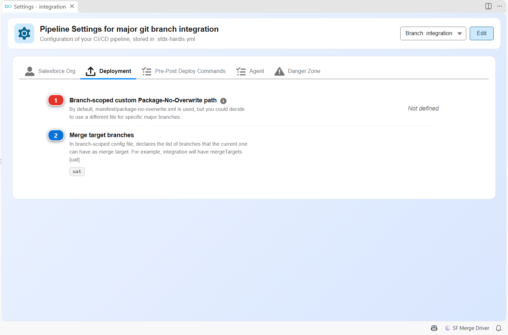

| | Setting | Key | What it does |
|:-:|---------|-----|--------------|
| **(1)** | Branch-scoped custom Package-No-Overwrite path | `packageNoOverwritePath` | By default, manifest/package-no-overwrite.xml is used, but you could decide to use a different file for specific major branches. In that case, set the path to a custom package-no-overwrite XML file in a branch-scoped sfdx-hardis configuration file. |
| **(2)** | Merge target branches | `mergeTargets` | In branch-scoped config file, declares the list of branches that the current one can have as merge target. For example, integration will have mergeTargets [uat] |

### Pre-Post Deploy Commands of a branch

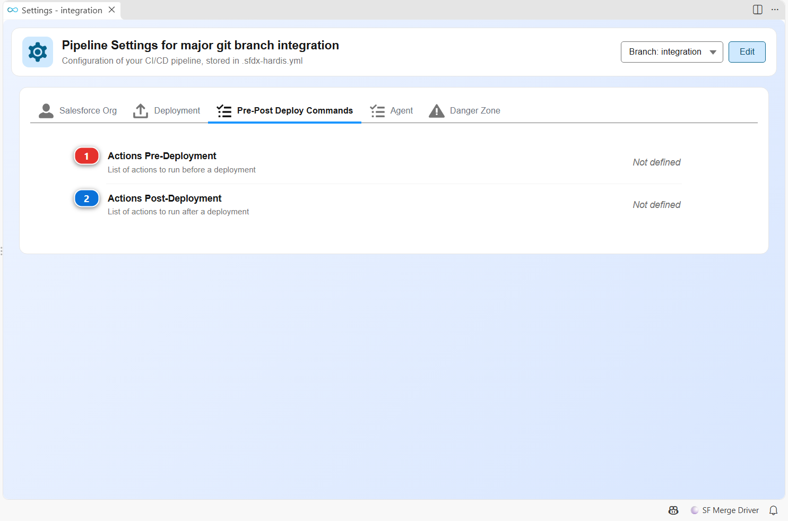

| | Setting | Key | What it does |
|:-:|---------|-----|--------------|
| **(1)** | Actions Pre-Deployment | `commandsPreDeploy` | List of actions to run before a deployment |
| **(2)** | Actions Post-Deployment | `commandsPostDeploy` | List of actions to run after a deployment |

### Agent of a branch

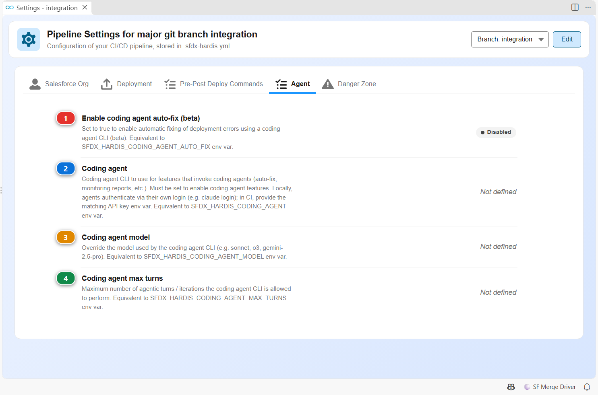

| | Setting | Key | What it does |
|:-:|---------|-----|--------------|
| **(1)** | Enable coding agent auto-fix (beta) | `codingAgentAutoFix` | Set to true to enable automatic fixing of deployment errors using a coding agent CLI (beta). Equivalent to SFDX_HARDIS_CODING_AGENT_AUTO_FIX env var. Default: `false`. |
| **(2)** | Coding agent | `codingAgent` | Coding agent CLI to use for features that invoke coding agents (auto-fix, monitoring reports, etc.). Must be set to enable coding agent features. Locally, agents authenticate via their own login (e.g. claude login); in CI, provide the matching API key env var. Equivalent to SFDX_HARDIS_CODING_AGENT env var. |
| **(3)** | Coding agent model | `codingAgentModel` | Override the model used by the coding agent CLI (e.g. sonnet, o3, gemini-2.5-pro). Equivalent to SFDX_HARDIS_CODING_AGENT_MODEL env var. |
| **(4)** | Coding agent max turns | `codingAgentMaxTurns` | Maximum number of agentic turns / iterations the coding agent CLI is allowed to perform. Equivalent to SFDX_HARDIS_CODING_AGENT_MAX_TURNS env var. |

### Danger Zone of a branch

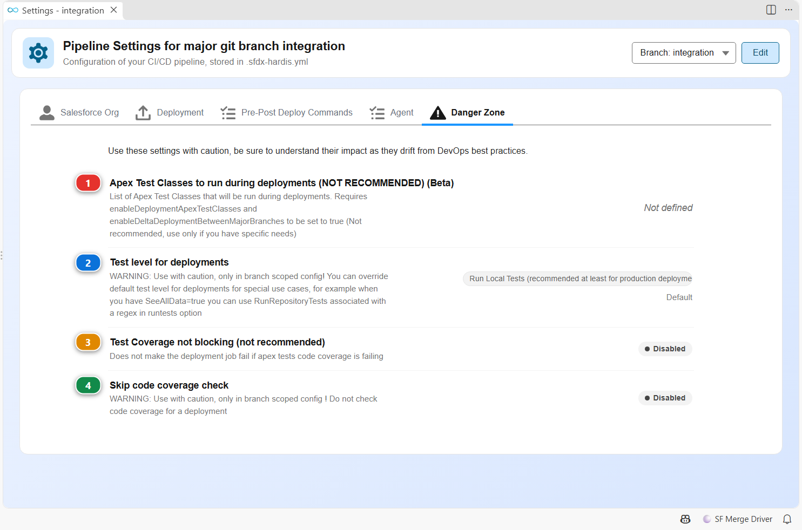

| | Setting | Key | What it does |
|:-:|---------|-----|--------------|
| **(1)** | Apex Test Classes to run during deployments (NOT RECOMMENDED) (Beta) | `deploymentApexTestClasses` | List of Apex Test Classes that will be run during deployments. Requires enableDeploymentApexTestClasses and enableDeltaDeploymentBetweenMajorBranches to be set to true (Not recommended, use only if you have specific needs) |
| **(2)** | Test level for deployments | `testLevel` | WARNING: Use with caution, only in branch scoped config! You can override default test level for deployments for special use cases, for example when you have SeeAllData=true you can use RunRepositoryTests associated with a regex in runtests option Default: `RunLocalTests`. |
| **(3)** | Test Coverage not blocking (not recommended) | `testCoverageNotBlocking` | Does not make the deployment job fail if apex tests code coverage is failing Default: `false`. |
| **(4)** | Skip code coverage check | `skipCodeCoverage` | WARNING: Use with caution, only in branch scoped config ! Do not check code coverage for a deployment Default: `false`. |

## Settings the panel does not edit

`.sfdx-hardis.yml` accepts more keys than this panel shows, such as the monitoring and notification settings. The [configuration reference](schema/sfdx-hardis-json-schema-parameters.html) lists all of them, and [Configuration](sfdx-hardis-config-file.md) explains how the files are read.
